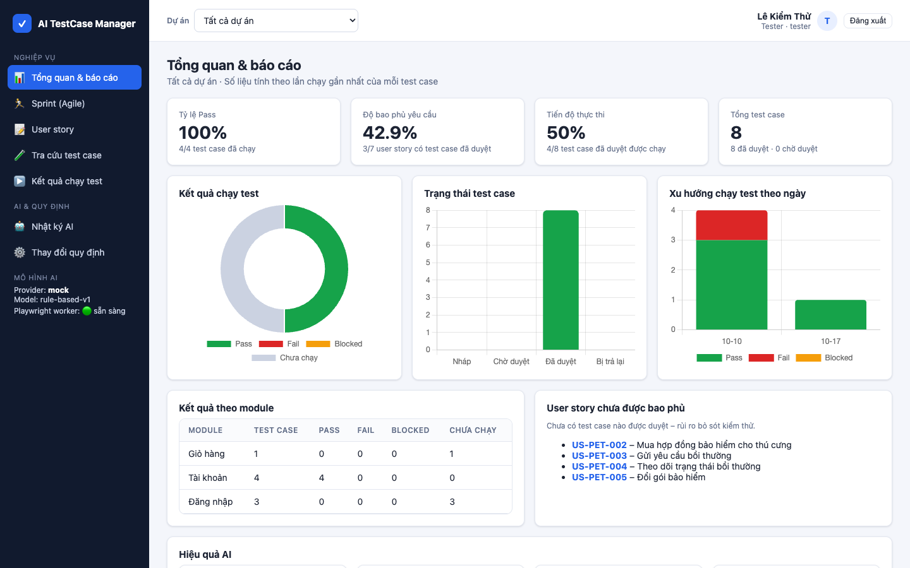

# AI TestCase Manager – Hệ thống quản lý test case có hỗ trợ AI

Đồ án môn **SE104 – Nhập môn Công nghệ phần mềm**, Trường Đại học Công nghệ Thông tin – ĐHQG TP.HCM.

User story → **AI sinh test case** → Tester chỉnh sửa → QA Lead duyệt → **AI sinh script Playwright** và chạy tự động → Báo cáo.

Đồ án được thực hiện theo **Agile/Scrum** (nhóm 4 người, 5 sprint × 1 tuần) và hệ thống hỗ trợ đội QA làm Scrum: sprint, story point, Product backlog, burndown, velocity, Definition of Done tự động.



## Chạy demo nhanh

**macOS:** bấm đúp `ChayDemo.command` (lần đầu sẽ tự cài thư viện). Trình duyệt tự mở `http://localhost:3000`.

**Hoặc bằng lệnh** (cần Node.js ≥ 20 và Google Chrome):

```bash
cd app && npm install && cp .env.example .env && npm run reset && npm start
```

```bash
cd automation && npm install
```

**Hoặc Docker:**

```bash
docker compose up --build
```

| Vai trò | Tài khoản | Mật khẩu |
|---|---|---|
| Admin | `admin` | `Admin@123` |
| QA Lead | `qalead` | `QaLead@123` |
| Tester | `tester` | `Tester@123` |
| Developer | `dev` | `Dev@123456` |

Mặc định AI chạy chế độ **mock** (offline, không cần API key). Dùng AI thật: sửa `app/.env` → `AI_PROVIDER=gemini` và `GEMINI_API_KEY=...` (hoặc `claude`, `openai`).

## Nội dung thư mục

| Thư mục / file | Nội dung |
|---|---|
| `docs/BaoCaoDoAn.pdf` | **Báo cáo đồ án** đầy đủ (bản Word để chỉnh sửa: `docs/BaoCaoDoAn.docx`; bản HTML: `docs/BaoCaoDoAn.html`) |
| `docs/SlideThuyetTrinh.html` | **Slide bảo vệ** (mở bằng trình duyệt, phím ← → để chuyển, có bản `.pdf`) |
| `docs/00a_QuyTrinhAgile.md` | **Quy trình Agile/Scrum**: vai trò, Product Backlog, kế hoạch 5 sprint, phân công nhóm, DoR/DoD, các sự kiện Scrum, mẫu biên bản |
| `docs/agile/ProductBacklog.csv` | Product Backlog để nhập vào Jira/Trello |
| `docs/00…09_*.md` | Từng chương: kế hoạch, khảo sát, yêu cầu, phân tích, thiết kế, cài đặt, kiểm thử, triển khai, **kịch bản demo**, hướng phát triển |
| `docs/hientrang/` | Sơ đồ tổ chức và quy trình hiện tại (draw.io), sinh bằng `python3 docs/hientrang/generate_hientrang.py` |
| `docs/dfd/` | 13 sơ đồ DFD + sơ đồ phối hợp (draw.io), sinh bằng `python3 docs/dfd/generate_dfd.py` |
| `docs/erd/` | Sơ đồ ERD (draw.io) sinh từ `app/src/db/schema.sql` bằng `python3 docs/erd/generate_erd.py` |
| `docs/images/` | Ảnh chụp màn hình hệ thống |
| `app/` | Mã nguồn hệ thống (Node.js, Express, SQLite) + unit/API test + E2E Playwright |
| `automation/` | Playwright worker chạy script do AI sinh + bộ test mẫu Page Object Model cho Sauce Demo |
| `.github/workflows/ci.yml` | CI/CD GitHub Actions |
| `Dockerfile`, `docker-compose.yml` | Triển khai bằng Docker |
| `ChayDemo.command`, `ChayKiemThu.command` | Bấm đúp để chạy demo / chạy toàn bộ kiểm thử |

## Kiểm thử

```bash
cd app && npm test             # 55 unit + API test
cd app && npm run test:e2e     # 9 kịch bản E2E bằng Playwright
cd automation && npm run test:samples   # 8 test Playwright mẫu trên saucedemo.com
```

Cấu hình automation (URL cần test, tài khoản test, chạy hiện trình duyệt, làm chậm thao tác khi demo…): sao chép `automation/.env.example` thành `automation/.env` rồi sửa. Không có `.env` thì dùng giá trị mặc định cho Sauce Demo.

## Cập nhật báo cáo sau khi sửa tài liệu

Sửa tên, MSSV các thành viên trong `docs/tools/cover.js`, sau đó:

```bash
cd docs/tools && npm install && npm run build && npm run docx
```

## Công nghệ

Node.js · Express 5 · SQLite (better-sqlite3) · Zod · JWT · bcrypt · helmet · Chart.js · ExcelJS · **Playwright** · Gemini / Claude / OpenAI API · Docker · GitHub Actions · Mermaid
