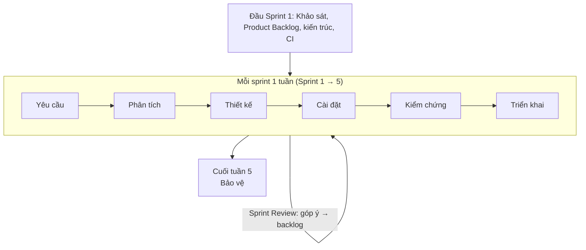

# Chương 0. Tổng quan đề tài và kế hoạch thực hiện

## 0.1. Thông tin đồ án

| Mục | Nội dung |
|---|---|
| Môn học | SE104 – Nhập môn Công nghệ phần mềm |
| Trường | Trường Đại học Công nghệ Thông tin – ĐHQG TP.HCM (UIT) |
| Tên đề tài | **Hệ thống quản lý test case có hỗ trợ trí tuệ nhân tạo (AI TestCase Manager)** |
| Hình thức | Nhóm 4 sinh viên (vai trò Scrum và phân công: [Chương 0A](00a_QuyTrinhAgile.md), mục 0A.3) |
| Thời gian | 5 tuần |
| Mô hình phát triển | **Agile – Scrum** (5 sprint × 1 tuần), báo cáo trình bày theo 7 hoạt động của môn học |
| Sản phẩm | Ứng dụng web chạy được + bộ tài liệu + bộ kiểm thử tự động |

## 0.2. Lý do chọn đề tài

Trong các đội kiểm thử phần mềm hiện nay, test case vẫn chủ yếu được viết thủ công trên Excel/Google Sheets:

- Tốn thời gian: một user story trung bình cần 30–60 phút để viết đủ test case.
- Dễ bỏ sót case lỗi và case biên, nhất là khi deadline gấp.
- Khó theo dõi ai đã duyệt, phiên bản nào là bản mới nhất, test case nào đã chạy.
- Việc chuyển test case thủ công thành script tự động tiếp tục tốn thêm thời gian.

Các mô hình ngôn ngữ lớn (LLM) có thể sinh bản nháp test case trong vài giây. Tuy vậy AI có thể sinh sai, nên cần **một quy trình có con người kiểm soát**: AI sinh, Tester sửa, QA Lead duyệt, có lưu vết. Đề tài xây dựng hệ thống quản lý test case khép kín theo đúng quy trình đó.

## 0.3. Mục tiêu

1. Xây dựng phần mềm quản lý vòng đời test case: **User story → AI sinh test case → Tester chỉnh sửa → QA Lead duyệt → Chạy test (thủ công/tự động bằng Playwright) → Báo cáo**.
2. Áp dụng quy trình công nghệ phần mềm theo **Agile/Scrum**: mỗi sprint đi qua đủ yêu cầu → phân tích → thiết kế → cài đặt → kiểm chứng → triển khai và giao một bản chạy được.
3. Tích hợp AI đúng cách: AI là **một chức năng** của hệ thống, được tách thành module riêng (AI Service), có kiểm soát chất lượng đầu ra và bảo mật dữ liệu.
4. Bảo đảm chất lượng bằng kiểm thử tự động nhiều tầng (unit, API, E2E) và CI/CD.

## 0.4. Phạm vi

**Trong phạm vi:**

- Quản lý người dùng, phân quyền 5 vai trò: Admin, QA Lead, PO/BA, Tester, Developer.
- Quản lý dự án, module, user story (nhập tay hoặc nhập từ file CSV/JSON).
- AI sinh test case từ user story và acceptance criteria.
- Soạn thảo, lưu lịch sử phiên bản, gửi duyệt, duyệt/trả lại test case.
- Ghi nhận kết quả chạy test thủ công (Pass/Fail/Blocked); Developer báo đã sửa lỗi kèm bản build để Tester kiểm thử lại.
- AI sinh script Playwright từ test case đã duyệt và chạy tự động, lưu ảnh chụp lỗi.
- Báo cáo: tỷ lệ pass, độ bao phủ yêu cầu, tiến độ thực thi, hiệu quả AI.
- Thay đổi quy định (số test case tối đa, số lần gọi AI…) không cần sửa mã nguồn.
- Bảo mật: JWT, bcrypt, RBAC, audit log, che dữ liệu nhạy cảm trước khi gửi AI, chống prompt injection, sandbox khi chạy script.

**Ngoài phạm vi (hướng phát triển):** tích hợp Jira 2 chiều, RAG theo tài liệu nghiệp vụ, fine-tune model riêng, AI agent tự sửa script (self-healing) – xem [Chương 9](09_HuongPhatTrien.md).

## 0.5. Mô hình phát triển: Agile (Scrum) kết hợp 7 hoạt động của môn học

Đồ án **thực hiện theo Agile/Scrum** – 5 sprint, mỗi sprint 1 tuần, mỗi sprint giao một phần mềm chạy được – thay vì thác nước thuần (làm xong toàn bộ yêu cầu rồi mới thiết kế, xong thiết kế mới lập trình). Lý do: yêu cầu liên quan đến AI khó chốt từ đầu, cần demo sớm để lấy góp ý, và chức năng rủi ro (AI) phải được làm và kiểm chứng sớm. Chi tiết quy trình: [Chương 0A](00a_QuyTrinhAgile.md).

Môn SE104 yêu cầu đi qua 7 hoạt động. Trong Agile, **7 hoạt động này lặp lại trong mỗi sprint** cho từng nhóm chức năng nhỏ; báo cáo vẫn tổ chức theo 7 chương để giảng viên dễ chấm, nội dung mỗi chương được bổ sung dần qua các sprint.

| Hoạt động | Sản phẩm đầu ra | Thực hiện ở | Tài liệu |
|---|---|---|---|
| Quy trình Agile | Product Backlog, kế hoạch sprint, DoR/DoD, biên bản | Sprint 1, cập nhật mỗi sprint | [00a_QuyTrinhAgile.md](00a_QuyTrinhAgile.md) |
| 1. Khảo sát hiện trạng | Quy trình QA hiện tại, vấn đề, nhu cầu | Sprint 1; bổ sung qua Sprint Review | [01_KhaoSatHienTrang.md](01_KhaoSatHienTrang.md) |
| 2. Xác định yêu cầu | YC1–YC13, BM, QĐ, yêu cầu phi chức năng | Tổng quát ở Sprint 1, chi tiết theo từng sprint | [02_DacTaYeuCau.md](02_DacTaYeuCau.md) |
| 3. Phân tích | Use case, đặc tả, DFD, hoạt động, trạng thái | Mỗi sprint cho các story của sprint | [03_PhanTich.md](03_PhanTich.md) |
| 4. Thiết kế | Kiến trúc, ERD, class, sequence, giao diện, API, bảo mật | Kiến trúc ở Sprint 1, chi tiết mỗi sprint | [04_ThietKe.md](04_ThietKe.md) |
| 5. Cài đặt | Mã nguồn, Git flow | Mỗi sprint | [05_CaiDat.md](05_CaiDat.md) |
| 6. Kiểm chứng | Test tự động chạy trên CI mỗi lần push | Mỗi sprint (thuộc Definition of Done) | [06_KiemThu.md](06_KiemThu.md) |
| 7. Triển khai | Bản demo mỗi sprint; Docker ở Sprint 5 | Cuối mỗi sprint | [07_TrienKhai_HuongDanSuDung.md](07_TrienKhai_HuongDanSuDung.md) |
| Bảo vệ | Kịch bản demo | Cuối tuần 5 | [08_KichBanDemo.md](08_KichBanDemo.md) |

## 0.6. Kế hoạch sprint (5 tuần, nhóm 4 người)

| Sprint | Tuần | Sprint Goal | Story point |
|---|---|---|---|
| 1 | 1 | Hiểu bài toán, sẵn sàng phát triển (khảo sát, backlog, kiến trúc, repo + CI); người dùng đăng nhập theo vai trò và lập được user story | 13 |
| 2 | 2 | AI sinh được test case an toàn từ user story *(rủi ro cao nhất, làm sớm)*; test case được sửa và lưu phiên bản | 22 |
| 3 | 3 | Test case được duyệt, chạy thủ công, tra cứu và xem được báo cáo | 18 |
| 4 | 4 | Test case đã duyệt chạy tự động được bằng Playwright; quy định thay đổi được; Developer báo đã sửa lỗi | 22 |
| 5 | 5 | Quản lý sprint trong hệ thống, nhập/xuất, Docker; hoàn thiện tài liệu, slide; bảo vệ cuối tuần (Sprint Review cuối cùng) | 16 |

Danh sách story của từng sprint, ước lượng và Definition of Done: [Chương 0A](00a_QuyTrinhAgile.md). Mỗi sprint có biên bản Planning, Review, Retrospective và Daily log làm minh chứng.

## 0.7. Công cụ quản lý dự án

| Mục đích | Công cụ |
|---|---|
| Product Backlog, sprint board | Jira Software (Scrum board) hoặc Trello; nhập sẵn từ `docs/agile/ProductBacklog.csv`. Cột: Backlog → To do → In progress (WIP ≤ 2) → Code review → Testing → Done |
| Theo dõi sprint của dự án được kiểm thử | Trang **Sprint (Agile)** trong chính hệ thống (YC12): bảng sprint, burndown, velocity |
| Quản lý mã nguồn | Git + GitHub, nhánh `main` (ổn định) và `feature/pb-xx-*` (mỗi story một nhánh), Pull Request, ít nhất 1 thành viên khác review trước khi merge |
| CI/CD | GitHub Actions: unit test → API test → E2E Playwright → build Docker image; CI xanh là điều kiện của Definition of Done |
| Vẽ sơ đồ | Mermaid (lưu cùng mã nguồn, có lịch sử phiên bản), draw.io, StarUML |
| Tài liệu | Markdown trong thư mục `docs/`, cập nhật mỗi sprint |

## 0.8. Rủi ro và cách xử lý

| Rủi ro | Mức độ | Cách xử lý |
|---|---|---|
| API LLM lỗi/hết quota/mất mạng khi demo | Cao | Chế độ **MockProvider** chạy offline; quay sẵn video demo |
| AI sinh test case sai hoặc sai định dạng | Cao | Kiểm tra JSON schema + thử lại; con người luôn review/duyệt; lưu nhật ký |
| Thời gian ngắn (5 tuần), khối lượng lớn | Cao | Backlog ưu tiên MoSCoW; làm Must trước; story Could bị trả về backlog nếu sprint trễ, không kéo dài sprint |
| Phối hợp nhóm 4 người: chia việc không đều, xung đột code | Trung bình | Mỗi story có 1 người phụ trách; Daily Scrum 15 phút; mỗi story một nhánh, Pull Request nhỏ, có người review, CI chạy tự động |
| Lộ API key, dữ liệu nhạy cảm | Trung bình | Key chỉ ở backend (.env), che PII trước khi gửi AI |
| Script do AI sinh chạy mã nguy hiểm | Trung bình | Kiểm tra tĩnh, tiến trình riêng, timeout, Docker sandbox |
| Trễ tiến độ | Trung bình | Theo dõi burndown mỗi ngày; điều chỉnh cam kết theo velocity thực tế; làm AI từ Sprint 2 |
