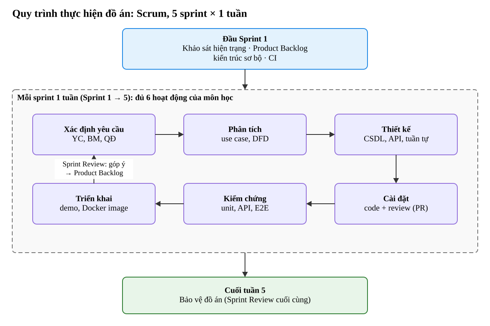

# Chương 0. Tổng quan đề tài và kế hoạch thực hiện

## 0.1. Thông tin đồ án

| Mục | Nội dung |
|---|---|
| Môn học | SE104 – Nhập môn Công nghệ phần mềm |
| Trường | Trường Đại học Công nghệ Thông tin – ĐHQG TP.HCM (UIT) |
| Tên đề tài | **Hệ thống quản lý kiểm thử có hỗ trợ trí tuệ nhân tạo (AI TestCase Manager)** |
| Căn cứ | Đặc tả yêu cầu nghiệp vụ MVP – bản chốt ngày 16/11/2026 (`docs/DacTa_YeuCauNghiepVu_1011.docx`) |
| Hình thức | Nhóm 4 sinh viên (vai trò Scrum và phân công: [Chương 0A](00a_QuyTrinhAgile.md), mục 0A.3) |
| Thời gian | 5 tuần |
| Mô hình phát triển | **Agile – Scrum** (5 sprint × 1 tuần), báo cáo trình bày theo 7 hoạt động của môn học |
| Sản phẩm | Ứng dụng web chạy được + bộ tài liệu + bộ kiểm thử tự động |

## 0.2. Lý do chọn đề tài

Trong các đội kiểm thử dùng Jira, requirement (user story kèm acceptance criteria) được PO/BA sửa liên tục trong sprint, còn test case nằm ở Excel/Google Sheets hoặc công cụ riêng:

- Khi requirement đổi, **không ai biết test case nào đã lỗi thời**; Tester phải đọc lại và dò tay, dễ sót, test cũ vẫn được chạy và báo Pass sai.
- Không biết sau thay đổi **cần chạy lại những test nào**; regression hoặc chạy hết (tốn thời gian) hoặc chọn theo cảm tính.
- Viết test case thủ công mất 30–60 phút mỗi requirement, dễ bỏ sót case lỗi và case biên.
- Duyệt test case qua chat, kết quả chạy không gắn với bản build nào, báo cáo tổng hợp bằng tay.

Các mô hình ngôn ngữ lớn (LLM) đọc được hai phiên bản requirement và các test liên quan để chỉ ra test cần sửa, test còn thiếu, test nên chạy lại. Tuy vậy AI có thể sai, nên cần **một quy trình có con người kiểm soát**: AI đề xuất kèm lý do, QA Lead quyết định, mọi thay đổi qua duyệt và có lưu vết.

**Điểm mới trọng tâm của đề tài:** AI giúp QA xác định test nào cần sửa và test nào cần chạy lại sau khi requirement thay đổi trên Jira. Jira quản lý requirement gốc; ứng dụng quản lý nghiệp vụ kiểm thử và bản sao requirement được đồng bộ.

## 0.3. Mục tiêu

1. Xây dựng ứng dụng web quản lý kiểm thử: **Requirement (từ Jira) → Test case (AI sinh, Tester soạn, liên kết AC) → QA Lead duyệt → Test Suite, Test Run → Ghi kết quả → Báo sửa lỗi, kiểm thử lại → Báo cáo**.
2. Khi requirement đổi: lưu phiên bản, tự gắn cờ đúng test bị ảnh hưởng, AI phân tích ảnh hưởng và đề xuất bộ regression; QA Lead quyết định.
3. Áp dụng quy trình công nghệ phần mềm theo **Agile/Scrum**: mỗi sprint đi qua đủ yêu cầu → phân tích → thiết kế → cài đặt → kiểm chứng → triển khai.
4. Tích hợp AI đúng cách: AI Service là module riêng, kiểm soát chất lượng đầu ra, bảo mật dữ liệu; AI không tự đổi dữ liệu.
5. Bảo đảm chất lượng bằng kiểm thử tự động nhiều tầng (unit, API, E2E) và CI/CD.

## 0.4. Phạm vi

**Trong phạm vi (MVP – 18 yêu cầu):**

- Quản lý người dùng, phân quyền 5 vai trò toàn cục: Admin, QA Lead, PO/BA, Tester, Developer.
- Đồng bộ **một chiều từ Jira**: dự án, module, thành viên, requirement (tiêu đề, mô tả, AC) nhận diện bằng issue ID; webhook, đồng bộ định kỳ, Đồng bộ ngay; chỉ ghi bản mới hơn; mỗi lần nội dung đổi tạo một phiên bản; requirement biến mất được gắn cờ Cần kiểm tra, không tự lưu trữ.
- AI sinh test case từ requirement, mỗi test chỉ rõ AC liên quan.
- Soạn thảo, liên kết AC, lưu phiên bản, gửi duyệt, duyệt/trả lại; cờ Cần xem lại khi requirement đổi, Đã xem lại kèm lý do.
- Test Suite; Test Run có build, môi trường, phân công, phiên bản test cố định; ghi kết quả Pass/Fail/Blocked.
- AI phân tích ảnh hưởng (Cần sửa, Còn thiếu, Nên chạy lại, Cần làm rõ), QA Lead rà soát đề xuất; AI đề xuất bộ regression, xác nhận thành Test Run.
- Developer báo đã sửa lỗi kèm build; kiểm thử lại gắn với lần Fail gốc.
- Báo cáo theo dự án hoặc Test Run: tỷ lệ pass, tiến độ, độ bao phủ requirement và AC, thống kê AI; tra cứu, xuất Excel.
- Thay đổi quy định không cần sửa mã nguồn; bảo mật: JWT, bcrypt, RBAC, audit log, che dữ liệu nhạy cảm, chống prompt injection.

**Ngoài MVP (đã có code, tắt mặc định):** YC19 sinh và chạy script Playwright, YC20 theo dõi sprint.

**Ngoài phạm vi (hướng phát triển):** ghi ngược lên Jira, hàng đợi sự kiện bền vững, phân quyền theo dự án, regression theo bản phát hành, RAG – xem [Chương 9](09_HuongPhatTrien.md).

## 0.5. Mô hình phát triển: Agile (Scrum) kết hợp 7 hoạt động của môn học

Đồ án **thực hiện theo Agile/Scrum** – 5 sprint, mỗi sprint 1 tuần, mỗi sprint giao một phần mềm chạy được – thay vì thác nước thuần (làm xong toàn bộ yêu cầu rồi mới thiết kế, xong thiết kế mới lập trình). Lý do: yêu cầu liên quan đến AI khó chốt từ đầu, cần demo sớm để lấy góp ý, và chức năng rủi ro (AI) phải được làm và kiểm chứng sớm. Chi tiết quy trình: [Chương 0A](00a_QuyTrinhAgile.md).

Môn SE104 yêu cầu đi qua 7 hoạt động. Trong Agile, **7 hoạt động này lặp lại trong mỗi sprint** cho từng nhóm chức năng nhỏ; báo cáo vẫn tổ chức theo 7 chương để giảng viên dễ chấm, nội dung mỗi chương được bổ sung dần qua các sprint.

*File gốc:* `docs/sodo/QuyTrinhThucHien.drawio` (mở bằng draw.io để sửa).

| Hoạt động | Sản phẩm đầu ra | Thực hiện ở | Tài liệu |
|---|---|---|---|
| Quy trình Agile | Product Backlog, kế hoạch sprint, DoR/DoD, biên bản | Sprint 1, cập nhật mỗi sprint | [00a_QuyTrinhAgile.md](00a_QuyTrinhAgile.md) |
| 1. Khảo sát hiện trạng | Quy trình QA hiện tại, vấn đề, nhu cầu | Sprint 1; bổ sung qua Sprint Review | [01_KhaoSatHienTrang.md](01_KhaoSatHienTrang.md) |
| 2. Xác định yêu cầu | 18 YC của MVP, BM1–BM17, QĐ1–QĐ18, yêu cầu phi chức năng | Tổng quát ở Sprint 1, chi tiết theo từng sprint | [02_DacTaYeuCau.md](02_DacTaYeuCau.md) |
| 3. Phân tích | Use case, đặc tả, DFD, hoạt động, trạng thái | Mỗi sprint cho các story của sprint | [03_PhanTich.md](03_PhanTich.md) |
| 4. Thiết kế | Kiến trúc, ERD, class, sequence, giao diện, API, bảo mật | Kiến trúc ở Sprint 1, chi tiết mỗi sprint | [04_ThietKe.md](04_ThietKe.md) |
| 5. Cài đặt | Mã nguồn, Git flow | Mỗi sprint | [05_CaiDat.md](05_CaiDat.md) |
| 6. Kiểm chứng | Test tự động chạy trên CI mỗi lần push | Mỗi sprint (thuộc Definition of Done) | [06_KiemThu.md](06_KiemThu.md) |
| 7. Triển khai | Bản demo mỗi sprint; Docker ở Sprint 5 | Cuối mỗi sprint | [07_TrienKhai_HuongDanSuDung.md](07_TrienKhai_HuongDanSuDung.md) |
| Bảo vệ | Kịch bản demo | Cuối tuần 5 | [08_KichBanDemo.md](08_KichBanDemo.md) |

## 0.6. Kế hoạch sprint (5 tuần, nhóm 4 người)

| Sprint | Tuần | Sprint Goal |
|---|---|---|
| 1 | 1 | Hiểu bài toán, sẵn sàng phát triển (khảo sát, backlog, kiến trúc, repo + CI); đăng nhập theo vai trò; đồng bộ requirement từ Jira có phiên bản |
| 2 | 2 | AI sinh được test case an toàn, mỗi test gắn AC *(rủi ro cao, làm sớm)*; soạn, lưu phiên bản, gửi duyệt, duyệt |
| 3 | 3 | Test Suite, Test Run cố định phiên bản, ghi kết quả, tra cứu, báo cáo theo dự án và Test Run |
| 4 | 4 | Requirement đổi: gắn cờ Cần xem lại, Cần kiểm tra; AI phân tích ảnh hưởng, rà soát đề xuất, bộ regression *(điểm mới)* |
| 5 | 5 | Báo sửa lỗi và kiểm thử lại, xuất Excel, thay đổi quy định, Docker; hoàn thiện tài liệu, slide; bảo vệ |

Danh sách story của từng sprint, ước lượng và Definition of Done: [Chương 0A](00a_QuyTrinhAgile.md). Mỗi sprint có biên bản Planning, Review, Retrospective và Daily log làm minh chứng.

## 0.7. Công cụ quản lý dự án

| Mục đích | Công cụ |
|---|---|
| Product Backlog, sprint board | Jira Software (Scrum board) hoặc Trello; nhập sẵn từ `docs/agile/ProductBacklog.csv`. Cột: Backlog → To do → In progress (WIP ≤ 2) → Code review → Testing → Done |
| Quản lý mã nguồn | Git + GitHub, nhánh `main` (ổn định) và `feature/pb-xx-*` (mỗi story một nhánh), Pull Request, ít nhất 1 thành viên khác review trước khi merge |
| CI/CD | GitHub Actions: unit test → API test → E2E Playwright → build Docker image; CI xanh là điều kiện của Definition of Done |
| Vẽ sơ đồ | **draw.io** (use case, DFD, ERD, hoạt động, trạng thái, tuần tự – sinh bằng script Python nên có lịch sử phiên bản); DB Browser for SQLite xem CSDL; OpenAPI 3.1 cho API |
| Tài liệu | Markdown trong thư mục `docs/`, cập nhật mỗi sprint |

## 0.8. Rủi ro và cách xử lý

| Rủi ro | Mức độ | Cách xử lý |
|---|---|---|
| API LLM lỗi/hết quota/mất mạng khi demo | Cao | Chế độ **MockProvider** chạy offline; quay sẵn video demo |
| AI sinh test hoặc đề xuất sai | Cao | Kiểm tra JSON schema + thử lại; AI không tự đổi test, QA Lead quyết định; phần bắt buộc của regression không phụ thuộc AI; lưu nhật ký |
| Requirement đổi nhiều lần, đồng bộ chồng nhau | Trung bình | Nhận diện bằng issue ID, chỉ ghi bản Jira mới hơn, lưu mọi phiên bản; đề xuất cũ chuyển Lỗi thời |
| Thời gian ngắn (5 tuần), khối lượng lớn | Cao | Backlog ưu tiên MoSCoW; làm Must trước; story Could bị trả về backlog nếu sprint trễ, không kéo dài sprint |
| Phối hợp nhóm 4 người: chia việc không đều, xung đột code | Trung bình | Mỗi story có 1 người phụ trách; Daily Scrum 15 phút; mỗi story một nhánh, Pull Request nhỏ, có người review, CI chạy tự động |
| Lộ API key, dữ liệu nhạy cảm | Trung bình | Key chỉ ở backend (.env), che PII trước khi gửi AI |
| Script do AI sinh chạy mã nguy hiểm (phần mở rộng YC19) | Thấp | Tắt mặc định; khi bật: kiểm tra tĩnh, tiến trình riêng, timeout, Docker sandbox |
| Trễ tiến độ | Trung bình | Theo dõi burndown mỗi ngày; điều chỉnh cam kết theo velocity thực tế; làm AI từ Sprint 2 |
