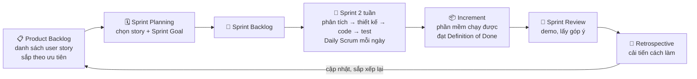
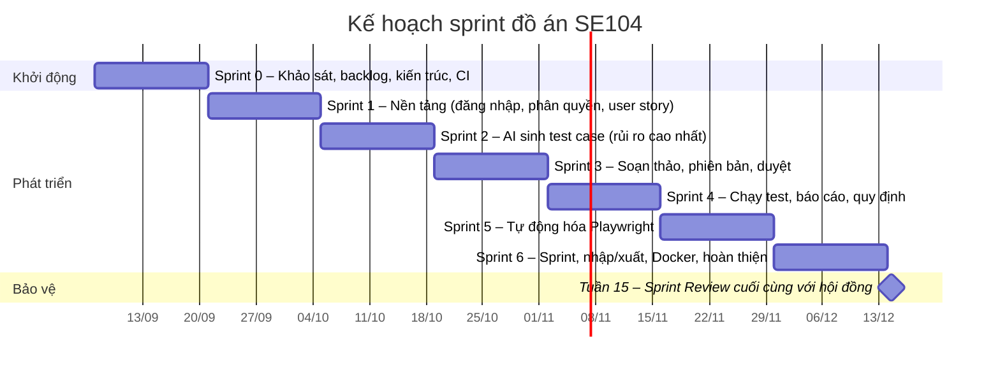
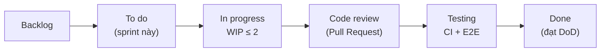

# Chương 0A. Quy trình phát triển Agile (Scrum)

> Đồ án được **thực hiện theo Agile/Scrum**: chia thành các sprint 2 tuần, mỗi sprint giao một phần mềm chạy được. Báo cáo vẫn trình bày theo 7 hoạt động của môn học (khảo sát → triển khai), vì các hoạt động này diễn ra **lặp lại trong mỗi sprint** chứ không bị bỏ đi.

## 0A.1. Vì sao chọn Agile thay cho thác nước thuần

| Tiêu chí | Thác nước | Agile (Scrum) | Lựa chọn cho đồ án |
|---|---|---|---|
| Yêu cầu | Chốt từ đầu, đổi rất tốn kém | Được phép thay đổi, ưu tiên lại mỗi sprint | Yêu cầu AI chưa rõ từ đầu (chất lượng LLM, định dạng kết quả) → cần linh hoạt |
| Giao sản phẩm | Một lần ở cuối dự án | Mỗi 1–4 tuần có bản chạy được | Có bản demo cho giảng viên góp ý sớm |
| Kiểm thử | Dồn về cuối | Liên tục, là một phần của "Hoàn thành" | Phù hợp nghề QA/automation; có CI từ tuần đầu |
| Rủi ro | Phát hiện muộn (lúc tích hợp) | Phát hiện sớm, làm phần rủi ro trước | Chức năng AI (rủi ro cao nhất) làm ở Sprint 2 |
| Tài liệu | Rất đầy đủ, viết trước | "Vừa đủ", cập nhật theo sprint | Tài liệu vẫn đầy đủ vì môn học yêu cầu, nhưng viết dần theo sprint |
| Phù hợp | Yêu cầu ổn định, dự án có kiểm định (y tế, hàng không, nhà nước) | Sản phẩm mới, yêu cầu thay đổi, cần phản hồi nhanh | Đề tài là sản phẩm mới có AI → Agile |

**Tuyên ngôn Agile (2001) – 4 giá trị**, và cách đồ án thể hiện:

| Giá trị Agile | Thể hiện trong đồ án |
|---|---|
| Cá nhân và tương tác hơn quy trình và công cụ | Sprint Review có người dùng thật (đồng nghiệp QA) dùng thử và góp ý |
| Phần mềm chạy được hơn tài liệu đầy đủ | Mỗi sprint kết thúc bằng một bản demo chạy được; tài liệu cập nhật theo |
| Cộng tác với khách hàng hơn đàm phán hợp đồng | Giảng viên và người dùng được xem bản demo sau mỗi sprint |
| Phản hồi với thay đổi hơn bám theo kế hoạch | Product backlog được sắp xếp lại sau mỗi Sprint Review |

## 0A.2. Khung Scrum



## 0A.3. Vai trò khi làm một mình

Scrum được thiết kế cho nhóm 3–9 người. Vì đồ án làm cá nhân, sinh viên áp dụng **Scrum cá nhân (Personal Scrum)**: một người đảm nhiệm nhiều vai trò, nhưng **tách rõ thời điểm** đóng từng vai trò, và mời người ngoài đóng vai người dùng.

| Vai trò Scrum | Ai đảm nhiệm | Việc cụ thể |
|---|---|---|
| Product Owner | Sinh viên | Viết và sắp xếp Product Backlog, chốt Sprint Goal, quyết định story nào "đủ tốt" |
| Scrum Master | Sinh viên (tự quản) | Giữ nhịp sprint, ghi Daily log, tổ chức Retrospective, gỡ vướng mắc |
| Developers | Sinh viên | Phân tích, thiết kế, lập trình, kiểm thử, triển khai |
| Stakeholder / người dùng | 2–3 đồng nghiệp QA, giảng viên hướng dẫn | Tham gia khảo sát, dùng thử bản demo trong Sprint Review, góp ý |

> Mẹo khi đóng nhiều vai: buổi Planning và Review làm với "mũ" Product Owner (hỏi *làm gì, có giá trị không*); trong sprint đội "mũ" Developer (hỏi *làm thế nào*); Retrospective đội "mũ" Scrum Master (hỏi *làm sao để làm tốt hơn*).

## 0A.4. Product Backlog

Product Backlog là danh sách **user story của chính hệ thống AI TestCase Manager**, sắp theo ưu tiên. Ưu tiên dùng **MoSCoW** (Must / Should / Could / Won't), độ lớn ước lượng bằng **story point** theo dãy Fibonacci (1, 2, 3, 5, 8, 13). Story mẫu dùng làm mốc: PB-03 "tạo dự án và module" = 2 điểm.

Bản dạng CSV để nhập vào Jira/Trello: [`docs/agile/ProductBacklog.csv`](agile/ProductBacklog.csv).

| Mã | Epic | User story | SP | Ưu tiên | Sprint | YC |
|---|---|---|---|---|---|---|
| PB-01 | Quản trị & bảo mật | Là người dùng, tôi muốn đăng nhập bằng tài khoản được cấp, để dùng đúng chức năng theo vai trò | 3 | Must | 1 | UC01 |
| PB-02 | Quản trị & bảo mật | Là Admin, tôi muốn tạo, khóa tài khoản và gán vai trò, để kiểm soát ai được làm gì | 3 | Must | 1 | YC11 |
| PB-03 | Quản trị & bảo mật | Là Admin, tôi muốn tạo dự án và module, để tổ chức user story theo sản phẩm | 2 | Must | 1 | YC11 |
| PB-04 | User story | Là Tester, tôi muốn lập user story kèm acceptance criteria, để có đầu vào cho test case | 3 | Must | 1 | YC1 |
| PB-05 | Quản trị & bảo mật | Là Admin, tôi muốn xem nhật ký hoạt động, để truy vết ai đã làm gì | 2 | Should | 1 | BM-13 |
| PB-06 | AI test case | Là Tester, tôi muốn AI sinh test case từ user story, để tiết kiệm thời gian viết nháp | 8 | Must | 2 | YC2 |
| PB-07 | AI test case | Là Admin, tôi muốn dữ liệu nhạy cảm được che trước khi gửi AI, để không lộ thông tin khách hàng | 3 | Must | 2 | BM-09 |
| PB-08 | AI test case | Là Admin, tôi muốn hệ thống chống prompt injection, để AI không bị điều khiển bởi dữ liệu xấu | 3 | Must | 2 | BM-10 |
| PB-09 | AI test case | Là QA Lead, tôi muốn xem nhật ký AI (prompt, kết quả gốc), để truy vết khi AI sinh sai | 2 | Should | 3 | – |
| PB-10 | AI test case | Là Admin, tôi muốn đổi nhà cung cấp LLM bằng cấu hình, để chủ động chi phí và chất lượng | 3 | Should | 3 | YC2 |
| PB-11 | Duyệt & phiên bản | Là Tester, tôi muốn sửa test case và lưu phiên bản, để không mất bản AI gốc | 5 | Must | 3 | YC3 |
| PB-12 | Duyệt & phiên bản | Là Tester, tôi muốn gửi duyệt nhiều test case một lần, để QA Lead xem xét | 2 | Must | 3 | YC3 |
| PB-13 | Duyệt & phiên bản | Là QA Lead, tôi muốn duyệt hoặc trả lại kèm ghi chú, để kiểm soát chất lượng | 3 | Must | 3 | YC4 |
| PB-14 | Thực thi & báo cáo | Là Tester, tôi muốn tra cứu test case theo nhiều tiêu chí, để tìm nhanh | 3 | Should | 4 | YC7 |
| PB-15 | Thực thi & báo cáo | Là Tester, tôi muốn ghi kết quả Pass/Fail/Blocked, để theo dõi chất lượng | 3 | Must | 4 | YC5 |
| PB-16 | Thực thi & báo cáo | Là QA Lead, tôi muốn xem báo cáo tỷ lệ pass và độ bao phủ, để báo cáo tiến độ | 5 | Must | 4 | YC6 |
| PB-17 | Thực thi & báo cáo | Là QA Lead, tôi muốn thay đổi quy định không cần sửa code, để hệ thống thích ứng với đội | 3 | Must | 4 | YC10 |
| PB-18 | Tự động hóa | Là Tester, tôi muốn AI sinh script Playwright từ test case đã duyệt, để không phải viết lại | 5 | Should | 5 | YC9 |
| PB-19 | Tự động hóa | Là Tester, tôi muốn chạy script tự động an toàn và xem ảnh lỗi, để tiết kiệm thời gian chạy lại | 8 | Should | 5 | YC9 |
| PB-20 | Duyệt & phiên bản | Là QA Lead, tôi muốn so sánh bản AI gốc với bản đã sửa, để đánh giá chất lượng AI | 3 | Could | 5 | YC3 |
| PB-21 | Agile | Là QA Lead, tôi muốn chia user story theo sprint và ước lượng story point, để lập kế hoạch | 5 | Should | 6 | YC12 |
| PB-22 | Agile | Là QA Lead, tôi muốn xem burndown và velocity, để biết sprint có kịp không | 3 | Could | 6 | YC12 |
| PB-23 | User story | Là Tester, tôi muốn nhập user story từ file CSV, để không gõ lại từ Jira | 3 | Should | 6 | YC8 |
| PB-24 | Thực thi & báo cáo | Là QA Lead, tôi muốn xuất test case ra Excel, để gửi cho khách hàng | 2 | Should | 6 | YC8 |
| PB-25 | Triển khai | Là Admin, tôi muốn triển khai bằng Docker, để cài đặt nhanh và đồng nhất | 3 | Should | 6 | – |
| PB-26 | Tích hợp | Là Tester, tôi muốn đồng bộ 2 chiều với Jira, để không nhập tay | 8 | Won't (bản này) | – | – |
| PB-27 | AI nâng cao | Là Tester, tôi muốn AI dùng tài liệu nghiệp vụ (RAG), để test case sát thực tế hơn | 13 | Won't (khóa luận) | – | – |
| PB-28 | AI nâng cao | Là Tester, tôi muốn script tự sửa locator khi giao diện đổi (self-healing) | 13 | Won't (khóa luận) | – | – |

**Hạng mục kỹ thuật** (không phải user story, làm ở Sprint 0 và duy trì suốt dự án): dựng repo Git, cấu trúc thư mục, CI trên GitHub Actions, khung test (unit, API, E2E Playwright), dữ liệu mẫu.

## 0A.5. Kế hoạch sprint (15 tuần)

Sprint dài **2 tuần**. Velocity dự kiến khoảng **13–16 story point/sprint** (một người, vừa học vừa làm). Sau mỗi sprint, velocity thực tế được dùng để điều chỉnh các sprint sau.



| Sprint | Tuần | Sprint Goal | Story (SP) | Tổng SP | Tài liệu cập nhật |
|---|---|---|---|---|---|
| 0 | 1–2 | "Hiểu bài toán và sẵn sàng phát triển" | Khảo sát, Product Backlog, kiến trúc sơ bộ, repo + CI | – | Ch.1, Ch.2 (bản đầu), Ch.0A |
| 1 | 3–4 | "Người dùng đăng nhập theo vai trò và lập được user story" | PB-01 (3), PB-02 (3), PB-03 (2), PB-04 (3), PB-05 (2) | 13 | UC01–UC04, DFD YC1, ERD v1, MH01–MH04 |
| 2 | 5–6 | "AI sinh được test case an toàn từ user story" | PB-06 (8), PB-07 (3), PB-08 (3) | 14 | UC06, DFD YC2, sequence sinh test case, thiết kế prompt |
| 3 | 7–8 | "Test case được sửa, duyệt và truy vết được" | PB-09 (2), PB-10 (3), PB-11 (5), PB-12 (2), PB-13 (3) | 15 | UC07–UC09, sơ đồ trạng thái, class Strategy |
| 4 | 9–10 | "QA Lead nhìn thấy chất lượng sản phẩm qua báo cáo" | PB-14 (3), PB-15 (3), PB-16 (5), PB-17 (3) | 14 | UC10, UC13, UC15, UC16, DFD YC5/6/10, bảng tham số |
| 5 | 11–12 | "Test case đã duyệt chạy tự động được bằng Playwright" | PB-18 (5), PB-19 (8), PB-20 (3) | 16 | UC11, UC12, sequence YC9, thiết kế sandbox |
| 6 | 13–14 | "Đội làm Scrum lập kế hoạch sprint ngay trong hệ thống; sẵn sàng bàn giao" | PB-21 (5), PB-22 (3), PB-23 (3), PB-24 (2), PB-25 (3) | 16 | YC12, Ch.6 tổng kết, Ch.7, slide, video demo |
| – | 15 | Bảo vệ đồ án | Demo bản cuối cùng | – | Kịch bản demo |

> Nếu một sprint không kịp, story có ưu tiên thấp nhất (Could) được trả về Product Backlog, **không kéo dài sprint**. Ví dụ PB-22 (burndown) là story đầu tiên được bỏ nếu Sprint 6 trễ.

## 0A.6. Definition of Ready và Definition of Done

**Definition of Ready (DoR)** – story chỉ được đưa vào sprint khi:

- [ ] Viết đúng mẫu *"Là…, tôi muốn…, để…"*
- [ ] Có acceptance criteria kiểm chứng được (mỗi tiêu chí một dòng)
- [ ] Đã ước lượng story point (≤ 8; story 13 điểm phải tách nhỏ)
- [ ] Biết rõ biểu mẫu (BM) và quy định (QĐ) liên quan
- [ ] Không phụ thuộc story chưa làm

**Definition of Done (DoD)** – story chỉ được tính là hoàn thành (và cộng vào velocity) khi:

- [ ] Code đã merge vào `main` qua Pull Request, tự review theo checklist
- [ ] Unit test / API test cho quy định nghiệp vụ mới; **CI xanh**
- [ ] Có ít nhất 1 kịch bản E2E Playwright cho luồng chính (với story có giao diện)
- [ ] Mọi acceptance criteria được kiểm chứng
- [ ] Tài liệu liên quan được cập nhật (đặc tả UC, DFD, ERD, API)
- [ ] Demo được trong Sprint Review

> Chính hệ thống AI TestCase Manager cũng áp dụng DoD cho dự án mà nó quản lý: một user story được tính **Hoàn thành** khi có ít nhất 1 test case đã duyệt và mọi test case đã duyệt đều có lần chạy gần nhất là PASS (YC12).

## 0A.7. Các sự kiện Scrum (điều chỉnh cho một người)

| Sự kiện | Khi nào | Thời lượng | Cách làm khi làm một mình | Sản phẩm |
|---|---|---|---|---|
| Sprint Planning | Ngày đầu sprint | 1 giờ | Chọn story từ đầu backlog đến khi tổng SP ≈ velocity; chốt Sprint Goal; tách story thành task | Sprint backlog trên bảng Jira/Trello |
| Daily Scrum | Mỗi ngày làm việc | 5 phút | Ghi nhật ký 3 câu: *hôm qua đã làm gì, hôm nay làm gì, đang vướng gì* | Daily log (minh chứng) |
| Backlog Refinement | Giữa sprint | 30 phút | Viết rõ, ước lượng, tách nhỏ story của sprint sau | Story đạt DoR |
| Sprint Review | Ngày cuối sprint | 30–45 phút | Demo cho 1–2 đồng nghiệp QA hoặc giảng viên; ghi góp ý thành story mới | Biên bản review, backlog cập nhật |
| Retrospective | Sau Review | 20 phút | Mẫu **Start / Stop / Continue**; chọn 1 cải tiến cho sprint sau | Biên bản retro |

**Bảng công việc (Jira/Trello):**



Giới hạn **WIP ≤ 2**: không làm quá 2 việc cùng lúc, hoàn thành dứt điểm trước khi bắt đầu việc mới.

## 0A.8. Bảy hoạt động của SE104 diễn ra trong mỗi sprint

Agile không bỏ các hoạt động của thác nước mà **làm chúng cho từng lát mỏng chức năng**. Ma trận dưới cho thấy các chương của báo cáo được viết dần qua các sprint.

| Hoạt động (chương) | Sprint 0 | Sprint 1 | Sprint 2 | Sprint 3 | Sprint 4 | Sprint 5 | Sprint 6 |
|---|---|---|---|---|---|---|---|
| Khảo sát (Ch.1) | ●●● | ● (Review) | ● | ● | ● | ● | ● |
| Yêu cầu (Ch.2) | ●● (YC tổng quát) | ● YC1, YC11 | ● YC2 | ● YC3, YC4 | ● YC5, 6, 7, 10 | ● YC9 | ● YC8, YC12 |
| Phân tích (Ch.3) | | ● UC01–04 | ● UC06 | ● UC07–09 | ● UC10, 13, 15, 16 | ● UC11, 12 | ● UC05, 14, 19 |
| Thiết kế (Ch.4) | ● kiến trúc | ● ERD v1 | ● AI Service | ● class, trạng thái | ● bảng tham số | ● sandbox | ● sprint |
| Cài đặt (Ch.5) | ● khung dự án | ● | ● | ● | ● | ● | ● |
| Kiểm chứng (Ch.6) | ● CI | ● | ● | ● | ● | ● | ●● tổng kết |
| Triển khai (Ch.7) | | ● bản demo | ● | ● | ● | ● | ●● Docker |

(● = có làm trong sprint; ●●/●●● = làm nhiều)

## 0A.9. Ước lượng, velocity và burndown

- **Ước lượng:** so sánh story mới với story mốc (PB-03 = 2 điểm). Story "AI sinh test case" (PB-06) phức tạp và nhiều rủi ro nên 8 điểm.
- **Velocity:** tổng story point đạt DoD trong một sprint. Ví dụ dữ liệu mẫu trong hệ thống: Sprint 1 cam kết 13, hoàn thành 5 → sprint sau nên cam kết ít hơn hoặc tách story nhỏ hơn.
- **Burndown chart:** số story point còn lại theo ngày so với đường lý tưởng. Đường thực tế nằm trên đường lý tưởng quá lâu là dấu hiệu sprint sẽ trễ.

Các chỉ số này được hệ thống tự tính ở trang **Sprint (Agile)** (YC12).

## 0A.10. Mẫu biên bản (minh chứng nộp kèm)

**Sprint Planning – Sprint __**

```text
Ngày: __/__/____      Thời lượng: __ phút
Sprint Goal: ...............................................
Velocity sprint trước: __ SP      Cam kết sprint này: __ SP
Story đưa vào sprint: PB-__ (__ SP), PB-__ (__ SP), ...
Rủi ro / phụ thuộc: ........................................
```

**Daily log**

```text
[__/__] Hôm qua: ... | Hôm nay: ... | Vướng: ...
```

**Sprint Review – Sprint __**

```text
Người tham dự: ...                     Bản demo: commit/tag ....
Story hoàn thành (DoD): ...           Story chưa xong (trả về backlog): ...
Góp ý của người dùng → story mới: PB-__ ...
Velocity thực tế: __ SP
```

**Retrospective – Sprint __**

| Bắt đầu làm (Start) | Ngừng làm (Stop) | Tiếp tục (Continue) |
|---|---|---|
| Viết E2E test ngay khi làm giao diện | Code nhiều chức năng trước rồi mới test | Làm phần rủi ro (AI) sớm |

Cải tiến chọn cho sprint sau: ............................................

## 0A.11. Khó khăn khi áp dụng Agile một mình và cách xử lý

| Khó khăn | Cách xử lý |
|---|---|
| Không có người phản biện như trong nhóm | Mời đồng nghiệp QA dự Sprint Review; tự review PR theo checklist; CI bắt lỗi tự động |
| Dễ bỏ qua các buổi họp | Đặt lịch cố định (thứ Hai planning, thứ Sáu tuần 2 review + retro); Daily log chỉ 5 phút |
| Môn học yêu cầu tài liệu đầy đủ, Agile lại ưu tiên phần mềm | DoD bắt buộc cập nhật tài liệu; tài liệu viết dần theo sprint thay vì dồn cuối kỳ |
| Ước lượng sai khi chưa có số liệu | Sprint 1 cam kết ít; dùng velocity thực tế để điều chỉnh |
| Mốc nộp của môn học cố định | Sprint 2 tuần khớp với các mốc nộp; mỗi mốc nộp là một bản Increment |
