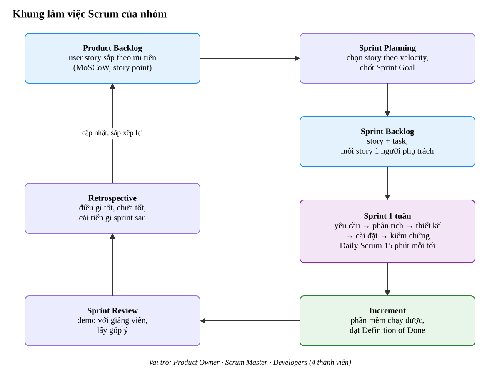
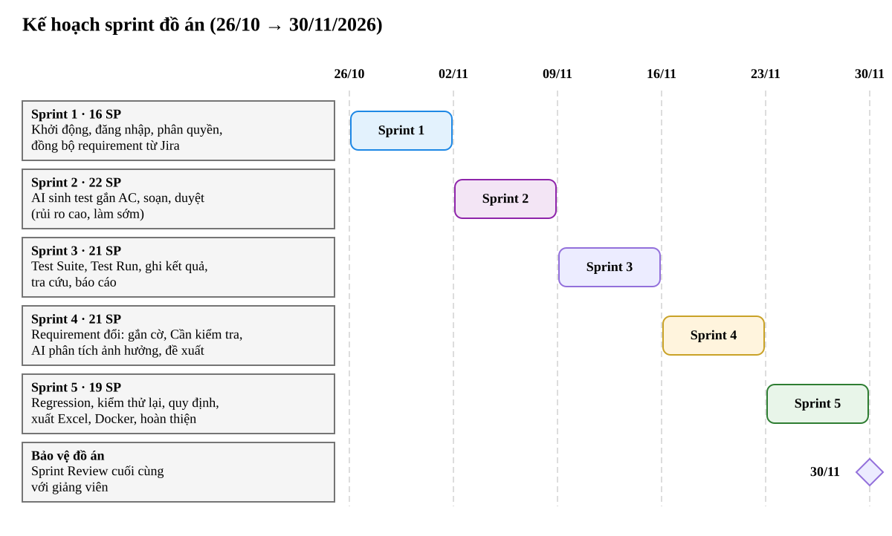
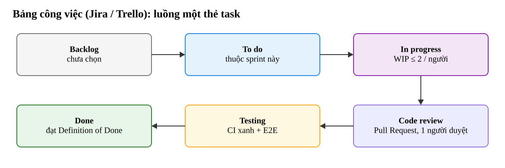

# Chương 0A. Quy trình phát triển Agile (Scrum)

> Đồ án được **thực hiện theo Agile/Scrum**: chia thành 5 sprint, mỗi sprint 1 tuần, mỗi sprint giao một phần mềm chạy được. Báo cáo vẫn trình bày theo 7 hoạt động của môn học (khảo sát → triển khai), vì các hoạt động này diễn ra **lặp lại trong mỗi sprint** chứ không bị bỏ đi.

## 0A.1. Vì sao chọn Agile thay cho thác nước thuần

| Tiêu chí | Thác nước | Agile (Scrum) | Lựa chọn cho đồ án |
|---|---|---|---|
| Yêu cầu | Chốt từ đầu, đổi rất tốn kém | Được phép thay đổi, ưu tiên lại mỗi sprint | Yêu cầu AI chưa rõ từ đầu (chất lượng LLM, định dạng kết quả) → cần linh hoạt |
| Giao sản phẩm | Một lần ở cuối dự án | Mỗi 1–4 tuần có bản chạy được | Có bản demo cho giảng viên góp ý sớm |
| Kiểm thử | Dồn về cuối | Liên tục, là một phần của "Hoàn thành" | Phù hợp nghề QA/automation; có CI từ tuần đầu |
| Rủi ro | Phát hiện muộn (lúc tích hợp) | Phát hiện sớm, làm phần rủi ro trước | Chức năng AI (rủi ro cao nhất) làm ở Sprint 2 |
| Tài liệu | Rất đầy đủ, viết trước | "Vừa đủ", cập nhật theo sprint | Tài liệu vẫn đầy đủ vì môn học yêu cầu, nhưng viết dần theo sprint |
| Phù hợp | Yêu cầu ổn định, dự án có kiểm định (y tế, hàng không, nhà nước) | Sản phẩm mới, yêu cầu thay đổi, cần phản hồi nhanh | Đề tài là sản phẩm mới có AI → Agile |

**Tuyên ngôn Agile (2001) – 4 giá trị**, và cách đồ án thể hiện:

| Giá trị Agile | Thể hiện trong đồ án |
|---|---|
| Cá nhân và tương tác hơn quy trình và công cụ | Nhóm họp Daily Scrum mỗi ngày; Sprint Review có người dùng (giảng viên, bạn cùng lớp đóng vai QA) dùng thử và góp ý |
| Phần mềm chạy được hơn tài liệu đầy đủ | Mỗi sprint kết thúc bằng một bản demo chạy được; tài liệu cập nhật theo |
| Cộng tác với khách hàng hơn đàm phán hợp đồng | Giảng viên và người dùng được xem bản demo sau mỗi sprint |
| Phản hồi với thay đổi hơn bám theo kế hoạch | Product backlog được sắp xếp lại sau mỗi Sprint Review |

## 0A.2. Khung Scrum



*File gốc:* `docs/sodo/KhungScrum.drawio` (mở bằng draw.io để sửa).

## 0A.3. Vai trò và phân công trong nhóm

Nhóm có **4 thành viên**, đúng quy mô Scrum (3–9 người). Product Owner và Scrum Master là hai người khác nhau; cả 4 người đều là Developer. Mỗi người phụ trách chính một mảng nhưng vẫn review code và tài liệu của nhau.

| Thành viên | Vai trò Scrum | Phụ trách chính | Chương báo cáo |
|---|---|---|---|
| [Thành viên 1] | Product Owner + Developer | Khảo sát, Product Backlog, yêu cầu (BM, QĐ), phân tích (use case, DFD), nhập/xuất dữ liệu | Ch.0, 1, 2, 3 |
| [Thành viên 2] | Scrum Master + Developer | Kiến trúc, backend, CSDL, AI Service (prompt, che PII, chống injection); giữ nhịp sprint, tổ chức các buổi họp | Ch.0A, 4, 5 |
| [Thành viên 3] | Developer | Giao diện web, các màn hình (requirement, Test Run, đề xuất AI, regression), báo cáo và biểu đồ | Ch.4 (giao diện), 7 |
| [Thành viên 4] | Developer | Kiểm thử: unit, API, E2E Playwright; Jira giả lập; CI, Docker | Ch.6, 7 |
| Giảng viên, bạn cùng lớp | Stakeholder / người dùng | Tham gia khảo sát (đóng vai đội QA), dùng thử bản demo trong Sprint Review, góp ý | – |

> Tên thành viên được cập nhật sau; phân công có thể đổi trong buổi Sprint Planning nhưng phải ghi vào biên bản.

## 0A.4. Product Backlog

Product Backlog là danh sách **user story của chính hệ thống AI TestCase Manager**, sắp theo ưu tiên. Ưu tiên dùng **MoSCoW** (Must / Should / Could / Won't), độ lớn ước lượng bằng **story point** theo dãy Fibonacci (1, 2, 3, 5, 8, 13). Story mẫu dùng làm mốc: PB-05 "xem nhật ký hoạt động" = 2 điểm. Product Backlog được lập lại theo đặc tả bản chốt 16/11/2026: các story cũ về script Playwright và sprint chuyển xuống Won't (MVP).

Bản dạng CSV để nhập vào Jira/Trello: [`docs/agile/ProductBacklog.csv`](agile/ProductBacklog.csv). Bản Excel để đọc và in (mỗi trường một cột, có trang tổng story point theo sprint): [`docs/agile/ProductBacklog.xlsx`](agile/ProductBacklog.xlsx), sinh từ file CSV bằng `cd docs/tools && npm run backlog`.

| Mã | Epic | User story | SP | Ưu tiên | Sprint | YC |
|---|---|---|---|---|---|---|
| PB-01 | Quản trị & bảo mật | Là người dùng, tôi muốn đăng nhập bằng tài khoản được cấp, để dùng đúng chức năng theo vai trò | 3 | Must | 1 | UC01 |
| PB-02 | Quản trị & bảo mật | Là Admin, tôi muốn tạo, khóa tài khoản và gán vai trò, để kiểm soát ai được làm gì | 3 | Must | 1 | YC11 |
| PB-03 | Tích hợp Jira | Là Admin, tôi muốn kiểm tra kết nối Jira và thêm dự án kèm module, thành viên từ Jira, để không tạo dự án bằng tay | 3 | Must | 1 | YC12 |
| PB-04 | Tích hợp Jira | Là QA Lead, tôi muốn requirement kèm AC được đồng bộ từ Jira theo issue ID và lưu phiên bản, để có đầu vào cho test mà không chép tay | 5 | Must | 1 | YC1 |
| PB-05 | Quản trị & bảo mật | Là Admin, tôi muốn xem nhật ký hoạt động, để truy vết ai đã làm gì | 2 | Should | 1 | SE-12 |
| PB-06 | AI test case | Là Tester, tôi muốn AI sinh test case từ requirement, mỗi test chỉ rõ AC liên quan, để tiết kiệm thời gian viết nháp | 8 | Must | 2 | YC2 |
| PB-07 | AI test case | Là Admin, tôi muốn dữ liệu nhạy cảm được che trước khi gửi AI, để không lộ thông tin khách hàng | 3 | Must | 2 | SE-09 |
| PB-08 | AI test case | Là Admin, tôi muốn hệ thống chống prompt injection, để AI không bị điều khiển bởi dữ liệu xấu | 3 | Must | 2 | SE-10 |
| PB-09 | Test case | Là Tester, tôi muốn soạn test, gán AC và lưu phiên bản, để không mất bản AI gốc và biết test kiểm tra AC nào | 5 | Must | 2 | YC3 |
| PB-10 | Test case | Là QA Lead, tôi muốn duyệt hoặc trả lại test kèm ghi chú, để kiểm soát chất lượng | 3 | Must | 2 | YC4 |
| PB-11 | Thực thi | Là Tester, tôi muốn gom test thành Test Suite, để lập đợt kiểm thử nhanh | 3 | Must | 3 | YC13 |
| PB-12 | Thực thi | Là QA Lead, tôi muốn lập Test Run có build, môi trường, phân công và cố định phiên bản test, để kết quả gắn đúng nội dung và bản build | 5 | Must | 3 | YC14 |
| PB-13 | Thực thi | Là Tester, tôi muốn ghi kết quả Pass/Fail/Blocked trong đợt được giao, để theo dõi chất lượng | 3 | Must | 3 | YC5 |
| PB-14 | Báo cáo | Là Tester, tôi muốn tra cứu test theo nhiều tiêu chí, để tìm nhanh | 3 | Should | 3 | YC7 |
| PB-15 | Báo cáo | Là QA Lead, tôi muốn xem báo cáo theo dự án hoặc Test Run, gồm độ bao phủ requirement và AC, để báo cáo tiến độ | 5 | Must | 3 | YC6 |
| PB-16 | AI test case | Là Admin, tôi muốn đổi nhà cung cấp LLM bằng cấu hình, để chủ động chi phí và chất lượng | 2 | Should | 3 | YC2 |
| PB-17 | Thay đổi requirement | Là Tester, tôi muốn khi requirement đổi trên Jira thì test bị ảnh hưởng tự được gắn cờ Cần xem lại, để không chạy test lỗi thời | 5 | Must | 4 | YC8 |
| PB-18 | Thay đổi requirement | Là Tester, tôi muốn xác nhận Đã xem lại kèm lý do (từng test hoặc hàng loạt), để gỡ cờ khi test vẫn đúng | 2 | Must | 4 | YC3 |
| PB-19 | Thay đổi requirement | Là QA Lead, tôi muốn requirement biến mất trên Jira được gắn cờ Cần kiểm tra để tôi chọn Lưu trữ hoặc Giữ lại, để không mất test vì lỗi đồng bộ | 3 | Must | 4 | YC8 |
| PB-20 | Thay đổi requirement | Là Tester, tôi muốn AI phân tích ảnh hưởng và đề xuất test cần sửa, còn thiếu, nên chạy lại kèm lý do, để không bỏ sót | 8 | Must | 4 | YC15 |
| PB-21 | Thay đổi requirement | Là QA Lead, tôi muốn chấp nhận hoặc từ chối đề xuất AI, đề xuất lỗi thời không áp dụng được, để AI không tự đổi test | 3 | Must | 4 | YC16 |
| PB-22 | Thay đổi requirement | Là QA Lead, tôi muốn AI đề xuất bộ regression và tôi xác nhận thành Test Run, để biết cần chạy lại test nào | 5 | Must | 5 | YC17 |
| PB-23 | Thực thi | Là Developer, tôi muốn báo đã sửa lỗi kèm build để Tester kiểm thử lại đúng lần Fail, để khép kín vòng sửa lỗi | 5 | Must | 5 | YC18 |
| PB-24 | Quản trị & bảo mật | Là QA Lead, tôi muốn thay đổi quy định không cần sửa code, để hệ thống thích ứng với đội | 2 | Must | 5 | YC10 |
| PB-25 | Báo cáo | Là QA Lead, tôi muốn xuất test case ra Excel theo bộ lọc, để gửi cho khách hàng | 2 | Should | 5 | YC9 |
| PB-26 | AI test case | Là QA Lead, tôi muốn xem nhật ký AI (prompt đã che, kết quả gốc), để truy vết khi AI sai | 2 | Should | 5 | SE-12 |
| PB-27 | Triển khai | Là Admin, tôi muốn triển khai bằng Docker, để cài đặt nhanh và đồng nhất | 3 | Should | 5 | – |
| PB-28 | Mở rộng | Là Tester, tôi muốn AI sinh và chạy script Playwright từ test đã duyệt, để không viết lại (code đã có, tắt mặc định) | 13 | Won't (MVP) | – | YC19 |
| PB-29 | Mở rộng | Là QA Lead, tôi muốn theo dõi sprint, burndown, velocity lấy từ Jira (code đã có, tắt mặc định) | 8 | Won't (MVP) | – | YC20 |
| PB-30 | Tích hợp Jira | Là QA Lead, tôi muốn sự kiện Jira vào hàng đợi bền vững, để không mất thay đổi khi máy chủ tắt | 5 | Won't (MVP) | – | YC8 |
| PB-31 | Quản trị & bảo mật | Là Admin, tôi muốn phân quyền theo thành viên từng dự án, để giới hạn quyền ghi | 8 | Won't (MVP) | – | – |
| PB-32 | Tích hợp Jira | Là Tester, tôi muốn đẩy kết quả kiểm thử và đọc trạng thái Bug từ Jira, để không nhập tay | 8 | Won't (MVP) | – | – |
| PB-33 | AI nâng cao | Là Tester, tôi muốn AI dùng tài liệu nghiệp vụ (RAG), để test sát thực tế hơn | 13 | Won't (MVP) | – | – |

**Hạng mục kỹ thuật** (không phải user story, làm đầu Sprint 1 và duy trì suốt dự án): dựng repo Git, cấu trúc thư mục, CI trên GitHub Actions, khung test (unit, API, E2E Playwright), dữ liệu mẫu.

## 0A.5. Kế hoạch sprint (5 tuần)

Sprint dài **1 tuần**. Velocity dự kiến khoảng **16–22 story point/sprint** (nhóm 4 người, vừa học vừa làm các môn khác). Sprint 1 cam kết ít vì phải dành đầu tuần cho khảo sát, lập backlog và dựng dự án. Sau mỗi sprint, velocity thực tế được dùng để điều chỉnh các sprint sau.



*File gốc:* `docs/sodo/KeHoachSprint.drawio` (mở bằng draw.io để sửa).

| Sprint | Tuần | Sprint Goal | Story (SP) | Tổng SP | Tài liệu cập nhật |
|---|---|---|---|---|---|
| 1 | 1 | "Hiểu bài toán; người dùng đăng nhập theo vai trò và lấy được requirement có phiên bản từ Jira" | Khảo sát, Product Backlog, kiến trúc sơ bộ, repo + CI; PB-01 (3), PB-02 (3), PB-03 (3), PB-04 (5), PB-05 (2) | 16 | Ch.0A, Ch.1, Ch.2 (bản đầu); UC01–UC02, UC08–UC10, DFD YC1, YC11, YC12, ERD v1 |
| 2 | 2 | "AI sinh được test case an toàn, gắn AC; test được soạn, lưu phiên bản và duyệt" | PB-06 (8), PB-07 (3), PB-08 (3), PB-09 (5), PB-10 (3) | 22 | UC15–UC17, UC23; DFD YC2–YC4; sequence sinh test, duyệt; thiết kế prompt, class Strategy |
| 3 | 3 | "QA Lead lập Test Run cố định phiên bản, Tester ghi kết quả, xem được báo cáo" | PB-11 (3), PB-12 (5), PB-13 (3), PB-14 (3), PB-15 (5), PB-16 (2) | 21 | UC19, UC20, UC24, UC03, UC05; DFD YC5–YC7, YC13, YC14; trạng thái test case, Test Run |
| 4 | 4 | "Khi requirement đổi trên Jira, đội QA biết test nào cần sửa (điểm mới)" | PB-17 (5), PB-18 (2), PB-19 (3), PB-20 (8), PB-21 (3) | 21 | UC11, UC18, UC21, UC22, UC25; DFD YC8, YC15, YC16; trạng thái requirement, đề xuất; sequence phân tích ảnh hưởng |
| 5 | 5 | "Biết cần chạy lại test nào, khép kín vòng sửa lỗi; sẵn sàng bàn giao và bảo vệ" | PB-22 (5), PB-23 (5), PB-24 (2), PB-25 (2), PB-26 (2), PB-27 (3) | 19 | UC07, UC12, UC26; DFD YC9, YC10, YC17, YC18; Ch.6 tổng kết, Ch.7, slide, video demo; bảo vệ |

## 0A.6. Definition of Ready và Definition of Done

**Definition of Ready (DoR)** – story chỉ được đưa vào sprint khi:

- [ ] Viết đúng mẫu *"Là…, tôi muốn…, để…"*
- [ ] Có acceptance criteria kiểm chứng được (mỗi tiêu chí một dòng)
- [ ] Đã ước lượng story point (≤ 8; story 13 điểm phải tách nhỏ)
- [ ] Biết rõ biểu mẫu (BM) và quy định (QĐ) liên quan
- [ ] Không phụ thuộc story chưa làm

**Definition of Done (DoD)** – story chỉ được tính là hoàn thành (và cộng vào velocity) khi:

- [ ] Code đã merge vào `main` qua Pull Request, được ít nhất 1 thành viên khác review theo checklist
- [ ] Unit test / API test cho quy định nghiệp vụ mới; **CI xanh**
- [ ] Có ít nhất 1 kịch bản E2E Playwright cho luồng chính (với story có giao diện)
- [ ] Mọi acceptance criteria được kiểm chứng
- [ ] Tài liệu liên quan được cập nhật (đặc tả UC, DFD, ERD, API)
- [ ] Demo được trong Sprint Review

> Khi bật phần mở rộng YC20, chính hệ thống cũng áp dụng DoD cho dự án mà nó quản lý: một requirement được tính **Hoàn thành** khi có ít nhất 1 test đã duyệt và mọi test đã duyệt đều có lần chạy gần nhất là PASS.

## 0A.7. Các sự kiện Scrum của nhóm

| Sự kiện | Khi nào | Thời lượng | Cách làm trong nhóm | Sản phẩm |
|---|---|---|---|---|
| Sprint Planning | Thứ Hai đầu tuần | 1 giờ | Cả nhóm chọn story từ đầu backlog đến khi tổng SP ≈ velocity; chốt Sprint Goal; tách story thành task, mỗi story có 1 người phụ trách | Sprint backlog trên bảng Jira/Trello |
| Daily Scrum | Mỗi tối (trực tiếp hoặc online qua Meet/Discord) | 15 phút | Mỗi người trả lời 3 câu: *hôm qua đã làm gì, hôm nay làm gì, đang vướng gì*; Scrum Master ghi lại và gỡ vướng | Daily log (minh chứng) |
| Backlog Refinement | Thứ Tư hoặc thứ Năm | 30 phút | Product Owner cùng nhóm viết rõ, ước lượng (Planning Poker), tách nhỏ story của sprint sau | Story đạt DoR |
| Sprint Review | Cuối tuần (thứ Bảy) | 30–45 phút | Cả nhóm demo cho giảng viên hoặc bạn cùng lớp; ghi góp ý thành story mới | Biên bản review, backlog cập nhật |
| Retrospective | Sau Review | 20 phút | Mỗi người góp ý theo mẫu **Start / Stop / Continue**; cả nhóm chọn 1 cải tiến cho sprint sau | Biên bản retro |

**Bảng công việc (Jira/Trello):**



*File gốc:* `docs/sodo/BangCongViec.drawio` (mở bằng draw.io để sửa).

Giới hạn **WIP ≤ 2 mỗi người**: mỗi thành viên không làm quá 2 việc cùng lúc, hoàn thành dứt điểm trước khi bắt đầu việc mới.

## 0A.8. Bảy hoạt động của SE104 diễn ra trong mỗi sprint

Agile không bỏ các hoạt động của thác nước mà **làm chúng cho từng lát mỏng chức năng**. Ma trận dưới cho thấy các chương của báo cáo được viết dần qua các sprint.

| Hoạt động (chương) | Sprint 1 | Sprint 2 | Sprint 3 | Sprint 4 | Sprint 5 |
|---|---|---|---|---|---|
| Khảo sát (Ch.1) | ●●● | ● (Review) | ● | ● | ● |
| Yêu cầu (Ch.2) | ●● YC tổng quát, YC1, YC11, YC12 | ● YC2, YC3, YC4 | ● YC5, 6, 7, 13, 14 | ● YC8, YC15, YC16 | ● YC9, YC10, YC17, YC18 |
| Phân tích (Ch.3) | ● UC01, 02, 08–10 | ● UC15–17, 23 | ● UC03, 05, 06, 19, 20, 24 | ● UC11, 18, 21, 22, 25 | ● UC04, 07, 12–14, 26 |
| Thiết kế (Ch.4) | ● kiến trúc, ERD v1 | ● AI Service, class | ● Test Run, trạng thái | ● phiên bản, so AC, phân tích ảnh hưởng | ● regression, kiểm thử lại |
| Cài đặt (Ch.5) | ● khung dự án | ● | ● | ● | ● |
| Kiểm chứng (Ch.6) | ● CI | ● | ● | ● | ●● tổng kết |
| Triển khai (Ch.7) | ● bản demo | ● | ● | ● | ●● Docker |

(● = có làm trong sprint; ●●/●●● = làm nhiều)

## 0A.9. Ước lượng, velocity và burndown

- **Ước lượng:** so sánh story mới với story mốc (PB-05 = 2 điểm). Story "AI sinh test case" (PB-06) và "AI phân tích ảnh hưởng" (PB-20) phức tạp, nhiều rủi ro nên 8 điểm.
- **Velocity:** tổng story point đạt DoD trong một sprint. Ví dụ: Sprint 1 cam kết 16, hoàn thành 11 → sprint sau nên cam kết ít hơn hoặc tách story nhỏ hơn.
- **Burndown chart:** số story point còn lại theo ngày so với đường lý tưởng. Đường thực tế nằm trên đường lý tưởng quá lâu là dấu hiệu sprint sẽ trễ.

Nhóm theo dõi các chỉ số này trên bảng Jira của nhóm. (Trang Sprint trong chính hệ thống – YC20 – nằm ngoài MVP, tắt mặc định.)

## 0A.10. Mẫu biên bản (minh chứng nộp kèm)

**Sprint Planning – Sprint __**

```text
Ngày: __/__/____      Thời lượng: __ phút
Sprint Goal: ...............................................
Velocity sprint trước: __ SP      Cam kết sprint này: __ SP
Story đưa vào sprint: PB-__ (__ SP), PB-__ (__ SP), ...
Rủi ro / phụ thuộc: ........................................
```

**Daily log**

```text
[__/__] Hôm qua: ... | Hôm nay: ... | Vướng: ...
```

**Sprint Review – Sprint __**

```text
Người tham dự: ...                     Bản demo: commit/tag ....
Story hoàn thành (DoD): ...           Story chưa xong (trả về backlog): ...
Góp ý của người dùng → story mới: PB-__ ...
Velocity thực tế: __ SP
```

**Retrospective – Sprint __**

| Bắt đầu làm (Start) | Ngừng làm (Stop) | Tiếp tục (Continue) |
|---|---|---|
| Viết E2E test ngay khi làm giao diện | Code nhiều chức năng trước rồi mới test | Làm phần rủi ro (AI) sớm |

Cải tiến chọn cho sprint sau: ............................................

## 0A.11. Khó khăn khi áp dụng Agile trong nhóm sinh viên và cách xử lý

| Khó khăn | Cách xử lý |
|---|---|
| Lịch học của 4 thành viên khác nhau, khó họp đủ | Daily Scrum 15 phút online buổi tối; Planning, Review, Retro đặt lịch cố định (thứ Hai, thứ Bảy) |
| Chia việc không đều, khó biết ai đang làm gì | Ước lượng bằng story point; mỗi story có người phụ trách trên bảng Jira/Trello công khai; xem lại trong Retrospective |
| Xung đột code khi nhiều người sửa cùng lúc | Mỗi mục backlog một nhánh `feature/pb-xx-*`; Pull Request nhỏ, có người review; pull `main` thường xuyên; CI chạy test mỗi lần push |
| Sprint chỉ 1 tuần, dễ trễ | Làm phần rủi ro (AI) từ Sprint 2, phân tích ảnh hưởng ở Sprint 4; story Could trả về backlog thay vì kéo dài sprint |
| Môn học yêu cầu tài liệu đầy đủ, Agile lại ưu tiên phần mềm | DoD bắt buộc cập nhật tài liệu; mỗi người viết phần tài liệu của story mình làm, không dồn cuối kỳ |
| Ước lượng sai khi chưa có số liệu | Sprint 1 cam kết ít; dùng velocity thực tế để điều chỉnh |
| Mốc nộp của môn học cố định | Mỗi sprint 1 tuần kết thúc bằng một bản Increment; bản Increment cuối tuần 5 là bản bảo vệ |
