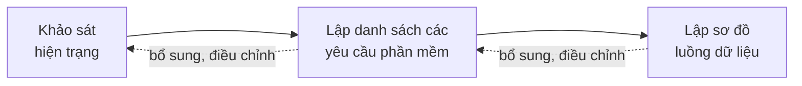
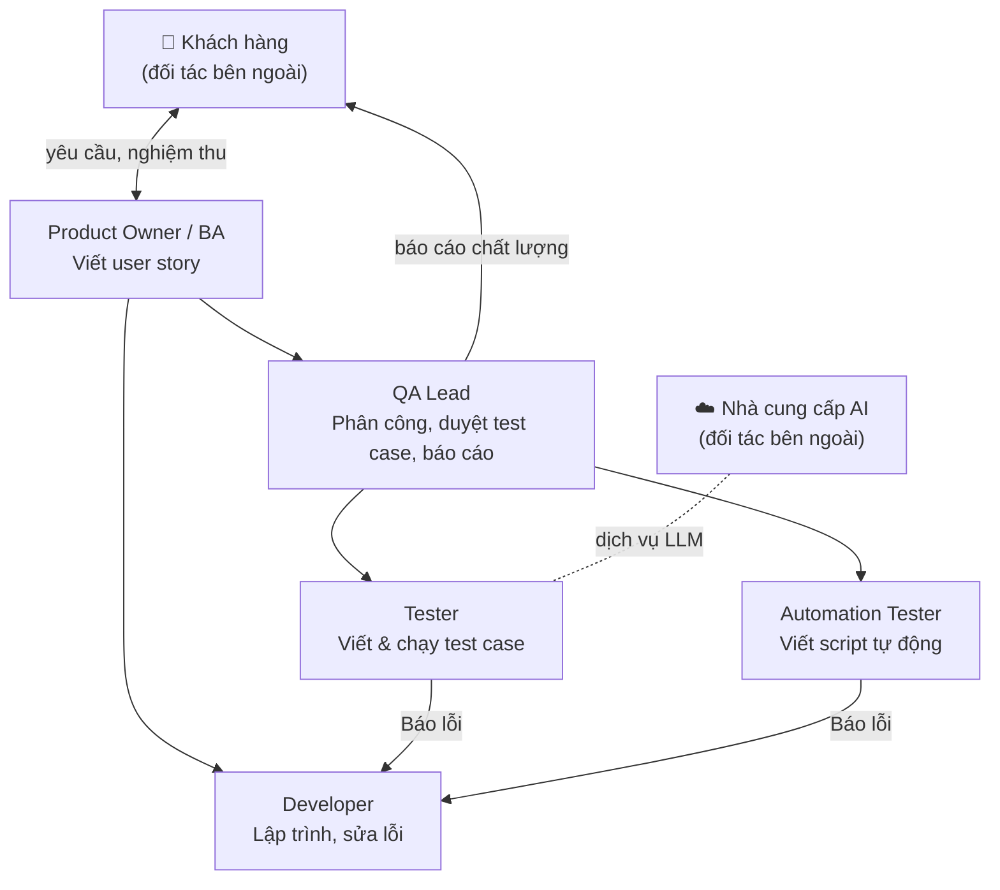

# Chương 1. Khảo sát hiện trạng

> **Mục tiêu** của khảo sát hiện trạng là tìm hiểu về **thế giới thực liên quan đến phần mềm**: tổ chức đang làm việc như thế nào, gặp vấn đề gì, cần gì. Theo môn học, cần khảo sát 3 hiện trạng: **tổ chức, nghiệp vụ, tin học**. Kết quả của chương này là đầu vào để lập danh sách yêu cầu ([Chương 2](02_DacTaYeuCau.md)) và sơ đồ luồng dữ liệu ([Chương 3](03_PhanTich.md)).

## 1.1. Đối tượng khảo sát

| Hạng mục | Nội dung |
|---|---|
| Đối tượng | Đội kiểm thử (QA) của một công ty phát triển phần mềm quy mô vừa (mô phỏng): 1 QA Lead, 4 Tester, 1 Automation Tester, làm việc cùng 6 Developer và 1 Product Owner/BA |
| Phạm vi | Các công việc liên quan đến test case: nhận yêu cầu, viết, duyệt, chạy, tự động hóa, báo cáo |
| Thời gian | Sprint 0 (tuần 1–2) của kế hoạch |

> **Lưu ý đạo đức và bảo mật:** không sử dụng dữ liệu thật của công ty khi chưa được phép bằng văn bản. Toàn bộ dữ liệu minh họa trong đồ án (dự án "App bảo hiểm thú cưng") là **hư cấu**. Dự án "Sauce Demo" là trang web công khai dành cho luyện kiểm thử tự động.

## 1.2. Phương pháp khảo sát

| Phương pháp | Cách làm trong đồ án | Ưu điểm | Khuyết điểm |
|---|---|---|---|
| **Phỏng vấn** | Trao đổi trực tiếp 30 phút với QA Lead, 2 Tester, 1 Automation Tester theo bảng câu hỏi bên dưới | Hiểu sâu, hỏi thêm được ngay chỗ chưa rõ; nắm được cả khó khăn không ghi trong tài liệu | Tốn thời gian; phụ thuộc kỹ năng hỏi; người được hỏi có thể trả lời theo ý chủ quan |
| **Quan sát** | Theo dõi một Tester viết và chạy test case cho 1 user story trong một buổi làm việc | Thấy cách làm thật, phát hiện thao tác thừa mà người làm không để ý | Mất thời gian; người bị quan sát có thể làm khác bình thường; khó quan sát công việc định kỳ (báo cáo cuối sprint) |
| **Dùng bảng câu hỏi** | Phiếu khảo sát online 10 câu gửi cả đội QA | Thu được nhiều ý kiến nhanh, dễ tổng hợp số liệu (thời gian viết test case, tỷ lệ dùng AI) | Câu trả lời ngắn, thiếu chi tiết; không hỏi thêm được; tỷ lệ phản hồi có thể thấp |
| **Thu thập thông tin, tài liệu** | Thu thập file Excel test case, báo cáo kiểm thử, quy trình QA của đội | Có biểu mẫu thật, chính xác; làm căn cứ để lập biểu mẫu (BM) | Tài liệu có thể cũ, không phản ánh cách làm hiện tại; dữ liệu nhạy cảm phải được che trước khi dùng |

### Bảng câu hỏi phỏng vấn (rút gọn)

1. Anh/chị nhận yêu cầu (user story) từ đâu, ở định dạng nào?
2. Viết test case cho một user story mất bao lâu? Dùng công cụ gì?
3. Ai duyệt test case? Duyệt như thế nào, lưu lại ra sao?
4. Khi yêu cầu thay đổi, anh/chị cập nhật test case thế nào?
5. Kết quả chạy test được ghi ở đâu? Báo cáo cho ai, bao lâu một lần?
6. Đã dùng AI (ChatGPT, Gemini…) để viết test case chưa? Gặp khó khăn gì?
7. Có tự động hóa kiểm thử không? Tự động hóa những phần nào?

## 1.3. Hiện trạng tổ chức

### Sơ đồ tổ chức

### Các bộ phận và giao tiếp với bên ngoài

Theo môn học, cần **chú trọng các bộ phận có giao tiếp với đối tác bên ngoài**, vì dữ liệu đi ra hoặc đi vào tổ chức ở đó.

| Bộ phận | Chức năng | Giao tiếp với bên ngoài |
|---|---|---|
| Product Owner / BA | Nhận yêu cầu từ khách hàng, viết user story và acceptance criteria | **Có** – với khách hàng: nhận yêu cầu, nghiệm thu |
| QA Lead | Phân công, duyệt test case, tổng hợp báo cáo chất lượng | **Có** – gửi báo cáo chất lượng cho khách hàng mỗi sprint |
| Tester | Viết test case, chạy test thủ công, ghi kết quả | **Có** – đang tự dùng dịch vụ AI bên ngoài (ChatGPT) để viết test case, có nguy cơ lộ dữ liệu |
| Automation Tester | Viết script kiểm thử tự động | Không |
| Developer | Lập trình, sửa lỗi theo bug Tester báo | Không |

## 1.4. Hiện trạng nghiệp vụ

### Danh sách nghiệp vụ của từng bộ phận

| Bộ phận | Nghiệp vụ |
|---|---|
| Product Owner / BA | NV1. Lập user story |
| Tester | NV2. Viết test case · NV3. Cập nhật test case khi yêu cầu đổi · NV5. Chạy test và ghi kết quả · NV6. Báo lỗi |
| QA Lead | NV4. Duyệt test case · NV8. Lập báo cáo kiểm thử · NV9. Lập kế hoạch sprint kiểm thử · NV10. Quản lý thành viên, quy định của đội |
| Automation Tester | NV7. Viết và chạy script kiểm thử tự động |

### Mô tả nghiệp vụ

| Mã | Tên công việc | Biểu mẫu liên quan | Quy định liên quan | Người thực hiện | Tần suất | Thời điểm | Cách thức thực hiện hiện tại |
|---|---|---|---|---|---|---|---|
| NV1 | Lập user story | Ticket Jira (tiêu đề, mô tả, acceptance criteria) | Mỗi story có ít nhất 1 acceptance criterion | PO/BA | 10–20 story/sprint | Đầu sprint | Gõ trên Jira |
| NV2 | Viết test case | File Excel test case (mục 1.4) | Mỗi acceptance criterion có ít nhất 1 test case; ưu tiên High/Medium/Low | Tester | 5–15 test case/story | Sau khi nhận story | Viết tay trên Excel, mất 30–60 phút/story; một số người dán story vào ChatGPT |
| NV3 | Cập nhật test case | File Excel | Không có quy định lưu phiên bản | Tester | Khi yêu cầu đổi | Bất kỳ lúc nào | Sửa đè trong file, đặt tên file `_v2`, `_final` |
| NV4 | Duyệt test case | Không có (nhận xét qua chat) | Chỉ QA Lead được duyệt | QA Lead | Mỗi story | Trước khi chạy test | Mở file, nhận xét qua chat/email; không lưu vết |
| NV5 | Chạy test, ghi kết quả | Cột "Kết quả" trong file Excel | Fail phải ghi mã bug | Tester | Hằng ngày | Trong sprint | Chạy tay, tô màu ô kết quả |
| NV6 | Báo lỗi | Ticket bug trên Jira | Có bước tái hiện, ảnh chụp | Tester | Khi Fail | Ngay khi phát hiện | Tạo ticket Jira, chụp màn hình thủ công |
| NV7 | Viết, chạy script tự động | File script (WebdriverIO/Playwright) | Chỉ tự động hóa test case đã ổn định | Automation Tester | Cuối sprint | Sau khi test case được duyệt | Đọc test case trên Excel, viết lại thành script |
| NV8 | Lập báo cáo kiểm thử | File báo cáo (tỷ lệ pass, số bug) | Báo cáo theo lần chạy gần nhất | QA Lead | 1 lần/sprint | Cuối sprint | Tổng hợp bằng tay từ nhiều file Excel, mất 1–2 giờ |
| NV9 | Lập kế hoạch sprint kiểm thử | Bảng sprint trên Jira | Sprint 2 tuần | QA Lead | 1 lần/sprint | Đầu sprint | Họp, chọn story trên Jira |
| NV10 | Quản lý thành viên, quy định | Không có | Không có | QA Lead | Khi có thay đổi | Bất kỳ lúc nào | Trao đổi miệng, không ghi nhận |

### Quy trình hiện tại

### Mẫu biểu đang dùng

**Mẫu test case Excel hiện tại:**

| TC ID | Tiêu đề | Điều kiện | Các bước | Kết quả mong đợi | Ưu tiên | Kết quả | Ghi chú |
|---|---|---|---|---|---|---|---|
| TC_001 | Đăng nhập thành công | Có tài khoản | 1. Mở trang… | Vào trang chủ | High | Pass | |

Nhược điểm: không có trạng thái duyệt, không có lịch sử thay đổi, không liên kết với user story, mỗi người một phiên bản file.

## 1.5. Hiện trạng tin học

| Thành phần | Hiện trạng | Ảnh hưởng đến phần mềm |
|---|---|---|
| **Hệ thống phần cứng** | Mỗi người có 1 laptop (macOS hoặc Windows, RAM 8–16 GB); có 1 máy chủ nội bộ chạy Jira | Phần mềm chạy trên trình duyệt, không cần máy mạnh; chạy script Playwright cần máy có ít nhất 8 GB RAM |
| **Hệ thống phần mềm** | Jira (yêu cầu, bug), Microsoft Excel / Google Sheets (test case), Chrome, VS Code, Node.js; một số Tester dùng ChatGPT bản miễn phí | Cần nhập được user story từ file xuất của Jira (CSV), xuất test case ra Excel; chạy trên Chrome |
| **Hệ thống mạng** | Mạng LAN văn phòng, Internet ổn định; truy cập Jira qua VPN khi làm ở nhà | Gọi dịch vụ LLM cần Internet; cần chế độ AI giả lập để vẫn làm được khi mất mạng |
| **Con người** | Đội QA thành thạo viết test case và Jira; 1 người biết viết script tự động; chưa ai được hướng dẫn dùng AI an toàn | Giao diện tiếng Việt, dễ học; hệ thống phải tự che dữ liệu nhạy cảm thay vì trông chờ người dùng tự nhớ |

## 1.6. Vấn đề ghi nhận

| # | Vấn đề | Hệ quả |
|---|---|---|
| V1 | Viết test case thủ công mất 30–60 phút/user story | Chậm tiến độ, Tester bị quá tải cuối sprint |
| V2 | Dễ bỏ sót case lỗi (negative) và case biên (edge) | Lỗi lọt ra môi trường production |
| V3 | Duyệt test case qua chat/email, không lưu vết | Không biết ai duyệt, khi nào, góp ý gì |
| V4 | Nhiều phiên bản file Excel | Chạy nhầm test case cũ |
| V5 | Không biết user story nào chưa có test case | Không đo được độ bao phủ yêu cầu |
| V6 | Tổng hợp báo cáo bằng tay | Mất 1–2 giờ mỗi lần, số liệu dễ sai |
| V7 | Viết lại test case thành script tự động | Làm 2 lần cùng một việc |
| V8 | Dùng ChatGPT tự phát, dán cả dữ liệu khách hàng | **Nguy cơ lộ dữ liệu nhạy cảm**; kết quả không được kiểm soát |
| V9 | Quy định của đội (số test case tối đa, ai được duyệt) chỉ trao đổi miệng | Mỗi người hiểu một kiểu, không kiểm soát được |

## 1.7. Nhu cầu của người dùng

| Vai trò | Nhu cầu |
|---|---|
| Tester | Có bản nháp test case nhanh để chỉnh sửa; biết test case nào bị trả lại và vì sao; ghi kết quả nhanh; có script tự động sẵn |
| QA Lead | Có hàng đợi duyệt rõ ràng; trả lại kèm góp ý; xem báo cáo tỷ lệ pass, độ bao phủ ngay lập tức; tự điều chỉnh quy định của đội; lập kế hoạch sprint |
| Developer | Xem test case và kết quả để tái hiện lỗi |
| Admin | Quản lý tài khoản, phân quyền, dự án; kiểm soát việc dùng AI (chi phí, bảo mật) |

## 1.8. Kết luận khảo sát

Cần một hệ thống tập trung, quản lý toàn bộ vòng đời test case, trong đó AI giúp tăng tốc khâu viết nháp và chuyển thành script tự động, còn **con người giữ quyền quyết định** (chỉnh sửa, duyệt). Hệ thống phải lưu vết đầy đủ, báo cáo tự động và bảo vệ dữ liệu khi làm việc với AI bên ngoài.

Các nghiệp vụ khảo sát được chuyển thành yêu cầu phần mềm ở [Chương 2](02_DacTaYeuCau.md):

| Nghiệp vụ | Yêu cầu phần mềm |
|---|---|
| NV1 Lập user story | YC1 Lập user story, YC8 Nhập user story từ file |
| NV2 Viết test case | YC2 Sinh test case bằng AI, YC3 Soạn thảo test case |
| NV3 Cập nhật test case | YC3 Soạn thảo (lưu phiên bản) |
| NV4 Duyệt test case | YC4 Duyệt test case |
| NV5 Chạy test, ghi kết quả | YC5 Ghi nhận kết quả chạy test |
| NV6 Báo lỗi | Ngoài phạm vi (vẫn dùng Jira); hệ thống lưu mã bug trong ghi chú kết quả |
| NV7 Viết, chạy script tự động | YC9 Sinh và chạy script tự động |
| NV8 Lập báo cáo | YC6 Lập báo cáo, YC7 Tra cứu, YC8 Xuất Excel |
| NV9 Lập kế hoạch sprint | YC12 Quản lý sprint |
| NV10 Quản lý thành viên, quy định | YC10 Thay đổi quy định, YC11 Quản lý người dùng, dự án |
