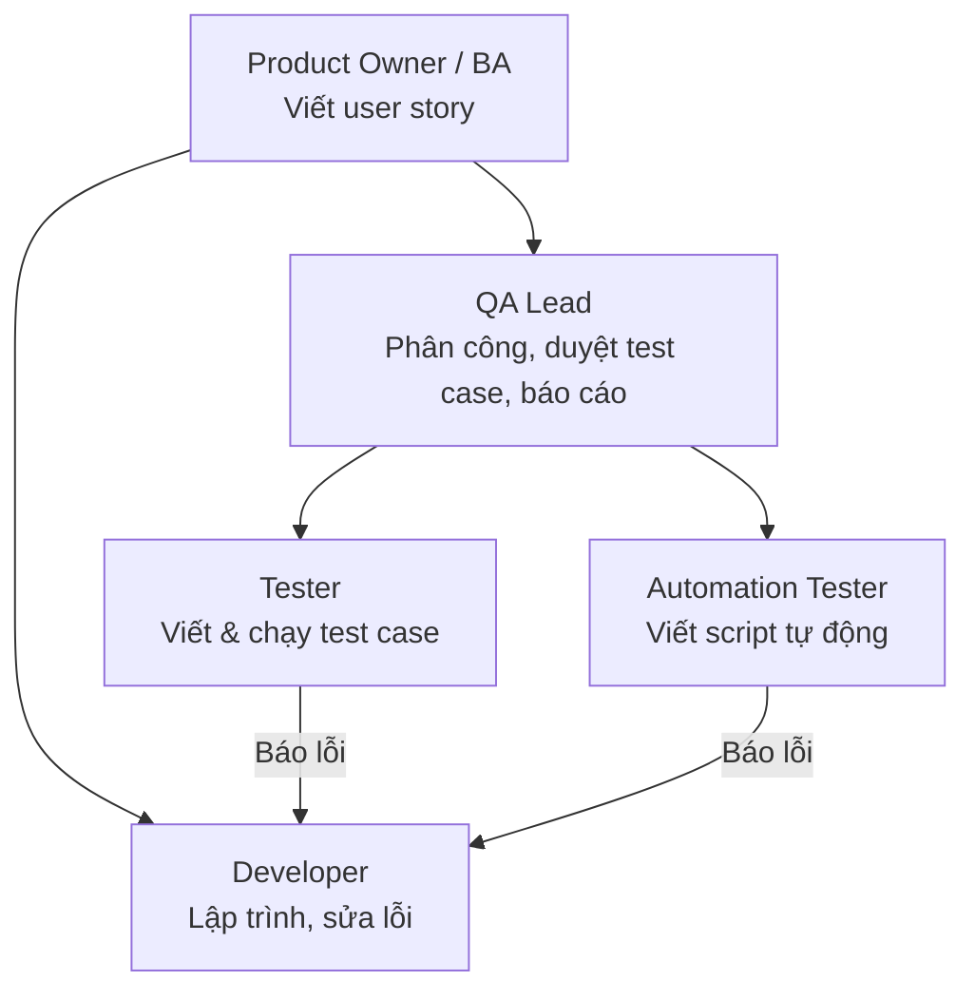
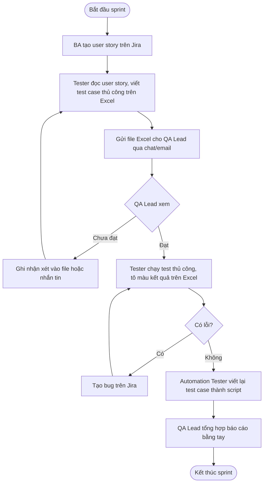

# Chương 1. Khảo sát hiện trạng

> Sản phẩm của giai đoạn: **mô tả hoạt động trong thế giới thực** – tổ chức hiện đang làm việc như thế nào, gặp vấn đề gì, cần gì.

## 1.1. Đối tượng và phương pháp khảo sát

| Hạng mục | Nội dung |
|---|---|
| Đối tượng | Đội kiểm thử (QA) của một công ty phát triển phần mềm quy mô vừa (mô phỏng): 1 QA Lead, 4 Tester, làm việc cùng 6 Developer |
| Phương pháp | Phỏng vấn trực tiếp, quan sát quy trình làm việc, thu thập mẫu biểu (file Excel test case, báo cáo kiểm thử) |
| Thời gian | Tuần 1 của kế hoạch |

> **Lưu ý đạo đức và bảo mật:** không sử dụng dữ liệu thật của công ty khi chưa được phép bằng văn bản. Toàn bộ dữ liệu minh họa trong đồ án (dự án "App bảo hiểm thú cưng") là **hư cấu**. Dự án "Sauce Demo" là trang web công khai dành cho luyện kiểm thử tự động.

### Bảng câu hỏi phỏng vấn (rút gọn)

1. Anh/chị nhận yêu cầu (user story) từ đâu, ở định dạng nào?
2. Viết test case cho một user story mất bao lâu? Dùng công cụ gì?
3. Ai duyệt test case? Duyệt như thế nào, lưu lại ra sao?
4. Khi yêu cầu thay đổi, anh/chị cập nhật test case thế nào?
5. Kết quả chạy test được ghi ở đâu? Báo cáo cho ai, bao lâu một lần?
6. Đã dùng AI (ChatGPT, Gemini…) để viết test case chưa? Gặp khó khăn gì?
7. Có tự động hóa kiểm thử không? Tự động hóa những phần nào?

## 1.2. Cơ cấu tổ chức liên quan

## 1.3. Quy trình hiện tại

## 1.4. Mẫu biểu đang dùng

**Mẫu test case Excel hiện tại:**

| TC ID | Tiêu đề | Điều kiện | Các bước | Kết quả mong đợi | Ưu tiên | Kết quả | Ghi chú |
|---|---|---|---|---|---|---|---|
| TC_001 | Đăng nhập thành công | Có tài khoản | 1. Mở trang… | Vào trang chủ | High | Pass | |

Nhược điểm: không có trạng thái duyệt, không có lịch sử thay đổi, không liên kết với user story, mỗi người một phiên bản file.

## 1.5. Vấn đề ghi nhận

| # | Vấn đề | Hệ quả |
|---|---|---|
| V1 | Viết test case thủ công mất 30–60 phút/user story | Chậm tiến độ, Tester bị quá tải cuối sprint |
| V2 | Dễ bỏ sót case lỗi (negative) và case biên (edge) | Lỗi lọt ra môi trường production |
| V3 | Duyệt test case qua chat/email, không lưu vết | Không biết ai duyệt, khi nào, góp ý gì |
| V4 | Nhiều phiên bản file Excel | Chạy nhầm test case cũ |
| V5 | Không biết user story nào chưa có test case | Không đo được độ bao phủ yêu cầu |
| V6 | Tổng hợp báo cáo bằng tay | Mất 1–2 giờ mỗi lần, số liệu dễ sai |
| V7 | Viết lại test case thành script tự động | Làm 2 lần cùng một việc |
| V8 | Dùng ChatGPT tự phát, dán cả dữ liệu khách hàng | **Nguy cơ lộ dữ liệu nhạy cảm**; kết quả không được kiểm soát |

## 1.6. Nhu cầu của người dùng

| Vai trò | Nhu cầu |
|---|---|
| Tester | Có bản nháp test case nhanh để chỉnh sửa; biết test case nào bị trả lại và vì sao; ghi kết quả nhanh; có script tự động sẵn |
| QA Lead | Có hàng đợi duyệt rõ ràng; trả lại kèm góp ý; xem báo cáo tỷ lệ pass, độ bao phủ ngay lập tức; tự điều chỉnh quy định của đội |
| Developer | Xem test case và kết quả để tái hiện lỗi |
| Admin | Quản lý tài khoản, phân quyền, dự án; kiểm soát việc dùng AI (chi phí, bảo mật) |

## 1.7. Kết luận khảo sát

Cần một hệ thống tập trung, quản lý toàn bộ vòng đời test case, trong đó AI giúp tăng tốc khâu viết nháp và chuyển thành script tự động, còn **con người giữ quyền quyết định** (chỉnh sửa, duyệt). Hệ thống phải lưu vết đầy đủ, báo cáo tự động và bảo vệ dữ liệu khi làm việc với AI bên ngoài. Các nhu cầu này được cụ thể hóa thành yêu cầu ở [Chương 2](02_DacTaYeuCau.md).
