# Chương 3. Phân tích

> Sản phẩm của giai đoạn: **mô hình thế giới thực** – sơ đồ use case, đặc tả use case, sơ đồ luồng dữ liệu (DFD) cho từng yêu cầu, sơ đồ hoạt động và sơ đồ trạng thái. Mọi mô hình bám theo đặc tả bản chốt ngày 16/11/2026 (Chương 2).

## 3.1. Sơ đồ use case tổng quát

Sơ đồ được vẽ bằng **draw.io** theo ký hiệu UML (file gốc: `docs/usecase/UseCaseTongQuat.drawio`, sinh bằng `python3 docs/usecase/generate_usecase.py`). Quyền của từng tác nhân khớp với bảng 3.2 và ma trận phân quyền ở mục 2.6.2 (code: `app/src/middleware/auth.js`). Sơ đồ chỉ vẽ phạm vi MVP; YC19, YC20 ở mục 3.4.20.

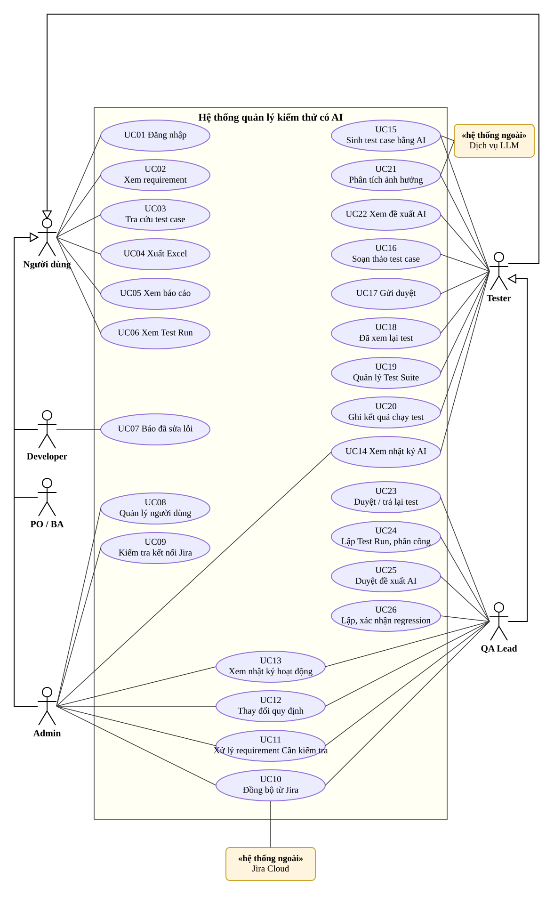

| Ký hiệu | Ý nghĩa |
|---|---|
| Hình người | Tác nhân (người dùng theo vai trò) |
| Hình elip | Use case (chức năng của hệ thống) |
| Hình chữ nhật «hệ thống ngoài» | Hệ thống bên ngoài mà use case gọi tới |
| Đường thẳng | Tác nhân thực hiện use case |
| Mũi tên tam giác rỗng | **Tổng quát hóa**: tác nhân con có mọi use case của tác nhân cha |

- **Người dùng** là tác nhân chung: mọi vai trò đều đăng nhập, xem requirement, tra cứu test case, xuất Excel, xem báo cáo và Test Run. Admin, PO/BA, Developer, Tester tổng quát hóa thành Người dùng.
- **Requirement đồng bộ một chiều từ Jira** (UC10): hệ thống không có chức năng lập, sửa, xóa hay nhập requirement.
- **PO / BA** viết requirement kèm AC **trên Jira**; trong hệ thống chỉ có các use case của Người dùng.
- **Developer** báo đã sửa lỗi kèm bản build (UC07) cho một lần chạy Fail để Tester kiểm thử lại.
- **Tester** sinh test bằng AI, soạn, gửi duyệt, xác nhận Đã xem lại, quản lý Test Suite, ghi kết quả, chạy phân tích ảnh hưởng và xem đề xuất AI.
- **QA Lead** tổng quát hóa thành **Tester**, thêm quyền duyệt test, lập Test Run, quyết định đề xuất AI, xác nhận bộ regression, đồng bộ Jira, xử lý requirement Cần kiểm tra, thay đổi quy định, xem nhật ký hoạt động.
- **Admin** quản lý người dùng, kiểm tra kết nối Jira (chỉ Admin), đồng bộ Jira, xử lý requirement Cần kiểm tra, thay đổi quy định, xem nhật ký.

> Mọi use case (trừ UC01) đều yêu cầu đã đăng nhập (`<<include>> UC01`).

## 3.2. Danh sách use case

| Mã | Tên use case | Tác nhân | Yêu cầu |
|---|---|---|---|
| UC01 | Đăng nhập, đăng xuất, đổi mật khẩu | Tất cả | Bảo mật |
| UC02 | Xem requirement, các phiên bản, so sánh phiên bản | Tất cả | YC1 |
| UC03 | Tra cứu test case | Tất cả | YC7 |
| UC04 | Xuất test case ra Excel | Tất cả | YC9 |
| UC05 | Xem báo cáo kiểm thử (dự án hoặc Test Run) | Tất cả | YC6 |
| UC06 | Xem Test Run, kết quả chạy | Tất cả | YC14, YC5 |
| UC07 | Báo đã sửa lỗi kèm bản build | Developer | YC18 |
| UC08 | Quản lý người dùng | Admin | YC11 |
| UC09 | Kiểm tra kết nối Jira | Admin | YC12 |
| UC10 | Đồng bộ từ Jira: thêm dự án, Đồng bộ ngay; nhận webhook, đồng bộ định kỳ | Admin, QA Lead; Jira | YC1, YC8, YC12 |
| UC11 | Xử lý requirement Cần kiểm tra: Lưu trữ hoặc Giữ lại | Admin, QA Lead | YC8 |
| UC12 | Thay đổi quy định | Admin, QA Lead | YC10 |
| UC13 | Xem nhật ký hoạt động | Admin, QA Lead | Bảo mật |
| UC14 | Xem nhật ký AI | Admin, QA Lead, Tester | Truy vết |
| UC15 | Sinh test case bằng AI | Tester, QA Lead; LLM | YC2 |
| UC16 | Soạn thảo test case: thêm, sửa, xóa, gán AC, xem lịch sử | Tester, QA Lead | YC3 |
| UC17 | Gửi duyệt test case (đơn lẻ, hàng loạt) | Tester, QA Lead | YC3 |
| UC18 | Đã xem lại test có cờ Cần xem lại (đơn lẻ, hàng loạt) | Tester, QA Lead | YC3, YC8 |
| UC19 | Quản lý Test Suite | Tester, QA Lead | YC13 |
| UC20 | Ghi kết quả chạy test trong Test Run | Tester, QA Lead | YC5 |
| UC21 | Phân tích ảnh hưởng bằng AI | Tester, QA Lead; LLM | YC15 |
| UC22 | Xem đề xuất AI | Tester, QA Lead | YC16 |
| UC23 | Duyệt, trả lại test case | QA Lead | YC4 |
| UC24 | Lập Test Run, phân công, đóng đợt; tạo đợt kiểm thử lại | QA Lead | YC14, YC18 |
| UC25 | Chấp nhận, từ chối đề xuất AI | QA Lead | YC16 |
| UC26 | Lập và xác nhận bộ regression | QA Lead; LLM | YC17 |

## 3.3. Đặc tả các use case chính

### UC15 – Sinh test case bằng AI

| Mục | Nội dung |
|---|---|
| Tác nhân | Tester, QA Lead; hệ thống ngoài: Dịch vụ LLM |
| Tiền điều kiện | Có quyền `ai:use`; requirement không lưu trữ, không Cần kiểm tra, có ≥ `MIN_AC_PER_STORY` AC; chưa đủ `MAX_TC_PER_STORY` test; chưa vượt hạn mức AI/giờ |
| Hậu điều kiện | Test mới ở trạng thái Nháp, nguồn AI, phiên bản 1, đã liên kết AC và phiên bản requirement hiện tại; bản nháp cũ giữ nguyên; có 1 dòng nhật ký AI |
| Luồng chính | 1. Mở requirement, bấm **Sinh test case bằng AI**. 2. Hệ thống kiểm tra QĐ2 và hạn mức. 3. Che dữ liệu nhạy cảm; phát hiện dấu hiệu prompt injection. 4. Ghép prompt: vai trò QA, quy định QĐ2, AC **đánh số**, định dạng JSON, dữ liệu bọc trong thẻ. 5. Gọi LLM, kiểm tra JSON theo schema (mỗi test phải có `ac_refs` trỏ tới AC có thật). 6. Cắt theo số test còn được tạo; lưu bản nháp; ghi nhật ký AI. 7. Hiển thị số test đã sinh, thời gian, dữ liệu đã che. |
| Luồng ngoại lệ | 2a. Thiếu AC, Cần kiểm tra, đã lưu trữ hoặc đủ 20 test → báo lỗi nêu quy định. 2b. Vượt hạn mức → 429. 5a. Sai schema → thử lại tối đa 2 lần, vẫn sai → báo lỗi, ghi nhật ký lỗi. 5b. Quá 30 giây → báo hết thời gian chờ. |
| Quy định | QĐ1, QĐ2 |

### UC18 – Đã xem lại test khi requirement đổi

| Mục | Nội dung |
|---|---|
| Tác nhân | Tester, QA Lead |
| Tiền điều kiện | Test có cờ **Cần xem lại** do AC đổi/bị bỏ, hoặc tiêu đề/mô tả đổi (QĐ3) |
| Hậu điều kiện | Cờ được gỡ; phiên bản requirement đã liên kết của test nâng lên phiên bản hiện tại; lưu người, phiên bản, lý do, thời điểm (`recheck_logs`) |
| Luồng chính | 1. Mở requirement, xem so sánh phiên bản trước/sau (AC đổi được tô màu). 2. Chọn một test, hoặc chọn nhiều test (dùng cho cờ do tiêu đề/mô tả đổi) để ghi một lý do chung. 3. Gán lại AC nếu cần, nhập lý do, bấm **Đã xem lại**. |
| Luồng thay thế | 3'. Test cần sửa → sửa test (UC16), test về Nháp, gửi duyệt; cờ gỡ khi QA Lead duyệt bản sửa (UC23). |
| Luồng ngoại lệ | 3a. Thiếu lý do → báo lỗi. 3b. Gán lại AC khi chọn nhiều test → báo lỗi, chỉ gán lại AC khi xác nhận từng test. 3c. Test không có cờ → 409. |
| Quy định | QĐ3, QĐ8 |

### UC23 – Duyệt, trả lại test case

| Mục | Nội dung |
|---|---|
| Tác nhân | QA Lead |
| Tiền điều kiện | Test ở trạng thái Chờ duyệt |
| Hậu điều kiện | Test Đã duyệt (gỡ cờ Cần xem lại, nâng phiên bản requirement liên kết) hoặc Bị trả lại kèm ghi chú; có phiếu duyệt BM3 |
| Luồng chính | 1. Mở **Duyệt test case**, xem hàng đợi (có cột nguồn: thủ công, AI, từ đề xuất). 2. Đọc nội dung và AC liên kết. 3. Chọn Duyệt hoặc Trả lại; lưu phiếu duyệt. |
| Luồng ngoại lệ | 3a. Trả lại không có ghi chú → báo lỗi. 3b. Test không ở Chờ duyệt → 409. Vai trò khác gọi API → 403. |
| Quy định | QĐ4 |

### UC24 – Lập Test Run, phân công, đóng đợt

| Mục | Nội dung |
|---|---|
| Tác nhân | QA Lead |
| Tiền điều kiện | Có quyền `testrun:manage`; dự án có test đủ **điều kiện chạy** |
| Hậu điều kiện | Có Test Run Đang mở với build, môi trường, hạn; mỗi test có **phiên bản được cố định** và người được giao |
| Luồng chính | 1. Mở **Test Run**, bấm **Lập đợt**, nhập tên, build, môi trường, hạn. 2. Chọn Test Suite hoặc từng test; hệ thống thêm test đủ điều kiện, liệt kê test bị bỏ qua kèm lý do. 3. Giao từng test (hoặc hàng loạt) cho Tester hoặc QA Lead. 4. Theo dõi tiến độ, cảnh báo (test có phiên bản mới, requirement đổi). 5. Bấm **Đóng đợt**; nếu còn test chưa chạy, hệ thống liệt kê số lượng và yêu cầu xác nhận. |
| Luồng ngoại lệ | 2a. Không test nào đủ điều kiện → báo lỗi, không tạo đợt rỗng khi chọn suite. 4a. Sửa build/môi trường khi đợt đã có kết quả → 409, hướng dẫn lập đợt mới. 5a. Đợt đã đóng → không ghi thêm kết quả. |
| Quy định | QĐ14 |

### UC20 – Ghi kết quả chạy test

| Mục | Nội dung |
|---|---|
| Tác nhân | Tester (người được giao), QA Lead |
| Tiền điều kiện | Test nằm trong một Test Run Đang mở |
| Hậu điều kiện | Lần chạy lưu với phiên bản test đã cố định; tiến độ đợt cập nhật; nếu là lần chạy lại thì liên kết lần Fail gốc và cập nhật phiếu kiểm thử lại |
| Luồng chính | 1. Mở Test Run, chọn test được giao. 2. Thực hiện các bước theo phiên bản đã cố định. 3. Chọn Pass / Fail / Blocked, nhập ghi chú, mã defect, liên kết bằng chứng; lưu. |
| Luồng ngoại lệ | 3a. Fail/Blocked thiếu ghi chú → báo lỗi. 3b. Không phải người được giao hoặc QA Lead → 403. 3c. Đợt đã đóng → 409. 3d. Build của đợt khác build Developer đã báo → cảnh báo, vẫn cho ghi. |
| Quy định | QĐ5, QĐ18 |

### UC21 – Phân tích ảnh hưởng bằng AI

| Mục | Nội dung |
|---|---|
| Tác nhân | Tester, QA Lead; hệ thống ngoài: Dịch vụ LLM |
| Tiền điều kiện | Requirement có ≥ 2 phiên bản; chưa vượt hạn mức AI |
| Hậu điều kiện | Có một bản phân tích (BM14) và các đề xuất ở trạng thái Chờ xử lý; **không test nào bị đổi**; có nhật ký AI |
| Luồng chính | 1. Mở requirement đã đổi, bấm **Phân tích ảnh hưởng**. 2. Hệ thống xác định mốc so: phiên bản cũ nhất mà các test đang liên kết; so với phiên bản hiện tại. 3. Che dữ liệu, ghép prompt gồm thay đổi AC/tiêu đề/mô tả và các test liên quan kèm phiên bản liên kết của từng test. 4. Gọi LLM, kiểm tra schema: mỗi đề xuất có loại (Cần sửa, Còn thiếu, Nên chạy lại, Cần làm rõ), lý do, phần thay đổi nguồn. 5. Lưu đề xuất, hiện ở màn hình **Đề xuất AI**. |
| Luồng ngoại lệ | 1a. Chỉ có 1 phiên bản → báo lỗi. 4a. Sai schema → thử lại; vẫn sai → báo lỗi, không lưu đề xuất. |
| Quy định | QĐ15 |

### UC25 – Chấp nhận, từ chối đề xuất AI

| Mục | Nội dung |
|---|---|
| Tác nhân | QA Lead |
| Tiền điều kiện | Đề xuất ở trạng thái Chờ xử lý |
| Hậu điều kiện | Đề xuất Đã chấp nhận / Đã từ chối / Lỗi thời; quyết định được lưu |
| Luồng chính | 1. Mở **Đề xuất AI**, xem nội dung trước và sau, lý do. 2. Bấm Chấp nhận: *Cần sửa* → test về Nháp với nội dung mới; *Còn thiếu* → test nháp mới (nguồn AI); *Nên chạy lại* → thêm vào bộ regression; *Cần làm rõ* → ghi nhận. 3. Bản nháp tạo ra mang mã đề xuất, phải qua UC23. |
| Luồng ngoại lệ | 2a. Phiên bản requirement hoặc test đã đổi từ lúc phân tích → chuyển **Lỗi thời**, không áp dụng. 2b. Từ chối thiếu ghi chú → báo lỗi. 2c. Còn thiếu khi đã đủ 20 test → báo lỗi. |
| Quy định | QĐ16 |

### UC26 – Lập và xác nhận bộ regression

| Mục | Nội dung |
|---|---|
| Tác nhân | QA Lead; hệ thống ngoài: Dịch vụ LLM (xếp ưu tiên) |
| Tiền điều kiện | Requirement đã đổi so với phiên bản test liên kết |
| Hậu điều kiện | Bộ regression đã xác nhận; một Test Run loại **Regression** được tạo |
| Luồng chính | 1. Bấm **Đề xuất regression** ở requirement. 2. Hệ thống lấy phần bắt buộc: test liên kết AC đã đổi (hoặc mọi test nếu tiêu đề/mô tả đổi). 3. AI xếp ưu tiên Cao/Trung bình/Thấp kèm lý do và gợi ý thêm test. 4. QA Lead thêm, bớt (bớt test bắt buộc phải ghi lý do), bấm **Xác nhận**. |
| Luồng ngoại lệ | 3a. Không gọi được AI → vẫn hiện danh sách test liên kết, nguồn Liên kết. 4a. Còn test chưa đủ điều kiện chạy trong bộ → không xác nhận được cho tới khi xử lý hoặc bỏ. |
| Quy định | QĐ17, QĐ14 |

### UC07 – Báo đã sửa lỗi

| Mục | Nội dung |
|---|---|
| Tác nhân | Developer |
| Tiền điều kiện | Có quyền `bug:fix`; có lần chạy Fail là lần gần nhất của test trong một Test Run, chưa được báo |
| Hậu điều kiện | Phiếu BM17 ở trạng thái **Chờ kiểm thử lại**; test hiện ở danh sách *Kiểm thử lại* |
| Luồng chính | 1. Mở **Kiểm thử lại** hoặc Test Run, xem ghi chú, mã defect, bằng chứng. 2. Sửa lỗi, bấm **Báo đã sửa**, nhập build và ghi chú. 3. Hệ thống cho biết chạy lại trong cùng đợt được không (đợt còn mở và trùng build); nếu không, QA Lead tạo đợt Kiểm thử lại (UC24). 4. Tester chạy lại (UC20): Pass → Đã đóng; Fail → Mở lại; Blocked → vẫn chờ. |
| Luồng ngoại lệ | 2a. Thiếu build → báo lỗi. 2b. Lần chạy không phải Fail gần nhất trong đợt, hoặc đã báo → 409. Vai trò khác → 403. |
| Quy định | QĐ18 |

### UC10, UC11 – Đồng bộ Jira và xử lý requirement Cần kiểm tra

| Mục | Nội dung |
|---|---|
| Tác nhân | Admin, QA Lead (UC09 kiểm tra kết nối: chỉ Admin); hệ thống ngoài: Jira |
| Tiền điều kiện | Cấu hình `JIRA_*` trong `.env` (để trống thì dùng Jira giả lập) |
| Hậu điều kiện | Dự án, module, thành viên, requirement được lưu; mỗi thay đổi nội dung tạo một phiên bản; có dòng `sync_logs` |
| Luồng chính | 1. Admin bấm **Kiểm tra kết nối Jira**. 2. Bấm **Thêm dự án từ Jira**, nhập mã (VD `SHOP`); hệ thống lấy dự án, component, thành viên và các issue loại `JIRA_ISSUE_TYPES`, tách mô tả và AC. 3. Về sau: webhook, định kỳ 5 phút hoặc **Đồng bộ ngay**; chỉ ghi khi bản trên Jira mới hơn; AC/tiêu đề/mô tả đổi → phiên bản mới, gắn cờ test (QĐ3). 4. Issue vắng mặt → hỏi lại Jira theo issue ID → gắn **Cần kiểm tra** kèm lý do. 5. QA Lead mở requirement Cần kiểm tra, chọn **Lưu trữ** hoặc **Giữ lại**. |
| Luồng ngoại lệ | 2a. Mã sai định dạng → 400; đã có → 409; không có trên Jira → 404. 3a. Lỗi Jira → thử lại 2 lần, ghi lỗi vào `sync_logs`, không đổi dữ liệu. 3b. Webhook sai mã bí mật → 401. 5a. Giữ lại: cờ vẫn còn; lần đồng bộ sau lấy lại được issue thì tự gỡ. |
| Quy định | QĐ1, QĐ8, QĐ12 |

### UC01 – Đăng nhập

| Mục | Nội dung |
|---|---|
| Luồng chính | 1. Nhập tên đăng nhập, mật khẩu. 2. Hệ thống so khớp mật khẩu băm (bcrypt). 3. Cấp JWT hạn 8 giờ, ghi audit log `LOGIN`. 4. Hiển thị menu theo vai trò. |
| Luồng ngoại lệ | Sai thông tin → thông báo chung "Tên đăng nhập hoặc mật khẩu không đúng", ghi `LOGIN_FAILED`. Sai quá 10 lần/15 phút → tạm chặn theo IP (lần đăng nhập đúng không bị đếm). Tài khoản bị khóa → từ chối. |

<!-- DFD:BEGIN (sinh tự động bởi docs/dfd/generate_dfd.py, đừng sửa tay) -->
## 3.4. Sơ đồ luồng dữ liệu (DFD) cho từng yêu cầu

Các sơ đồ được vẽ bằng phần mềm chuyên dụng **draw.io (diagrams.net)**. File gốc `.drawio` nằm trong thư mục `docs/dfd/` (mở bằng [app.diagrams.net](https://app.diagrams.net) hoặc draw.io Desktop để xem, sửa); hình trong báo cáo được sinh từ cùng một nguồn bằng lệnh `python3 docs/dfd/generate_dfd.py`.

### 3.4.1. Ký hiệu và quy ước

| Ký hiệu | Ý nghĩa |
|---|---|
| Hình chữ nhật | Người dùng (tác nhân) hoặc thiết bị nhập / xuất |
| Hình elip | Khối xử lý – một công việc của phần mềm |
| Mũi tên khối | Luồng dữ liệu, ghi tên D1–D6. Luồng **không có** được vẽ **màu trắng** và mô tả là "Không có" |
| Hai đường kẻ ngang | Bộ nhớ phụ (cơ sở dữ liệu) |

| Luồng | Ý nghĩa |
|---|---|
| **D1** | Thông tin **người dùng nhập** vào khối xử lý |
| **D2** | Thông tin từ **thiết bị nhập khác** (không phải bàn phím, chuột): file, dịch vụ bên ngoài… |
| **D3** | Dữ liệu **đọc** từ bộ nhớ phụ |
| **D4** | Dữ liệu **ghi** xuống bộ nhớ phụ (thông tin nhập cần lưu + kết quả mới tạo ra hoặc thay đổi) |
| **D5** | Thông tin đưa ra **thiết bị xuất khác** (không phải màn hình): máy in, file, dịch vụ bên ngoài… |
| **D6** | Thông tin **trả về người dùng**, luôn có thông báo thành công hoặc thất bại |

**Lưu ý khi vẽ:**
- Tên luồng D là **thông tin**, không phải hành động.
- Mỗi khối xử lý có ít nhất một luồng vào và một luồng ra.
- Không có luồng trực tiếp giữa tác nhân với tác nhân, hay giữa tác nhân với bộ nhớ phụ: mọi dữ liệu đều đi qua khối xử lý.
- Người dùng không nhập những thông tin đã lưu hoặc tính được (VD: người tạo, ngày tạo, phiên bản, tỷ lệ pass do hệ thống tự lấy / tự tính).

**Ba bước thực hiện cho mỗi yêu cầu:** (1) vẽ sơ đồ luồng dữ liệu; (2) mô tả các luồng D1–D6 (luồng không có ghi "Không có"); (3) viết thuật toán xử lý theo khuôn *Nhận D1 → Kết nối CSDL → Đọc D3 → kiểm tra quy định → Lưu D4 → Xuất D5 → Xuất D6 → Đóng kết nối → Kết thúc*. Ở mỗi bước kiểm tra, nếu không thỏa quy định thì ghi thông báo lỗi vào D6 và nhảy tới bước Xuất D6.
### 3.4.2. DFD YC1 – Xem requirement từ Jira và lịch sử thay đổi

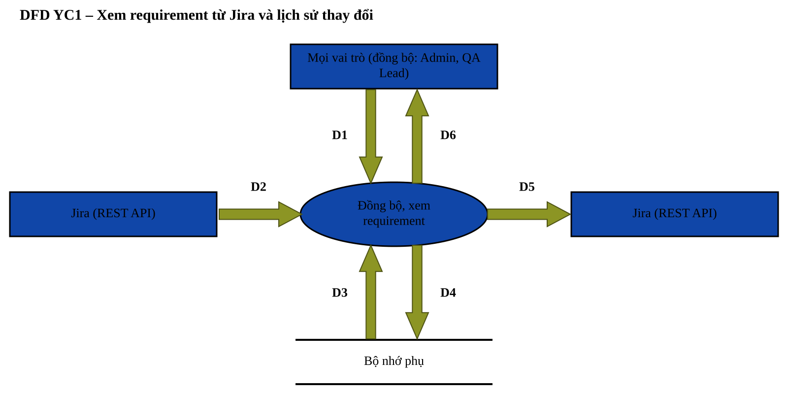

*Biểu mẫu:* BM1 · *Quy định:* QĐ1 · *File:* `docs/dfd/YC01_DongBoRequirement.drawio`

| Luồng | Mô tả |
|---|---|
| D1 | Dự án cần đồng bộ (thao tác Đồng bộ ngay); hoặc requirement cần xem, phiên bản cần so sánh. |
| D2 | Từ Jira: các issue thuộc loại JIRA_ISSUE_TYPES của dự án – issue ID, mã, Summary, Description (có mục "Acceptance criteria"), Priority, loại issue, component, trạng thái, thời điểm cập nhật (updated). |
| D3 | Mã Jira của dự án; requirement đã có (theo issue ID) cùng thời điểm cập nhật Jira đã lưu và phiên bản hiện tại; module của dự án. |
| D4 | Requirement mới (BM1, phiên bản 1) hoặc cập nhật; phiên bản mới khi tiêu đề, mô tả hoặc AC đổi; nhật ký đồng bộ; nhật ký hoạt động. |
| D5 | Yêu cầu tìm issue theo loại của dự án gửi Jira REST API, kèm thông tin xác thực đọc từ .env. |
| D6 | Danh sách requirement kèm trạng thái đồng bộ (Bình thường, Thiếu AC, Cần kiểm tra, Đã lưu trữ); chi tiết, lịch sử phiên bản và so sánh trước/sau; hoặc thông báo lỗi. |

**Thuật toán:**

- B1: Nhận D1 từ người dùng.
- B2: Kết nối cơ sở dữ liệu.
- B3: Đọc D3 từ bộ nhớ phụ.
- B4: Đồng bộ: kiểm tra người dùng có vai trò Admin hoặc QA Lead và dự án đã liên kết Jira? Nếu không thỏa: ghi thông báo lỗi vào D6, chuyển tới B11.
- B5: Xuất D5 đến Jira, nhận D2 (lấy hết các trang); lỗi kết nối thì thử lại tối đa 2 lần.
- B6: Với từng issue: nhận diện requirement bằng issue ID; chỉ ghi khi thời điểm cập nhật trên Jira mới hơn bản đã lưu.
- B7: Tách Description: phần trước nhãn "Acceptance criteria" là mô tả, mỗi dòng sau là một AC; đổi Priority về High / Medium / Low.
- B8: Tiêu đề, mô tả hoặc AC đổi thì tạo phiên bản mới, không xóa phiên bản cũ; đổi ưu tiên, trạng thái Jira chỉ cập nhật giá trị hiện tại.
- B9: Requirement không có AC được đánh dấu Thiếu AC.
- B10: Lưu D4 xuống bộ nhớ phụ.
- B11: Xuất D6 cho người dùng.
- B12: Đóng kết nối cơ sở dữ liệu.
- B13: Kết thúc.

### 3.4.3. DFD YC2 – Sinh test case bằng AI

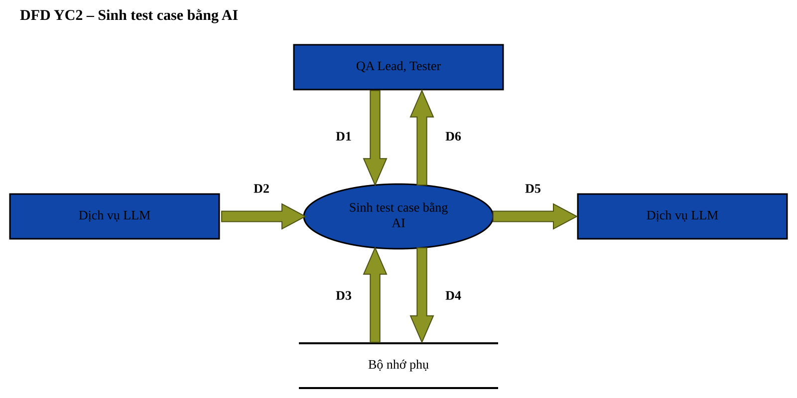

*Biểu mẫu:* BM2 · *Quy định:* QĐ2 · *File:* `docs/dfd/YC02_SinhTestCaseBangAI.drawio`

| Luồng | Mô tả |
|---|---|
| D1 | Requirement cần sinh test case. |
| D2 | Chuỗi JSON danh sách test case do LLM trả về, mỗi test có danh sách AC liên quan (ac_refs). |
| D3 | Nội dung requirement (tiêu đề, mô tả, AC đánh số); trạng thái lưu trữ, Cần kiểm tra; số test hiện có; tham số MAX_TC_PER_STORY, MIN_AC_PER_STORY, AI_MAX_RETRY, AI_TIMEOUT_SEC, AI_CALLS_PER_HOUR; số lần gọi AI của người dùng trong 1 giờ. |
| D4 | Test case mới (nguồn AI, Nháp, phiên bản 1, phiên bản requirement đã liên kết) cùng liên kết AC; nhật ký AI (prompt đã che dữ liệu, kết quả gốc, số lần thử, cờ injection). |
| D5 | Prompt gửi LLM: vai trò QA, quy định QĐ2, requirement ĐÃ CHE dữ liệu nhạy cảm, AC được đánh số. |
| D6 | Danh sách test case Nháp vừa sinh kèm AC liên quan, số test bị bỏ do vượt giới hạn, cảnh báo prompt injection; hoặc thông báo lỗi. |

**Thuật toán:**

- B1: Nhận D1 từ người dùng.
- B2: Kết nối cơ sở dữ liệu.
- B3: Đọc D3 từ bộ nhớ phụ.
- B4: Kiểm tra số lần gọi AI trong 1 giờ < AI_CALLS_PER_HOUR (dùng chung cho YC2, YC15, YC17)? Nếu không thỏa: ghi thông báo lỗi vào D6, chuyển tới B11.
- B5: Kiểm tra requirement chưa lưu trữ, không Cần kiểm tra và có ít nhất MIN_AC_PER_STORY AC? Nếu không thỏa: ghi thông báo lỗi vào D6, chuyển tới B11.
- B6: Tính số test còn được sinh = MAX_TC_PER_STORY − số test hiện có. Kiểm tra số này > 0? Nếu không thỏa: ghi thông báo lỗi vào D6, chuyển tới B11.
- B7: Che dữ liệu nhạy cảm và đánh dấu nếu phát hiện prompt injection; ghép prompt, xuất D5 đến LLM, chờ tối đa AI_TIMEOUT_SEC giây.
- B8: Nhận D2. Nếu sai JSON schema (thiếu ac_refs, sai số bước…) thì gọi lại, tối đa AI_MAX_RETRY lần; quá số lần vẫn sai? Nếu không thỏa: ghi thông báo lỗi vào D6, chuyển tới B11.
- B9: Cắt danh sách theo số test còn được sinh; giữ nguyên bản nháp cũ (không thay thế); đổi ac_refs thành nội dung AC để liên kết.
- B10: Lưu D4 xuống bộ nhớ phụ.
- B11: Xuất D6 cho người dùng.
- B12: Đóng kết nối cơ sở dữ liệu.
- B13: Kết thúc.

### 3.4.4. DFD YC3 – Soạn thảo, gửi duyệt và xem lại test case

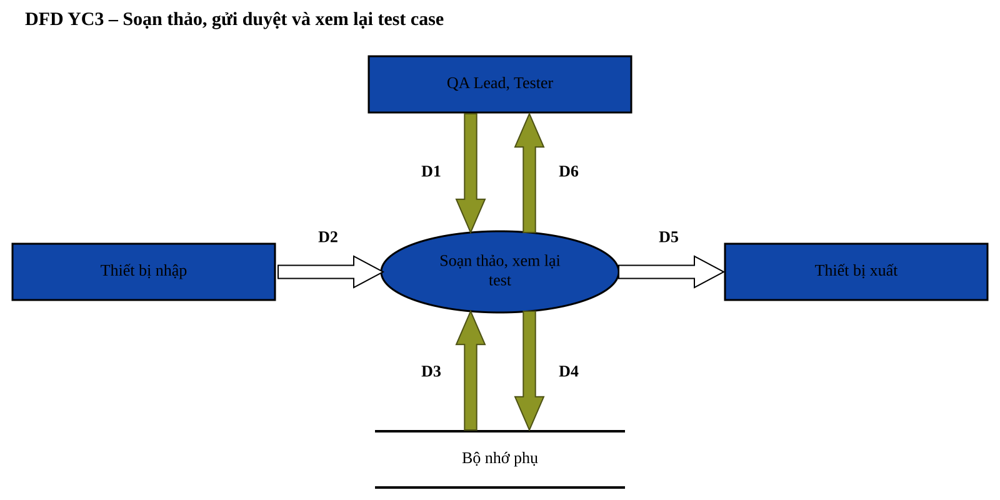

*Biểu mẫu:* BM2 · *Quy định:* QĐ3 · *File:* `docs/dfd/YC03_SoanThaoGuiDuyet.drawio`

| Luồng | Mô tả |
|---|---|
| D1 | Nội dung test case (BM2) và các AC liên kết; hoặc test cần gửi duyệt; hoặc test cần Đã xem lại kèm lý do (và AC gán lại). |
| D2 | Không có |
| D3 | Requirement và AC của phiên bản hiện tại; trạng thái, phiên bản, AC đã liên kết, cờ Cần xem lại của test; số test của requirement; lần chạy của test; tham số MAX_TC_PER_STORY. |
| D4 | Test mới hoặc phiên bản mới (Nháp), liên kết AC, phiên bản requirement đã liên kết; trạng thái Chờ duyệt; nhật ký Đã xem lại (người, phiên bản requirement, lý do, thời điểm) và gỡ cờ; nhật ký hoạt động. |
| D5 | Không có |
| D6 | Thông báo lưu, gửi duyệt, Đã xem lại thành công; hoặc thông báo lỗi vi phạm QĐ2, QĐ3. |

**Thuật toán:**

- B1: Nhận D1 từ người dùng.
- B2: Kết nối cơ sở dữ liệu.
- B3: Đọc D3 từ bộ nhớ phụ.
- B4: Thêm: kiểm tra số test < MAX_TC_PER_STORY, có 1–15 bước và AC thuộc phiên bản hiện tại? Nếu không thỏa: ghi thông báo lỗi vào D6, chuyển tới B10.
- B5: Sửa: kiểm tra test không ở trạng thái Chờ duyệt? Sửa test Đã duyệt thì đưa về Nháp; phiên bản test + 1.
- B6: Gửi duyệt: kiểm tra test ở trạng thái Nháp hoặc Bị trả lại và đã liên kết ít nhất 1 AC? Nếu không thỏa: ghi thông báo lỗi vào D6, chuyển tới B10.
- B7: Xóa: kiểm tra test Nháp hoặc Bị trả lại và chưa có lần chạy nào? Nếu không thỏa: ghi thông báo lỗi vào D6, chuyển tới B10.
- B8: Đã xem lại: kiểm tra test đang có cờ Cần xem lại và có lý do? Gỡ cờ, nâng phiên bản requirement đã liên kết lên phiên bản hiện tại.
- B9: Lưu D4 xuống bộ nhớ phụ.
- B10: Xuất D6 cho người dùng.
- B11: Đóng kết nối cơ sở dữ liệu.
- B12: Kết thúc.

### 3.4.5. DFD YC4 – Duyệt test case

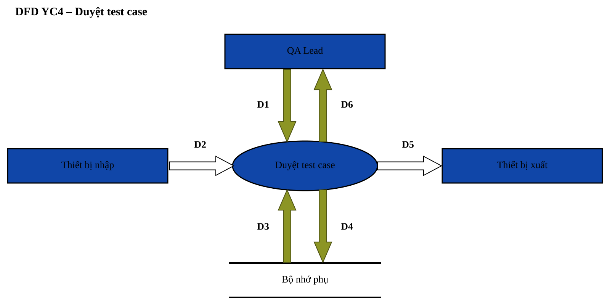

*Biểu mẫu:* BM3 · *Quy định:* QĐ4 · *File:* `docs/dfd/YC04_DuyetTestCase.drawio`

| Luồng | Mô tả |
|---|---|
| D1 | Test case, quyết định Duyệt / Trả lại, ghi chú (BM3). |
| D2 | Không có |
| D3 | Trạng thái hiện tại của test; phiên bản hiện tại của requirement; vai trò người duyệt. |
| D4 | Trạng thái mới; khi duyệt: gỡ cờ Cần xem lại và nâng phiên bản requirement đã liên kết; phiếu duyệt; nhật ký hoạt động. |
| D5 | Không có |
| D6 | Thông báo duyệt thành công kèm trạng thái mới, hoặc thông báo lỗi vi phạm QĐ4. |

**Thuật toán:**

- B1: Nhận D1 từ người dùng.
- B2: Kết nối cơ sở dữ liệu.
- B3: Đọc D3 từ bộ nhớ phụ.
- B4: Kiểm tra người duyệt có vai trò QA Lead? Nếu không thỏa: ghi thông báo lỗi vào D6, chuyển tới B8.
- B5: Kiểm tra test đang ở trạng thái Chờ duyệt (kể cả bản nháp tạo từ đề xuất AI)? Nếu không thỏa: ghi thông báo lỗi vào D6, chuyển tới B8.
- B6: Nếu quyết định là Trả lại: kiểm tra có ghi chú? Nếu không thỏa: ghi thông báo lỗi vào D6, chuyển tới B8.
- B7: Lưu D4 xuống bộ nhớ phụ.
- B8: Xuất D6 cho người dùng.
- B9: Đóng kết nối cơ sở dữ liệu.
- B10: Kết thúc.

### 3.4.6. DFD YC5 – Ghi nhận kết quả chạy test

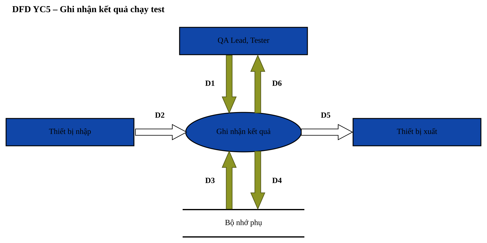

*Biểu mẫu:* BM4 · *Quy định:* QĐ5, QĐ18 · *File:* `docs/dfd/YC05_GhiKetQuaChayTest.drawio`

| Luồng | Mô tả |
|---|---|
| D1 | Test trong Test Run, kết quả Pass / Fail / Blocked, ghi chú, mã defect, liên kết bằng chứng (BM4). |
| D2 | Không có |
| D3 | Test Run (trạng thái, build, môi trường); test trong đợt (phiên bản cố định, người được giao); phiếu báo sửa đang chờ của test. |
| D4 | Lần chạy: kết quả, phiên bản test đã cố định, ghi chú, mã defect, bằng chứng, người chạy, thời điểm, lần Fail gốc (nếu là kiểm thử lại); trạng thái kiểm thử lại của phiếu báo sửa. |
| D5 | Không có |
| D6 | Thông báo ghi nhận thành công kèm cảnh báo (VD build khác build đã báo sửa), hoặc thông báo lỗi vi phạm QĐ5. |

**Thuật toán:**

- B1: Nhận D1 từ người dùng.
- B2: Kết nối cơ sở dữ liệu.
- B3: Đọc D3 từ bộ nhớ phụ.
- B4: Kiểm tra Test Run đang mở? Nếu không thỏa: ghi thông báo lỗi vào D6, chuyển tới B9.
- B5: Kiểm tra người ghi là người được giao hoặc QA Lead? Nếu không thỏa: ghi thông báo lỗi vào D6, chuyển tới B9.
- B6: Nếu kết quả là Fail hoặc Blocked: kiểm tra có ghi chú? Bằng chứng (nếu có) là đường dẫn? Nếu không thỏa: ghi thông báo lỗi vào D6, chuyển tới B9.
- B7: Nếu test đang chờ kiểm thử lại: gắn lần chạy với lần Fail gốc; Pass → Đã đóng, Fail → Mở lại, Blocked → vẫn chờ; build khác thì cảnh báo.
- B8: Lưu D4 xuống bộ nhớ phụ.
- B9: Xuất D6 cho người dùng.
- B10: Đóng kết nối cơ sở dữ liệu.
- B11: Kết thúc.

### 3.4.7. DFD YC6 – Lập báo cáo kiểm thử

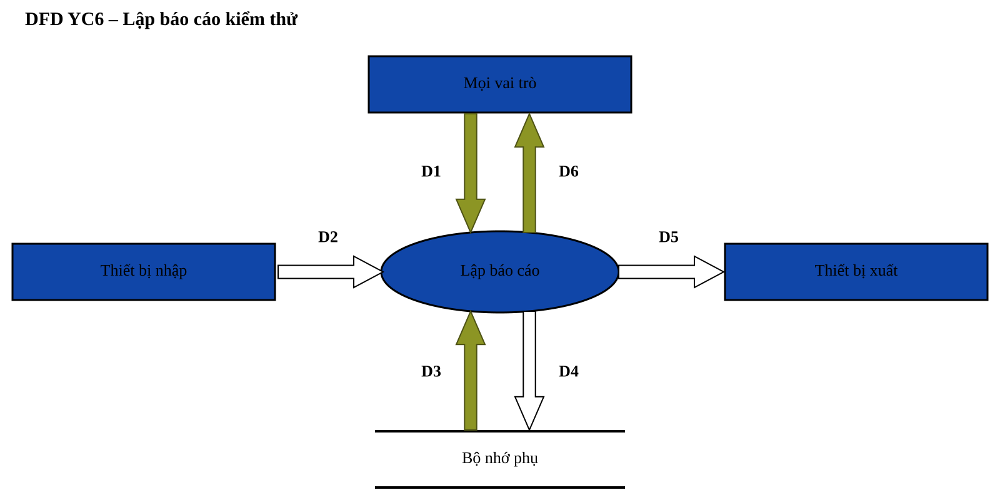

*Biểu mẫu:* BM5 · *Quy định:* QĐ6 · *File:* `docs/dfd/YC06_LapBaoCao.drawio`

| Luồng | Mô tả |
|---|---|
| D1 | Dự án hoặc Test Run cần xem báo cáo. |
| D2 | Không có |
| D3 | Requirement chưa lưu trữ và AC của phiên bản hiện tại; test Đã duyệt và liên kết AC; các lần chạy; đề xuất AI; nhật ký AI. |
| D4 | Không có |
| D5 | Không có |
| D6 | Báo cáo BM5: tỷ lệ pass, tiến độ thực thi, bao phủ requirement và bao phủ AC, kết quả theo module, xu hướng theo ngày, requirement và AC chưa được bao phủ, requirement Thiếu AC, số test cần xem lại, chờ kiểm thử lại, đề xuất AI, thống kê AI. |

**Thuật toán:**

- B1: Nhận D1 từ người dùng.
- B2: Kết nối cơ sở dữ liệu.
- B3: Đọc D3 từ bộ nhớ phụ.
- B4: Chọn Test Run: lấy lần chạy gần nhất của từng test trong đợt. Chọn dự án: chỉ tính lần chạy của phiên bản hiện tại của test Đã duyệt.
- B5: Tỷ lệ pass = Pass / số test đã chạy (Blocked tính là đã chạy, không tính Pass); tiến độ = số test đã chạy / số test trong phạm vi.
- B6: Bao phủ requirement = số requirement có test Đã duyệt / số requirement có AC (không gồm Thiếu AC); bao phủ AC tương tự theo từng AC.
- B7: Tỷ lệ AI phải sửa = số test nguồn AI có các bước hoặc kết quả mong đợi khác bản AI gốc / số test nguồn AI.
- B8: Xuất D6 cho người dùng.
- B9: Đóng kết nối cơ sở dữ liệu.
- B10: Kết thúc.

### 3.4.8. DFD YC7 – Tra cứu test case

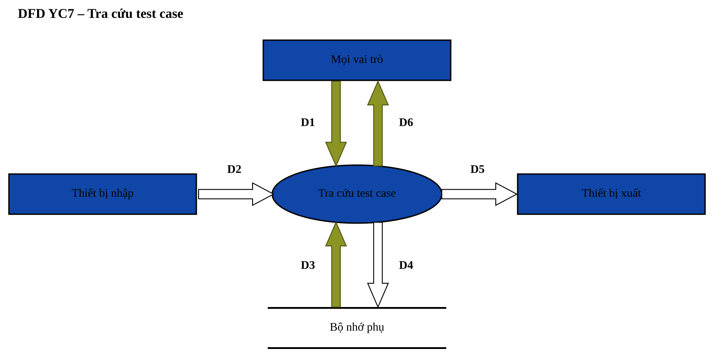

*Biểu mẫu:* BM6 · *Quy định:* QĐ7 · *File:* `docs/dfd/YC07_TraCuuTestCase.drawio`

| Luồng | Mô tả |
|---|---|
| D1 | Điều kiện tra cứu: từ khóa (mã / tiêu đề), dự án, module, trạng thái, độ ưu tiên, loại, nguồn, requirement, Test Suite, Test Run, cần xem lại, cần kiểm thử lại. |
| D2 | Không có |
| D3 | Các test thỏa điều kiện kèm requirement, phiên bản, cờ, suite và lần chạy của phiên bản hiện tại. |
| D4 | Không có |
| D5 | Không có |
| D6 | Danh sách test (BM6) sắp theo requirement mới nhất rồi theo mã test; "Kết quả gần nhất" là Chưa chạy nếu test vừa sửa. |

**Thuật toán:**

- B1: Nhận D1 từ người dùng.
- B2: Kết nối cơ sở dữ liệu.
- B3: Đọc D3 từ bộ nhớ phụ.
- B4: Ghép các điều kiện D1 theo AND thành câu truy vấn có tham số (không nối chuỗi SQL) trước khi đọc D3.
- B5: Kết quả gần nhất chỉ lấy lần chạy của phiên bản hiện tại của test (QĐ6, QĐ7).
- B6: Xuất D6 cho người dùng.
- B7: Đóng kết nối cơ sở dữ liệu.
- B8: Kết thúc.

### 3.4.9. DFD YC8 – Nhận thay đổi requirement từ Jira

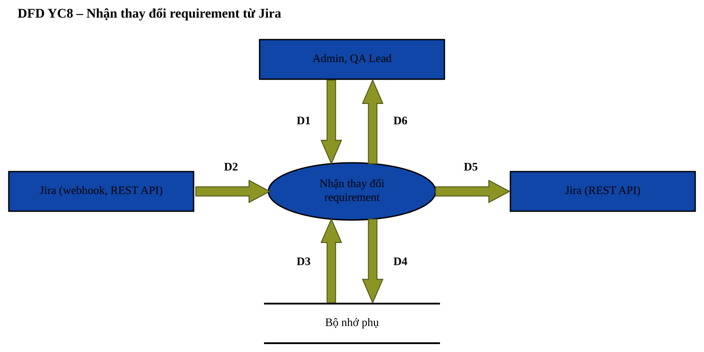

*Biểu mẫu:* BM7 · *Quy định:* QĐ8 · *File:* `docs/dfd/YC08_NhanThayDoiRequirement.drawio`

| Luồng | Mô tả |
|---|---|
| D1 | Thao tác Đồng bộ ngay; hoặc quyết định Lưu trữ / Giữ lại cho requirement Cần kiểm tra. |
| D2 | Từ Jira: sự kiện webhook kèm mã bí mật, hoặc lượt đồng bộ định kỳ; nội dung issue lấy lại qua REST API; kết quả hỏi lại từng issue ID. |
| D3 | JIRA_WEBHOOK_SECRET, JIRA_SYNC_MINUTES, JIRA_ISSUE_TYPES; requirement đã lưu (issue ID, thời điểm cập nhật Jira, nội dung, phiên bản); test và AC liên kết của requirement. |
| D4 | Phiên bản requirement mới; cờ Cần xem lại của test (lý do AC đổi / AC bị bỏ / tiêu đề, mô tả đổi); cờ Cần kiểm tra kèm lý do; quyết định Lưu trữ / Giữ lại; nhật ký đồng bộ (nguồn, thời điểm, kết quả, lỗi); nhật ký hoạt động. |
| D5 | Yêu cầu đọc issue qua Jira REST API (không dùng dữ liệu trong webhook); hỏi lại theo issue ID với requirement biến mất. |
| D6 | Kết quả đồng bộ (BM7): số requirement cập nhật, phiên bản mới, test bị gắn cờ, Cần kiểm tra; trạng thái và lỗi lần đồng bộ gần nhất; hoặc thông báo lỗi. |

**Thuật toán:**

- B1: Nhận D1 từ người dùng.
- B2: Nhận D2 từ thiết bị nhập.
- B3: Kết nối cơ sở dữ liệu.
- B4: Đọc D3 từ bộ nhớ phụ.
- B5: Webhook: kiểm tra đúng mã bí mật JIRA_WEBHOOK_SECRET và dự án đã được thêm vào hệ thống? Nếu không thỏa: ghi thông báo lỗi vào D6, chuyển tới B13.
- B6: Xuất D5, nhận D2 qua Jira API; lỗi thì thử lại tối đa 2 lần, vẫn lỗi thì ghi nhật ký đồng bộ thất bại và không thay đổi dữ liệu.
- B7: Với từng issue: chỉ ghi khi bản Jira mới hơn; nội dung đổi thì tạo phiên bản mới (như YC1).
- B8: AC đổi hoặc bị bỏ: gắn cờ Cần xem lại cho test liên kết với AC đó. Tiêu đề hoặc mô tả đổi: gắn cờ mọi test của requirement.
- B9: Requirement không còn trong kết quả (danh sách khác rỗng): hỏi Jira theo issue ID; 404 → "Jira báo không tìm thấy", khác loại → "Không còn thuộc loại được đồng bộ"; gắn cờ Cần kiểm tra, không tự lưu trữ.
- B10: Requirement Cần kiểm tra hoặc đã lưu trữ xuất hiện lại trên Jira thì tự gỡ cờ, tự hiện lại.
- B11: Quyết định: kiểm tra người dùng là Admin hoặc QA Lead và requirement đang Cần kiểm tra? Lưu trữ → ẩn requirement, giữ test; Giữ lại → chỉ ghi nhận, cờ vẫn giữ.
- B12: Lưu D4 xuống bộ nhớ phụ.
- B13: Xuất D6 cho người dùng.
- B14: Đóng kết nối cơ sở dữ liệu.
- B15: Kết thúc.

### 3.4.10. DFD YC9 – Xuất dữ liệu test case

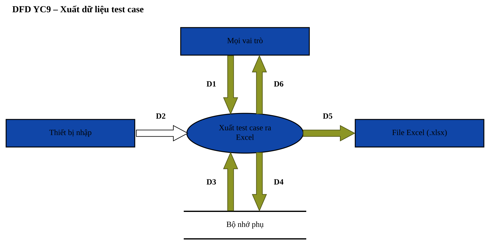

*Biểu mẫu:* BM8 · *Quy định:* QĐ9 · *File:* `docs/dfd/YC09_XuatTestCase.drawio`

| Luồng | Mô tả |
|---|---|
| D1 | Điều kiện lọc đang chọn ở màn hình tra cứu (như YC7). |
| D2 | Không có |
| D3 | Các test thỏa điều kiện kèm AC liên kết, suite, Test Run, phiên bản, cờ, kết quả gần nhất. |
| D4 | Nhật ký hoạt động (lần xuất). |
| D5 | File testcases.xlsx: mỗi test một dòng theo các cột của BM2 cùng kết quả gần nhất, requirement Jira, Test Suite, Test Run, phiên bản, cờ cần xem lại (BM8); dòng tiêu đề tô màu. |
| D6 | Trình duyệt tải file về, hoặc thông báo lỗi. |

**Thuật toán:**

- B1: Nhận D1 từ người dùng.
- B2: Kết nối cơ sở dữ liệu.
- B3: Đọc D3 từ bộ nhớ phụ.
- B4: Ghi từng test thành một dòng Excel; các bước và AC xuống dòng trong ô.
- B5: Lưu D4 xuống bộ nhớ phụ.
- B6: Xuất D5 ra thiết bị xuất.
- B7: Xuất D6 cho người dùng.
- B8: Đóng kết nối cơ sở dữ liệu.
- B9: Kết thúc.

### 3.4.11. DFD YC10 – Thay đổi quy định hệ thống

*Biểu mẫu:* BM9 · *Quy định:* QĐ10 · *File:* `docs/dfd/YC10_ThayDoiQuyDinh.drawio`

| Luồng | Mô tả |
|---|---|
| D1 | Tham số cần thay đổi, giá trị mới. |
| D2 | Không có |
| D3 | Giá trị hiện tại và miền giá trị cho phép của tham số; vai trò người sửa. |
| D4 | Giá trị mới, người sửa, thời điểm sửa; nhật ký hoạt động. |
| D5 | Không có |
| D6 | Thông báo thay đổi thành công (giá trị cũ → mới), hoặc thông báo giá trị ngoài miền cho phép. |

**Thuật toán:**

- B1: Nhận D1 từ người dùng.
- B2: Kết nối cơ sở dữ liệu.
- B3: Đọc D3 từ bộ nhớ phụ.
- B4: Kiểm tra người sửa có vai trò Admin hoặc QA Lead? Nếu không thỏa: ghi thông báo lỗi vào D6, chuyển tới B8.
- B5: Kiểm tra tham số thuộc BM9 (độ ưu tiên, nhãn "Acceptance criteria" và cấu hình Jira không sửa được trên giao diện)? Nếu không thỏa: ghi thông báo lỗi vào D6, chuyển tới B8.
- B6: Kiểm tra giá trị mới là số nguyên thuộc miền giá trị cho phép (QĐ10)? Nếu không thỏa: ghi thông báo lỗi vào D6, chuyển tới B8.
- B7: Lưu D4 xuống bộ nhớ phụ.
- B8: Xuất D6 cho người dùng.
- B9: Đóng kết nối cơ sở dữ liệu.
- B10: Kết thúc.

### 3.4.12. DFD YC11 – Quản lý người dùng

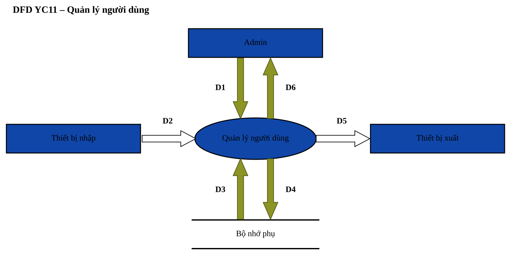

*Biểu mẫu:* BM10 · *Quy định:* QĐ11 · *File:* `docs/dfd/YC11_QuanLyNguoiDung.drawio`

| Luồng | Mô tả |
|---|---|
| D1 | Thông tin tài khoản (BM10): tên đăng nhập, họ tên, email, vai trò, mật khẩu; thao tác thêm, cập nhật, đổi vai trò, khóa / mở khóa. |
| D2 | Không có |
| D3 | Danh sách tên đăng nhập đã có; tài khoản đang đăng nhập. |
| D4 | Tài khoản (mật khẩu ĐÃ BĂM bcrypt); nhật ký hoạt động. |
| D5 | Không có |
| D6 | Thông báo lưu thành công (không chứa mật khẩu băm), hoặc thông báo lỗi vi phạm QĐ11. |

**Thuật toán:**

- B1: Nhận D1 từ người dùng.
- B2: Kết nối cơ sở dữ liệu.
- B3: Đọc D3 từ bộ nhớ phụ.
- B4: Kiểm tra người thực hiện có vai trò Admin? Nếu không thỏa: ghi thông báo lỗi vào D6, chuyển tới B9.
- B5: Kiểm tra tên đăng nhập 3–30 ký tự a-z 0-9 _ . và không trùng; mật khẩu ≥ 8 ký tự? Nếu không thỏa: ghi thông báo lỗi vào D6, chuyển tới B9.
- B6: Kiểm tra Admin không tự khóa hoặc tự hạ quyền chính mình? Nếu không thỏa: ghi thông báo lỗi vào D6, chuyển tới B9.
- B7: Băm mật khẩu bằng bcrypt.
- B8: Lưu D4 xuống bộ nhớ phụ.
- B9: Xuất D6 cho người dùng.
- B10: Đóng kết nối cơ sở dữ liệu.
- B11: Kết thúc.

### 3.4.13. DFD YC12 – Đồng bộ dự án từ Jira

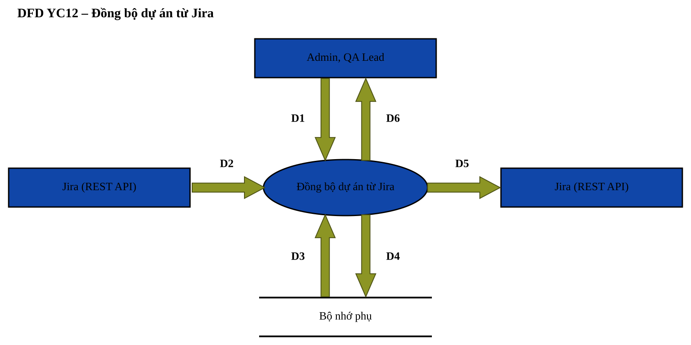

*Biểu mẫu:* BM11 · *Quy định:* QĐ12 · *File:* `docs/dfd/YC12_DongBoDuAnJira.drawio`

| Luồng | Mô tả |
|---|---|
| D1 | Thao tác Kiểm tra kết nối, hoặc mã dự án trên Jira cần thêm, hoặc thao tác Đồng bộ lại (BM11). |
| D2 | Từ Jira: kết quả xác thực; tên, mô tả dự án; component (module); thành viên (tên, email). |
| D3 | Mã dự án đã có; tài khoản đang hoạt động (email, họ tên) để gán thành viên. |
| D4 | Dự án (mã, tên, mô tả, mã Jira, thời điểm đồng bộ), module, thành viên dự án; requirement của dự án (như YC1); nhật ký hoạt động. |
| D5 | Yêu cầu gửi Jira REST API kèm thông tin xác thực đọc từ .env. |
| D6 | Kết quả kiểm tra kết nối; hoặc dự án vừa thêm kèm số module, số thành viên, thành viên chưa có tài khoản; hoặc thông báo lỗi. |

**Thuật toán:**

- B1: Nhận D1 từ người dùng.
- B2: Kết nối cơ sở dữ liệu.
- B3: Đọc D3 từ bộ nhớ phụ.
- B4: Kiểm tra quyền: kiểm tra kết nối chỉ Admin; thêm dự án, đồng bộ lại: Admin hoặc QA Lead? Nếu không thỏa: ghi thông báo lỗi vào D6, chuyển tới B11.
- B5: Kiểm tra kết nối: xuất D5, nhận D2; nếu chỉ kiểm tra kết nối thì chuyển tới bước Xuất D6.
- B6: Kiểm tra mã dự án 2–10 ký tự in hoa hoặc số, bắt đầu bằng chữ cái và chưa có trong hệ thống? Nếu không thỏa: ghi thông báo lỗi vào D6, chuyển tới B11.
- B7: Xuất D5 (lấy dự án, component, thành viên) đến Jira, nhận D2. Kiểm tra dự án có trên Jira? Nếu không thỏa: ghi thông báo lỗi vào D6, chuyển tới B11.
- B8: Gán thành viên theo email trùng; Jira ẩn email thì so họ tên, nhiều tài khoản trùng họ tên thì không gán. Thành viên chỉ để hiển thị và phân công, không cấp quyền.
- B9: Đồng bộ requirement của dự án vừa thêm (YC1).
- B10: Lưu D4 xuống bộ nhớ phụ.
- B11: Xuất D6 cho người dùng.
- B12: Đóng kết nối cơ sở dữ liệu.
- B13: Kết thúc.

### 3.4.14. DFD YC13 – Quản lý Test Suite

*Biểu mẫu:* BM12 · *Quy định:* QĐ13 · *File:* `docs/dfd/YC13_QuanLyTestSuite.drawio`

| Luồng | Mô tả |
|---|---|
| D1 | Thông tin suite (dự án, tên, mô tả); thao tác tạo, sửa, xóa; test cần thêm hoặc bớt. |
| D2 | Không có |
| D3 | Tên các suite của dự án; dự án của các test cần thêm. |
| D4 | Suite (tên, mô tả, người tạo, ngày tạo); danh sách test của suite; nhật ký hoạt động. |
| D5 | Không có |
| D6 | Suite sau khi lưu kèm danh sách test; hoặc thông báo lỗi vi phạm QĐ13. |

**Thuật toán:**

- B1: Nhận D1 từ người dùng.
- B2: Kết nối cơ sở dữ liệu.
- B3: Đọc D3 từ bộ nhớ phụ.
- B4: Kiểm tra người dùng có vai trò QA Lead hoặc Tester? Nếu không thỏa: ghi thông báo lỗi vào D6, chuyển tới B9.
- B5: Kiểm tra tên suite 3–100 ký tự và không trùng tên suite khác trong dự án? Nếu không thỏa: ghi thông báo lỗi vào D6, chuyển tới B9.
- B6: Thêm test: kiểm tra test cùng dự án với suite? (một test thuộc được nhiều suite)
- B7: Xóa suite: chỉ xóa suite và danh sách thuộc suite, không xóa test.
- B8: Lưu D4 xuống bộ nhớ phụ.
- B9: Xuất D6 cho người dùng.
- B10: Đóng kết nối cơ sở dữ liệu.
- B11: Kết thúc.

### 3.4.15. DFD YC14 – Lập Test Run và phân công

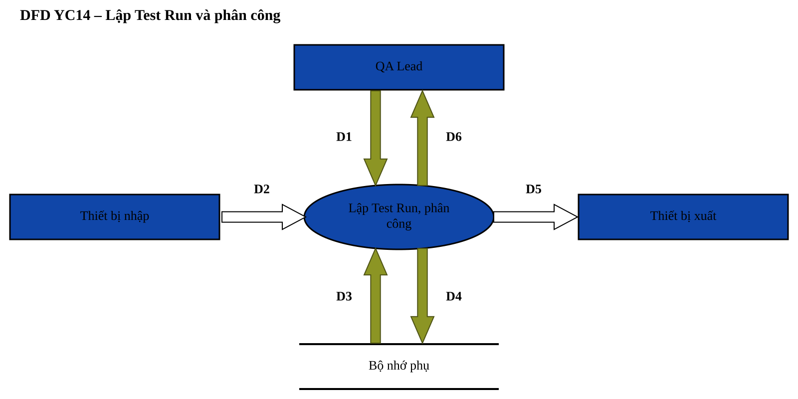

*Biểu mẫu:* BM13 · *Quy định:* QĐ14 · *File:* `docs/dfd/YC14_LapTestRun.drawio`

| Luồng | Mô tả |
|---|---|
| D1 | Thông tin đợt (BM13): dự án, tên, loại, build, môi trường, hạn; suite hoặc test được chọn; người được giao; hoặc thao tác sửa đợt, thêm/bỏ test, phân công lại, đóng đợt (kèm xác nhận). |
| D2 | Không có |
| D3 | Trạng thái, phiên bản, cờ của test; trạng thái lưu trữ, Cần kiểm tra của requirement; vai trò người được giao; các lần chạy đã có trong đợt. |
| D4 | Test Run; các test trong đợt với phiên bản cố định và người được giao; build, môi trường mới; trạng thái Đã đóng; nhật ký hoạt động. |
| D5 | Không có |
| D6 | Đợt vừa lập kèm danh sách test bị bỏ qua và lý do; tiến độ, cảnh báo (test có phiên bản mới, requirement đổi); hoặc thông báo lỗi vi phạm QĐ14. |

**Thuật toán:**

- B1: Nhận D1 từ người dùng.
- B2: Kết nối cơ sở dữ liệu.
- B3: Đọc D3 từ bộ nhớ phụ.
- B4: Kiểm tra người dùng có vai trò QA Lead và đã nhập build, môi trường? Nếu không thỏa: ghi thông báo lỗi vào D6, chuyển tới B12.
- B5: Kiểm tra người được giao là QA Lead hoặc Tester? Nếu không thỏa: ghi thông báo lỗi vào D6, chuyển tới B12.
- B6: Với từng test: kiểm tra điều kiện chạy – Đã duyệt, không có cờ Cần xem lại, requirement không lưu trữ hoặc Cần kiểm tra. Test không đủ điều kiện bị bỏ qua kèm lý do. Kiểm tra còn ít nhất 1 test đủ điều kiện? Nếu không thỏa: ghi thông báo lỗi vào D6, chuyển tới B12.
- B7: Cố định phiên bản hiện tại của từng test khi đưa vào đợt.
- B8: Sửa build hoặc môi trường: kiểm tra đợt chưa có kết quả nào? Nếu không thỏa: ghi thông báo lỗi vào D6, chuyển tới B12.
- B9: Bỏ test khỏi đợt: kiểm tra test chưa có kết quả trong đợt? Nếu không thỏa: ghi thông báo lỗi vào D6, chuyển tới B12.
- B10: Đóng đợt: còn test chưa chạy thì kiểm tra người dùng đã xác nhận? Nếu không thỏa: ghi thông báo lỗi vào D6, chuyển tới B12.
- B11: Lưu D4 xuống bộ nhớ phụ.
- B12: Xuất D6 cho người dùng.
- B13: Đóng kết nối cơ sở dữ liệu.
- B14: Kết thúc.

### 3.4.16. DFD YC15 – AI phân tích ảnh hưởng

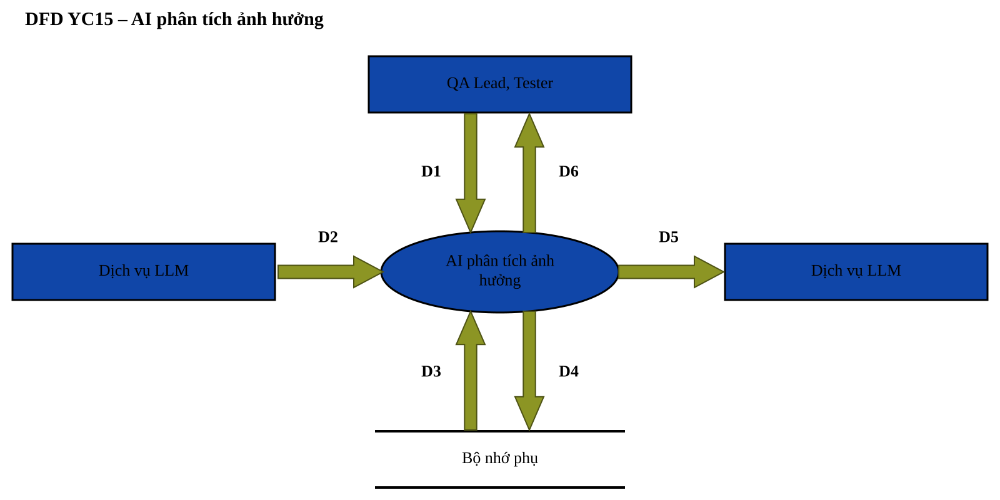

*Biểu mẫu:* BM14 · *Quy định:* QĐ15 · *File:* `docs/dfd/YC15_PhanTichAnhHuong.drawio`

| Luồng | Mô tả |
|---|---|
| D1 | Requirement đã đổi cần phân tích. |
| D2 | Chuỗi JSON danh sách đề xuất: loại, test liên quan, phần thay đổi nguồn (AC / tiêu đề / mô tả), lý do, nội dung test đề xuất. |
| D3 | Các phiên bản requirement; test của requirement kèm AC liên kết và phiên bản requirement đã liên kết; tham số AI; số lần gọi AI của người dùng trong 1 giờ. |
| D4 | Lần phân tích (mốc so, phiên bản hiện tại); các đề xuất (trạng thái Chờ xử lý, phiên bản requirement và test lúc phân tích); nhật ký AI. |
| D5 | Prompt gửi LLM: hai phiên bản requirement và các test, ĐÃ CHE dữ liệu nhạy cảm; quy tắc chỉ xét thay đổi sau phiên bản test đã liên kết. |
| D6 | Danh sách đề xuất (BM14); hoặc thông báo lỗi (requirement chỉ có 1 phiên bản, mọi test đã được xem lại, hết hạn mức AI, AI lỗi). |

**Thuật toán:**

- B1: Nhận D1 từ người dùng.
- B2: Kết nối cơ sở dữ liệu.
- B3: Đọc D3 từ bộ nhớ phụ.
- B4: Kiểm tra số lần gọi AI trong 1 giờ < AI_CALLS_PER_HOUR? Nếu không thỏa: ghi thông báo lỗi vào D6, chuyển tới B11.
- B5: Kiểm tra requirement chưa lưu trữ và có ít nhất 2 phiên bản? Nếu không thỏa: ghi thông báo lỗi vào D6, chuyển tới B11.
- B6: Xác định mốc so = phiên bản cũ nhất mà các test đã liên kết (chưa có test thì phiên bản liền trước). Kiểm tra mốc so cũ hơn phiên bản hiện tại? Nếu không thỏa: ghi thông báo lỗi vào D6, chuyển tới B11.
- B7: Với từng test, tính các thay đổi xảy ra sau phiên bản mà test đó đã liên kết.
- B8: Che dữ liệu, xuất D5 đến LLM, nhận D2; sai schema thì gọi lại tối đa AI_MAX_RETRY lần; quá số lần vẫn sai? Nếu không thỏa: ghi thông báo lỗi vào D6, chuyển tới B11.
- B9: Bỏ đề xuất trỏ tới test không thuộc requirement; mỗi đề xuất phải có loại, lý do và phần thay đổi nguồn. Phân tích không tự đổi test.
- B10: Lưu D4 xuống bộ nhớ phụ.
- B11: Xuất D6 cho người dùng.
- B12: Đóng kết nối cơ sở dữ liệu.
- B13: Kết thúc.

### 3.4.17. DFD YC16 – Rà soát và áp dụng đề xuất AI

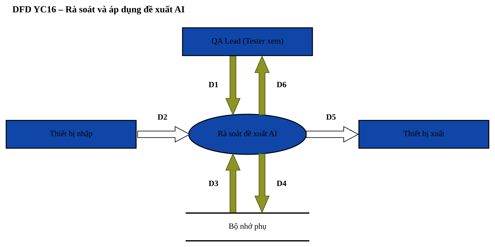

*Biểu mẫu:* BM15 · *Quy định:* QĐ16 · *File:* `docs/dfd/YC16_RaSoatDeXuat.drawio`

| Luồng | Mô tả |
|---|---|
| D1 | Đề xuất được chọn, quyết định Chấp nhận / Từ chối, ghi chú (BM15). |
| D2 | Không có |
| D3 | Đề xuất (loại, test liên quan, nội dung đề xuất, phiên bản requirement và test lúc phân tích); phiên bản hiện tại của requirement và test; số test của requirement; bộ regression đang lập của cùng thay đổi. |
| D4 | Trạng thái đề xuất (Đã chấp nhận / Đã từ chối / Lỗi thời), người quyết định, ngày, ghi chú; bản nháp test mới hoặc phiên bản Nháp mới ghi mã đề xuất; test thêm vào bộ regression; nhật ký hoạt động. |
| D5 | Không có |
| D6 | Đề xuất sau khi quyết định kèm test nháp vừa tạo (phải qua duyệt YC4); hoặc thông báo lỗi (Lỗi thời, thiếu ghi chú, vượt giới hạn test). |

**Thuật toán:**

- B1: Nhận D1 từ người dùng.
- B2: Kết nối cơ sở dữ liệu.
- B3: Đọc D3 từ bộ nhớ phụ.
- B4: Kiểm tra người quyết định có vai trò QA Lead và đề xuất đang Chờ xử lý? Nếu không thỏa: ghi thông báo lỗi vào D6, chuyển tới B10.
- B5: Từ chối: kiểm tra có ghi chú? Nếu không thỏa: ghi thông báo lỗi vào D6, chuyển tới B10.
- B6: Chấp nhận: kiểm tra phiên bản requirement và test chưa đổi so với lúc phân tích? Đã đổi thì chuyển đề xuất sang Lỗi thời.
- B7: Cần sửa: sửa test theo đề xuất, test về Nháp như khi sửa thủ công. Còn thiếu: kiểm tra số test < MAX_TC_PER_STORY? Tạo test nháp nguồn AI.
- B8: Nên chạy lại: thêm test vào bộ regression của cùng thay đổi (chưa có bộ thì tạo bộ). Cần làm rõ: chỉ ghi nhận để trao đổi với PO/BA.
- B9: Lưu D4 xuống bộ nhớ phụ.
- B10: Xuất D6 cho người dùng.
- B11: Đóng kết nối cơ sở dữ liệu.
- B12: Kết thúc.

### 3.4.18. DFD YC17 – AI đề xuất bộ regression

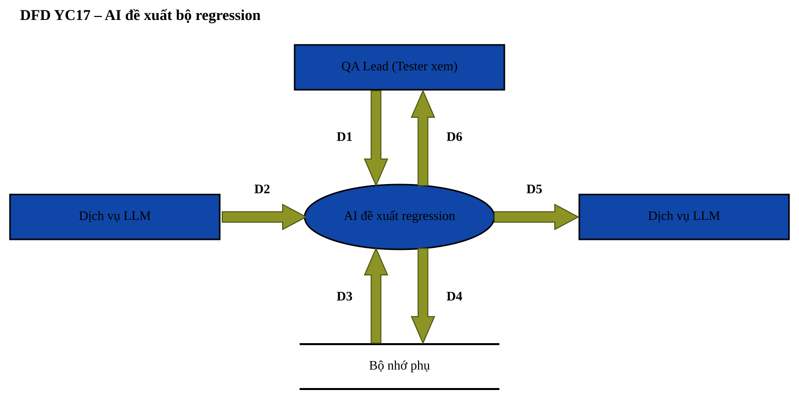

*Biểu mẫu:* BM16 · *Quy định:* QĐ17 · *File:* `docs/dfd/YC17_DeXuatRegression.drawio`

| Luồng | Mô tả |
|---|---|
| D1 | Requirement đã đổi; test cần thêm, bỏ (kèm lý do); thao tác xác nhận kèm tên đợt, build, môi trường, người được giao. |
| D2 | Chuỗi JSON: mức ưu tiên và lý do cho từng test, các test gợi ý thêm. |
| D3 | Hai phiên bản requirement của thay đổi; test liên kết với AC đã đổi (hoặc mọi test nếu tiêu đề, mô tả đổi); test đã duyệt khác của dự án; điều kiện chạy của từng test. |
| D4 | Bộ regression (Nháp / Đã xác nhận) và từng test: ưu tiên, lý do, nguồn, bắt buộc, đã bỏ, lý do bỏ; Test Run loại Regression khi xác nhận; nhật ký AI. |
| D5 | Prompt gửi LLM: requirement hiện tại, các test bắt buộc và test ứng viên, ĐÃ CHE dữ liệu nhạy cảm. |
| D6 | Bộ regression (BM16) kèm danh sách test chưa đủ điều kiện chạy; Test Run vừa tạo; hoặc thông báo lỗi vi phạm QĐ17. |

**Thuật toán:**

- B1: Nhận D1 từ người dùng.
- B2: Kết nối cơ sở dữ liệu.
- B3: Đọc D3 từ bộ nhớ phụ.
- B4: Lập bộ: kiểm tra số lần gọi AI trong 1 giờ < AI_CALLS_PER_HOUR và requirement có thay đổi chưa có bộ regression được xác nhận? Nếu không thỏa: ghi thông báo lỗi vào D6, chuyển tới B11.
- B5: Lấy phần bắt buộc: test liên kết với AC đã đổi; tiêu đề hoặc mô tả đổi thì mọi test của requirement.
- B6: Xuất D5 đến LLM, nhận D2 (xếp ưu tiên, gợi ý thêm). Không gọi được AI thì vẫn đưa ra danh sách test liên kết.
- B7: Bỏ test thuộc phần bắt buộc: kiểm tra có lý do? Nếu không thỏa: ghi thông báo lỗi vào D6, chuyển tới B11.
- B8: Xác nhận: kiểm tra người dùng là QA Lead và không còn test chưa đủ điều kiện chạy trong bộ (QĐ14)? Nếu không thỏa: ghi thông báo lỗi vào D6, chuyển tới B11.
- B9: Tạo Test Run loại Regression theo YC14 với các test còn trong bộ.
- B10: Lưu D4 xuống bộ nhớ phụ.
- B11: Xuất D6 cho người dùng.
- B12: Đóng kết nối cơ sở dữ liệu.
- B13: Kết thúc.

### 3.4.19. DFD YC18 – Báo đã sửa lỗi và kiểm thử lại

*Biểu mẫu:* BM17 · *Quy định:* QĐ18 · *File:* `docs/dfd/YC18_BaoSuaLoiKiemThuLai.drawio`

| Luồng | Mô tả |
|---|---|
| D1 | Lần chạy Fail được chọn, bản build đã sửa, ghi chú cho Tester (BM17); hoặc các phiếu chờ kiểm thử lại cần lập đợt, môi trường. |
| D2 | Không có |
| D3 | Kết quả của lần chạy; lần chạy gần nhất của test trong cùng Test Run; phiếu báo sửa đã có; Test Run chứa lần Fail (trạng thái, build). |
| D4 | Phiếu báo sửa (build, ghi chú, người báo, thời điểm, trạng thái Chờ kiểm thử lại); đợt Kiểm thử lại (theo YC14); nhật ký hoạt động. |
| D5 | Không có |
| D6 | Thông báo đã báo sửa và cách kiểm thử lại (chạy ngay trong đợt cũ nếu đợt còn mở và trùng build, ngược lại lập đợt Kiểm thử lại); hoặc thông báo lỗi vi phạm QĐ18. |

**Thuật toán:**

- B1: Nhận D1 từ người dùng.
- B2: Kết nối cơ sở dữ liệu.
- B3: Đọc D3 từ bộ nhớ phụ.
- B4: Kiểm tra người báo có vai trò Developer và đã nhập build (1–50 ký tự)? Nếu không thỏa: ghi thông báo lỗi vào D6, chuyển tới B9.
- B5: Kiểm tra lần chạy có kết quả Fail và là lần chạy gần nhất của test trong cùng Test Run? Nếu không thỏa: ghi thông báo lỗi vào D6, chuyển tới B9.
- B6: Kiểm tra lần chạy chưa được báo sửa? Nếu không thỏa: ghi thông báo lỗi vào D6, chuyển tới B9.
- B7: Lập đợt Kiểm thử lại: kiểm tra người dùng là QA Lead; build của đợt là build đã sửa. Kết quả chạy lại cập nhật phiếu ở YC5.
- B8: Lưu D4 xuống bộ nhớ phụ.
- B9: Xuất D6 cho người dùng.
- B10: Đóng kết nối cơ sở dữ liệu.
- B11: Kết thúc.

### 3.4.20. DFD phần mở rộng ngoài MVP

YC19 (sinh và chạy script Playwright) và YC20 (theo dõi sprint) không thuộc 18 yêu cầu MVP. Code vẫn giữ, ẩn bằng cờ `SCRIPT_ENABLED`, `SPRINT_ENABLED` (mặc định tắt); DFD dưới đây để tham khảo khi bật lại (hướng phát triển).

#### DFD YC19 – Sinh và chạy script kiểm thử tự động (mở rộng)

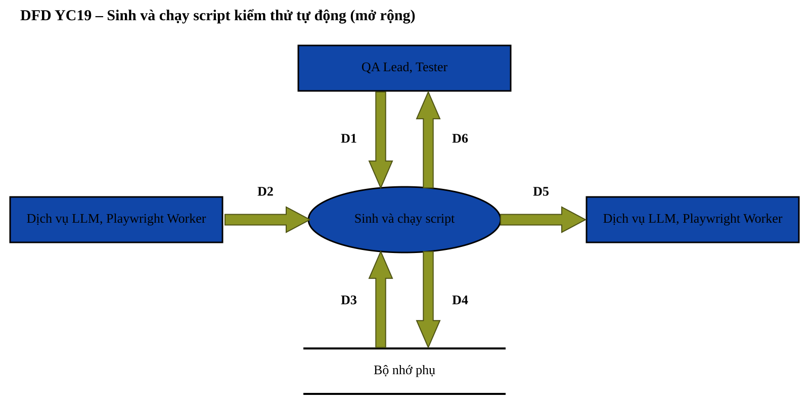

*Biểu mẫu:* BM18 · *Quy định:* QĐ19 · *File:* `docs/dfd/YC19_SinhVaChayScript.drawio`

| Luồng | Mô tả |
|---|---|
| D1 | Test case; yêu cầu sinh script hoặc chạy script; test trong Test Run để ghi kết quả; mã script đã sửa. |
| D2 | Từ LLM: mã script Playwright. Từ Playwright Worker: báo cáo chạy (JSON), log, ảnh chụp lỗi. |
| D3 | Test Đã duyệt, URL ứng dụng của dự án, script đang lưu; tham số RUN_TIMEOUT_SEC, AI_MAX_RETRY. |
| D4 | Script; lần chạy hình thức Tự động trong Test Run (kết quả, thời gian, log, ảnh lỗi); nhật ký AI. |
| D5 | Đến LLM: prompt đã che dữ liệu. Đến Playwright Worker: script đã qua kiểm tra tĩnh. |
| D6 | Mã script, kết quả Pass / Fail, log, ảnh chụp lỗi; hoặc thông báo lỗi vi phạm QĐ19. |

**Thuật toán:**

- B1: Nhận D1 từ người dùng.
- B2: Kết nối cơ sở dữ liệu.
- B3: Đọc D3 từ bộ nhớ phụ.
- B4: Kiểm tra bật cờ SCRIPT_ENABLED và test ở trạng thái Đã duyệt? Nếu không thỏa: ghi thông báo lỗi vào D6, chuyển tới B10.
- B5: Sinh script: xuất D5 (prompt) đến Dịch vụ LLM, nhận D2 (mã script).
- B6: Kiểm tra tĩnh script: không dùng module nguy hiểm, không truy cập process.env, không eval? Nếu không thỏa: ghi thông báo lỗi vào D6, chuyển tới B10.
- B7: Chạy script: kiểm tra đã chọn test trong một Test Run đang mở? Xuất D5 đến Playwright Worker, chờ tối đa RUN_TIMEOUT_SEC giây.
- B8: Xác định kết quả Pass / Fail và ghi như YC5.
- B9: Lưu D4 xuống bộ nhớ phụ.
- B10: Xuất D6 cho người dùng.
- B11: Đóng kết nối cơ sở dữ liệu.
- B12: Kết thúc.

#### DFD YC20 – Theo dõi sprint (mở rộng)

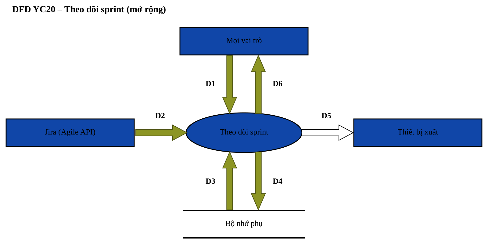

*Biểu mẫu:* BM19 · *Quy định:* QĐ20 · *File:* `docs/dfd/YC20_TheoDoiSprint.drawio`

| Luồng | Mô tả |
|---|---|
| D1 | Dự án và sprint cần xem. |
| D2 | Từ Jira (khi đồng bộ): các sprint của board dự án – tên, mục tiêu, ngày bắt đầu, ngày kết thúc, trạng thái. |
| D3 | Sprint đã đồng bộ; tham số SPRINT_MAX_DAYS; requirement của sprint, test Đã duyệt và kết quả chạy gần nhất. |
| D4 | Sprint mới hoặc cập nhật (BM19). |
| D5 | Không có |
| D6 | Bảng sprint theo trạng thái DoD, story point cam kết / hoàn thành (velocity), burndown; cảnh báo sprint chưa có ngày hoặc quá dài. |

**Thuật toán:**

- B1: Nhận D1 từ người dùng.
- B2: Kết nối cơ sở dữ liệu.
- B3: Đọc D3 từ bộ nhớ phụ.
- B4: Kiểm tra bật cờ SPRINT_ENABLED? Nếu không thỏa: ghi thông báo lỗi vào D6, chuyển tới B8.
- B5: Khi đồng bộ: bỏ qua sprint chưa có ngày (ghi cảnh báo); sprint dài hơn SPRINT_MAX_DAYS thì ghi cảnh báo.
- B6: Requirement đạt DoD: có ≥ 1 test Đã duyệt và mọi test Đã duyệt có lần chạy gần nhất là Pass; velocity = tổng story point đạt DoD.
- B7: Lưu D4 xuống bộ nhớ phụ.
- B8: Xuất D6 cho người dùng.
- B9: Đóng kết nối cơ sở dữ liệu.
- B10: Kết thúc.

### 3.4.21. Sơ đồ phối hợp giữa các công việc

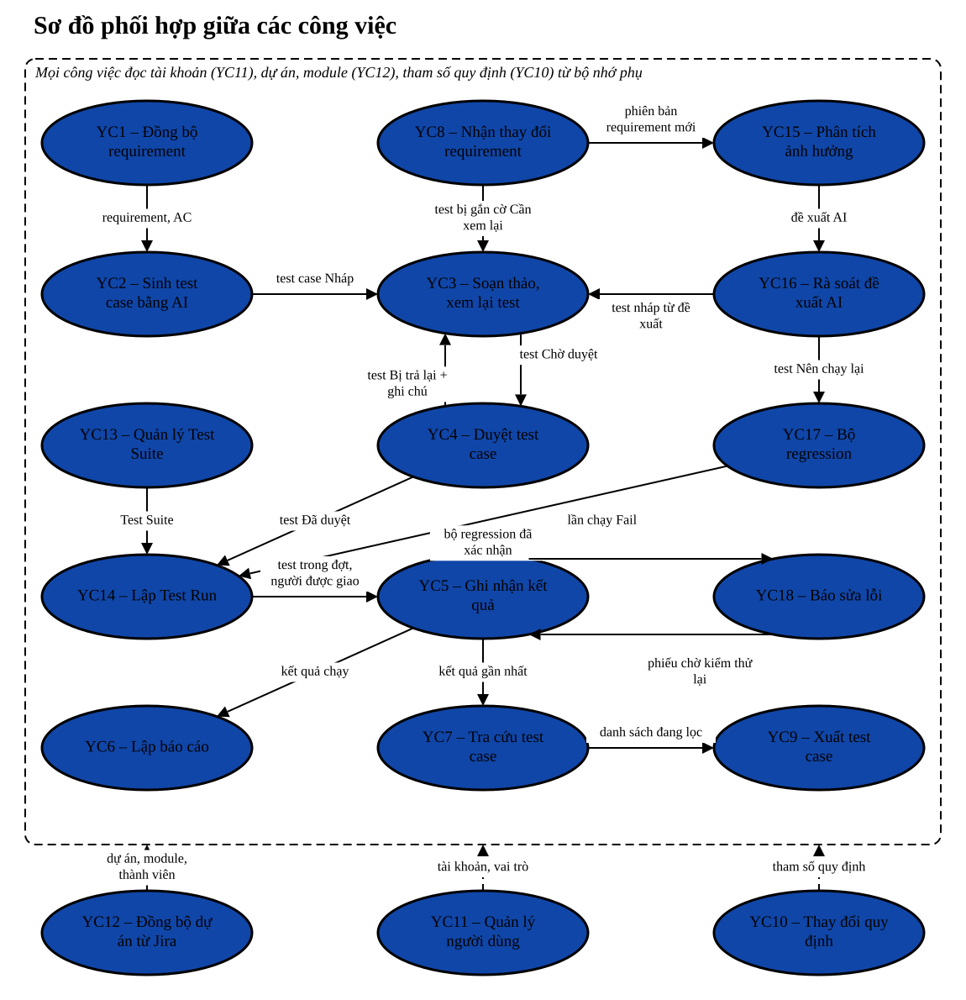

*File:* `docs/dfd/PhoiHop_CacCongViec.drawio`. Mỗi mũi tên là **thông tin** do công việc trước tạo ra (ghi xuống bộ nhớ phụ ở D4) và công việc sau sử dụng (đọc lên ở D3).

| Công việc trước | Thông tin chuyển giao | Công việc sau |
|---|---|---|
| YC1 – Đồng bộ requirement | requirement, AC | YC2 – Sinh test case bằng AI |
| YC8 – Nhận thay đổi requirement | test bị gắn cờ Cần xem lại | YC3 – Soạn thảo, xem lại test |
| YC8 – Nhận thay đổi requirement | phiên bản requirement mới | YC15 – Phân tích ảnh hưởng |
| YC15 – Phân tích ảnh hưởng | đề xuất AI | YC16 – Rà soát đề xuất AI |
| YC16 – Rà soát đề xuất AI | test nháp từ đề xuất | YC3 – Soạn thảo, xem lại test |
| YC16 – Rà soát đề xuất AI | test Nên chạy lại | YC17 – Bộ regression |
| YC2 – Sinh test case bằng AI | test case Nháp | YC3 – Soạn thảo, xem lại test |
| YC3 – Soạn thảo, xem lại test | test Chờ duyệt | YC4 – Duyệt test case |
| YC4 – Duyệt test case | test Bị trả lại + ghi chú | YC3 – Soạn thảo, xem lại test |
| YC4 – Duyệt test case | test Đã duyệt | YC14 – Lập Test Run |
| YC13 – Quản lý Test Suite | Test Suite | YC14 – Lập Test Run |
| YC17 – Bộ regression | bộ regression đã xác nhận | YC14 – Lập Test Run |
| YC14 – Lập Test Run | test trong đợt, người được giao | YC5 – Ghi nhận kết quả |
| YC5 – Ghi nhận kết quả | lần chạy Fail | YC18 – Báo sửa lỗi |
| YC18 – Báo sửa lỗi | phiếu chờ kiểm thử lại | YC5 – Ghi nhận kết quả |
| YC5 – Ghi nhận kết quả | kết quả chạy | YC6 – Lập báo cáo |
| YC5 – Ghi nhận kết quả | kết quả gần nhất | YC7 – Tra cứu test case |
| YC7 – Tra cứu test case | danh sách đang lọc | YC9 – Xuất test case |
| YC12 – Đồng bộ dự án từ Jira | dự án, module, thành viên | Mọi công việc |
| YC11 – Quản lý người dùng | tài khoản, vai trò | Mọi công việc |
| YC10 – Thay đổi quy định | tham số quy định | Mọi công việc |

<!-- DFD:END -->

## 3.5. Sơ đồ hoạt động

### 3.5.1. Quy trình nghiệp vụ mới

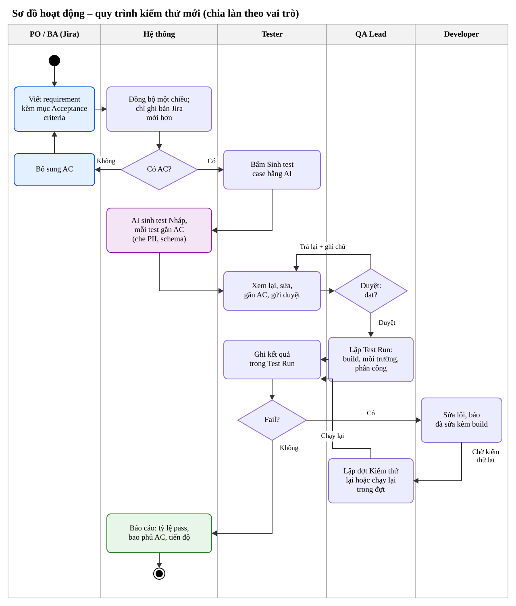

*File gốc:* `docs/sodo/HoatDong_QuyTrinhMoi.drawio` (mở bằng draw.io để sửa).

Sơ đồ chia **5 làn** theo vai trò; mỗi hoạt động nằm trong làn của người (hoặc hệ thống) thực hiện nó:

| Làn | Hoạt động chính | Yêu cầu liên quan |
|---|---|---|
| PO / BA (trên Jira) | Viết requirement kèm mục *Acceptance criteria*; bổ sung khi thiếu; sửa khi yêu cầu đổi | Ngoài hệ thống |
| Hệ thống | Đồng bộ requirement, tạo phiên bản; kiểm tra đủ AC; AI sinh test; gắn cờ Cần xem lại; tính tiến độ đợt và báo cáo | YC1, YC2, YC6, YC8 |
| Tester | Sinh test, sửa, gán AC, gửi duyệt; ghi kết quả trong Test Run; chạy lại sau khi Developer báo sửa | YC2, YC3, YC5 |
| QA Lead | Duyệt hoặc trả lại; gom Test Suite, lập Test Run, phân công, đóng đợt | YC4, YC13, YC14 |
| Developer | Sửa lỗi, báo đã sửa kèm bản build → Tester kiểm thử lại | YC18 |

So với quy trình cũ (Chương 1): requirement không phải chép tay từ Jira; mỗi lần đổi được lưu thành phiên bản và test liên quan tự được gắn cờ; AI rút ngắn bước viết nháp; duyệt có lưu vết; kết quả gắn với Test Run có build, môi trường và phiên bản test cố định; Developer báo đã sửa nên Tester biết ngay lần Fail nào cần kiểm thử lại; báo cáo tự động.

### 3.5.2. Xử lý khi requirement thay đổi (điểm mới của đề tài)

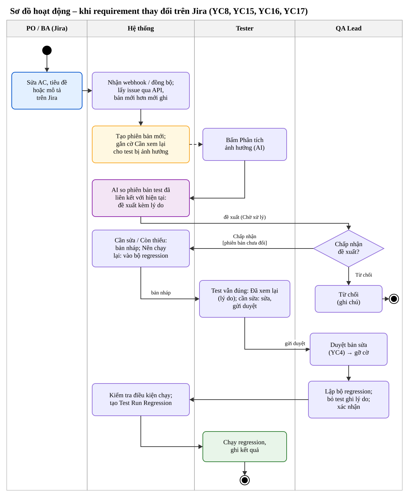

*File gốc:* `docs/sodo/HoatDong_ThayDoiRequirement.drawio`.

| Bước | Người thực hiện | Nội dung | Yêu cầu |
|---|---|---|---|
| 1 | PO/BA | Sửa tiêu đề, mô tả hoặc AC trên Jira | – |
| 2 | Hệ thống | Đồng bộ, chỉ ghi bản mới hơn; tạo phiên bản mới; gắn cờ Cần xem lại (AC đổi/bỏ → test liên kết AC đó; tiêu đề/mô tả đổi → mọi test) | YC8, QĐ3 |
| 3 | Tester | Chạy **Phân tích ảnh hưởng**: AI so mốc phiên bản test đã liên kết với phiên bản hiện tại | YC15 |
| 4 | QA Lead | Rà soát đề xuất: Cần sửa, Còn thiếu → bản nháp phải duyệt; Nên chạy lại → bộ regression; Cần làm rõ → trao đổi PO/BA | YC16 |
| 5 | Tester | Test vẫn đúng → **Đã xem lại** kèm lý do; test cần sửa → sửa, gửi duyệt | YC3, YC4 |
| 6 | QA Lead | Xác nhận bộ regression → tạo Test Run loại Regression | YC17, YC14 |
| 7 | Tester | Chạy regression, ghi kết quả | YC5 |

## 3.6. Sơ đồ trạng thái của test case

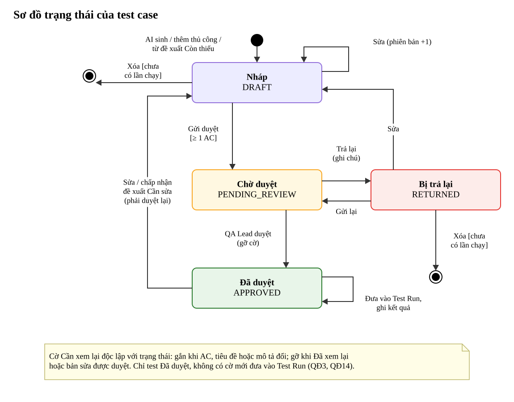

*File gốc:* `docs/sodo/TrangThai_TestCase.drawio`.

| Trạng thái | Ý nghĩa | Được phép |
|---|---|---|
| Nháp (`DRAFT`) | AI vừa sinh, Tester vừa thêm/sửa, hoặc tạo từ đề xuất AI | Sửa (phiên bản +1), gán AC, xóa (nếu chưa có lần chạy), gửi duyệt (cần ≥ 1 AC) |
| Chờ duyệt (`PENDING_REVIEW`) | Đã gửi, chờ QA Lead | Chỉ QA Lead duyệt / trả lại; không sửa, không xóa (QĐ3, QĐ4) |
| Bị trả lại (`RETURNED`) | QA Lead trả lại kèm ghi chú bắt buộc | Sửa (về Nháp), gửi lại, xóa (nếu chưa có lần chạy) |
| Đã duyệt (`APPROVED`) | Đạt chất lượng | Đưa vào Test Run nếu không có cờ Cần xem lại; sửa nội dung thì quay về Nháp và phải duyệt lại |

**Cờ Cần xem lại** (`needs_review`) độc lập với trạng thái: gắn khi AC liên kết đổi/bị bỏ (`AC_CHANGED`, `AC_REMOVED`) hoặc tiêu đề/mô tả đổi (`CONTENT_CHANGED`); gỡ khi **Đã xem lại** hoặc khi bản sửa được duyệt; lúc gỡ, `req_version` của test được nâng lên phiên bản hiện tại của requirement.

## 3.7. Sơ đồ trạng thái của requirement (đồng bộ từ Jira)

Requirement không có trạng thái do người dùng đổi tay, trừ quyết định Lưu trữ / Giữ lại cho requirement Cần kiểm tra.

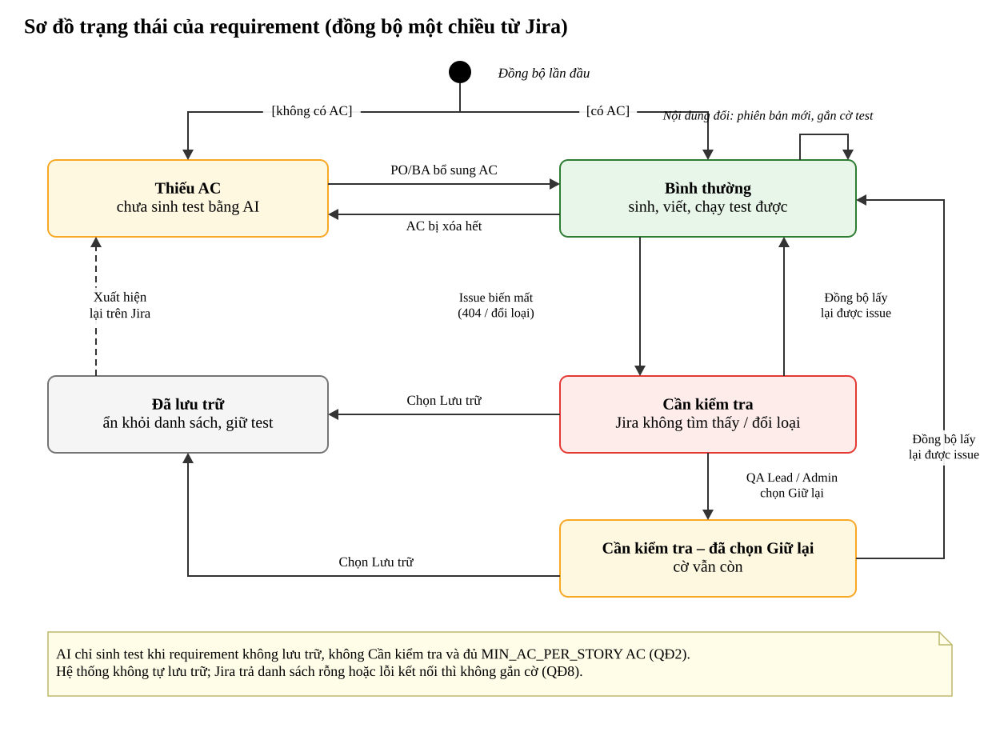

*File gốc:* `docs/sodo/TrangThai_Requirement.drawio`.

| Từ | Sự kiện | Đến | Dữ liệu thay đổi |
|---|---|---|---|
| (mới) | Đồng bộ lần đầu, có ≥ 1 AC | Bình thường | Thêm `user_stories`, phiên bản 1 |
| (mới) | Đồng bộ lần đầu, không có AC | Thiếu AC | Phiên bản 1, danh sách AC rỗng |
| Thiếu AC | PO/BA bổ sung AC trên Jira, đồng bộ | Bình thường | Phiên bản mới |
| Bình thường | Tiêu đề/mô tả/AC đổi | Bình thường | Phiên bản mới; gắn cờ test (QĐ3) |
| Bình thường | Jira báo không tìm thấy, hoặc issue không còn thuộc loại được đồng bộ | Cần kiểm tra | `check_reason` = `NOT_FOUND` / `TYPE_EXCLUDED` |
| Cần kiểm tra | QA Lead/Admin chọn **Giữ lại** | Cần kiểm tra (đã Giữ lại) | `check_kept_by`, `check_kept_at`; cờ vẫn còn |
| Cần kiểm tra | Đồng bộ sau thành công, lấy lại được issue đúng loại | Bình thường | `check_reason = NULL` |
| Cần kiểm tra | QA Lead/Admin chọn **Lưu trữ** | Đã lưu trữ | `archived = 1` (giữ test, lịch sử, kết quả) |
| Đã lưu trữ | Issue xuất hiện lại trên Jira | Bình thường / Thiếu AC | `archived = 0` |

Lỗi kết nối hoặc danh sách rỗng **không** chuyển trạng thái nào.

## 3.8. Sơ đồ trạng thái của Test Run, đề xuất AI và kiểm thử lại

### 3.8.1. Test Run

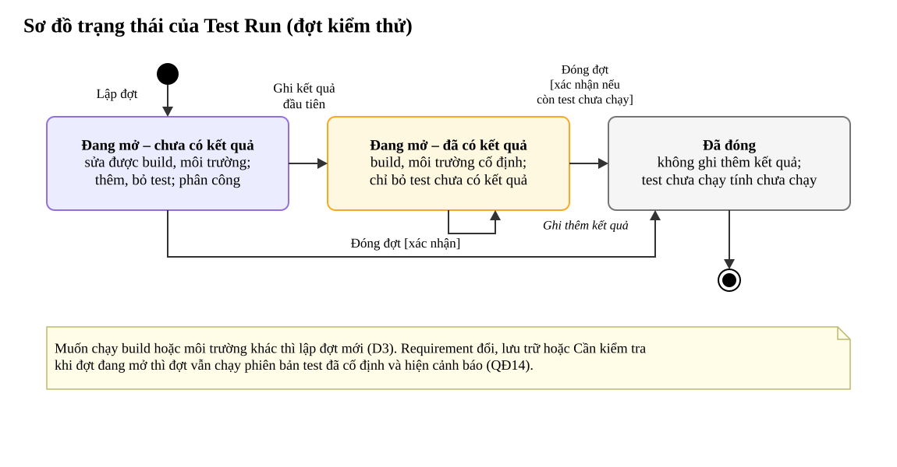

| Trạng thái | Được phép |
|---|---|
| Đang mở – chưa có kết quả | Sửa build, môi trường, hạn; thêm, bỏ test; phân công |
| Đang mở – đã có kết quả | Build, môi trường **cố định** (D3); ghi kết quả; chỉ bỏ test chưa có kết quả |
| Đã đóng | Chỉ xem; test chưa chạy được tính là chưa chạy |

### 3.8.2. Đề xuất AI

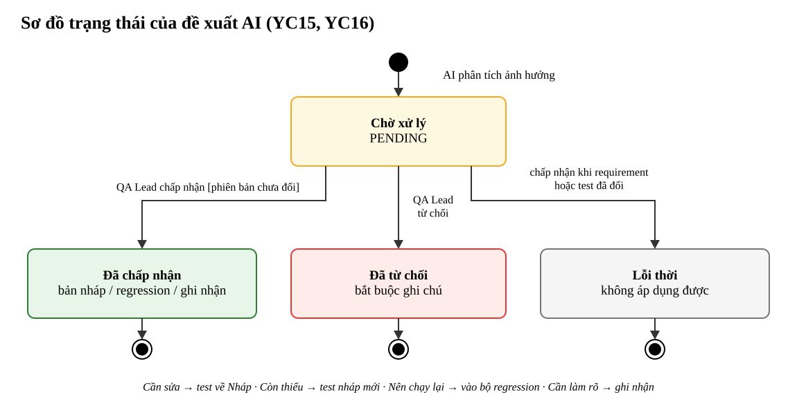

| Từ | Sự kiện | Đến |
|---|---|---|
| (mới) | Phân tích ảnh hưởng lưu đề xuất | Chờ xử lý |
| Chờ xử lý | QA Lead chấp nhận, phiên bản không đổi | Đã chấp nhận |
| Chờ xử lý | QA Lead từ chối kèm ghi chú | Đã từ chối |
| Chờ xử lý | Requirement hoặc test đổi sau lúc phân tích | Lỗi thời |

### 3.8.3. Kiểm thử lại

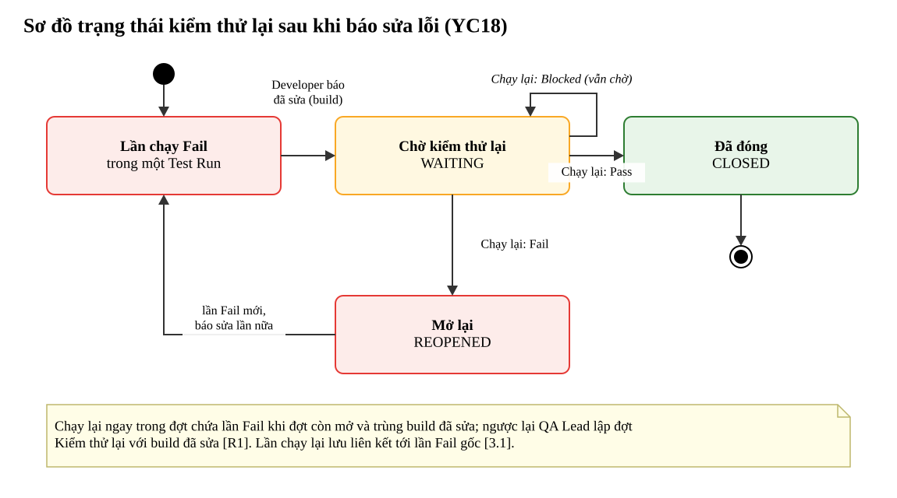

| Từ | Sự kiện | Đến |
|---|---|---|
| Lần chạy Fail | Developer báo đã sửa kèm build | Chờ kiểm thử lại |
| Chờ kiểm thử lại | Chạy lại Pass | Đã đóng |
| Chờ kiểm thử lại | Chạy lại Fail | Mở lại |
| Chờ kiểm thử lại | Chạy lại Blocked | Chờ kiểm thử lại |
| Mở lại | Developer báo sửa lần nữa | Chờ kiểm thử lại |
