# Chương 3. Phân tích

> Sản phẩm của giai đoạn: **mô hình thế giới thực** – sơ đồ use case, đặc tả use case, sơ đồ luồng dữ liệu (DFD) cho từng yêu cầu, sơ đồ hoạt động và sơ đồ trạng thái.

## 3.1. Sơ đồ use case tổng quát

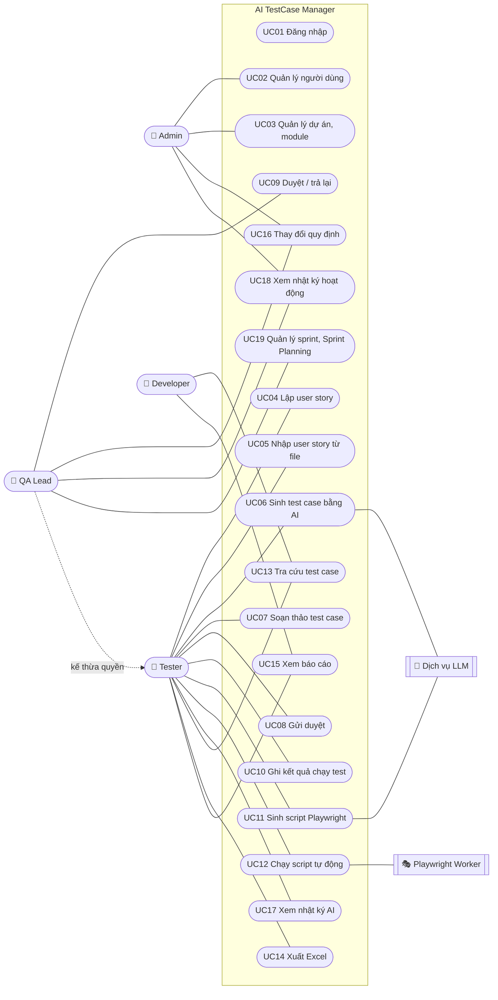

> Mọi use case (trừ UC01) đều yêu cầu đã đăng nhập (`<<include>> UC01`). QA Lead có toàn bộ quyền của Tester và thêm quyền duyệt.

## 3.2. Danh sách use case

| Mã | Tên use case | Tác nhân | Yêu cầu |
|---|---|---|---|
| UC01 | Đăng nhập / đăng xuất / đổi mật khẩu | Tất cả | Bảo mật |
| UC02 | Quản lý người dùng (thêm, khóa/mở khóa, phân vai trò) | Admin | YC11 |
| UC03 | Quản lý dự án, module | Admin | YC11 |
| UC04 | Lập, sửa, xóa user story | Tester, QA Lead, Admin | YC1 |
| UC05 | Nhập user story từ file CSV/JSON | Tester, QA Lead, Admin | YC8 |
| UC06 | Sinh test case bằng AI | Tester, QA Lead | YC2 |
| UC07 | Soạn thảo test case (thêm, sửa, xóa, xem lịch sử phiên bản) | Tester, QA Lead | YC3 |
| UC08 | Gửi duyệt test case (đơn lẻ hoặc hàng loạt) | Tester, QA Lead | YC3 |
| UC09 | Duyệt / trả lại test case | QA Lead | YC4 |
| UC10 | Ghi nhận kết quả chạy test thủ công | Tester, QA Lead | YC5 |
| UC11 | Sinh script Playwright bằng AI, xem lại, sửa, tải về | Tester, QA Lead | YC9 |
| UC12 | Chạy script tự động | Tester, QA Lead | YC9 |
| UC13 | Tra cứu test case | Tất cả | YC7 |
| UC14 | Xuất test case ra Excel | Tất cả | YC8 |
| UC15 | Xem báo cáo kiểm thử | Tất cả | YC6 |
| UC16 | Thay đổi quy định | Admin, QA Lead | YC10 |
| UC17 | Xem nhật ký AI | Tester, QA Lead, Admin | Truy vết |
| UC18 | Xem nhật ký hoạt động | Admin, QA Lead | Bảo mật |
| UC19 | Quản lý sprint: tạo sprint, đưa story từ backlog vào sprint, xem bảng sprint, burndown, velocity | QA Lead, Admin (Tester: đưa story vào sprint, xem) | YC12 |

## 3.3. Đặc tả các use case chính

### UC06 – Sinh test case bằng AI

| Mục | Nội dung |
|---|---|
| Tác nhân | Tester (hoặc QA Lead); hệ thống ngoài: Dịch vụ LLM |
| Mô tả | Từ user story và acceptance criteria, AI sinh danh sách test case ở trạng thái Nháp |
| Tiền điều kiện | Đã đăng nhập, có quyền `ai:use`; user story tồn tại; chưa vượt giới hạn gọi AI/giờ |
| Hậu điều kiện | Test case mới được lưu (nguồn AI, trạng thái Nháp, phiên bản 1); có 1 bản ghi nhật ký AI |
| Luồng chính | 1. Tester mở chi tiết user story, bấm **Sinh test case bằng AI**. 2. Hệ thống kiểm tra quyền và hạn mức gọi AI. 3. Hệ thống che dữ liệu nhạy cảm (email, SĐT, CCCD, số thẻ) trong user story. 4. Hệ thống phát hiện dấu hiệu prompt injection và gắn cờ nếu có. 5. Hệ thống ghép prompt: vai trò QA senior + quy định QĐ2 + định dạng JSON + dữ liệu story bọc trong `<user_story>`. 6. Hệ thống gửi prompt tới Dịch vụ LLM. 7. LLM trả về JSON. 8. Hệ thống kiểm tra JSON theo schema. 9. Hệ thống cắt bớt nếu vượt số test case tối đa, xóa các test case AI còn Nháp cũ, lưu test case mới và phiên bản 1. 10. Hệ thống ghi nhật ký AI và hiển thị: số test case, thời gian, dữ liệu đã che, cảnh báo (nếu có). |
| Luồng thay thế | 8a. JSON sai schema hoặc lỗi mạng → quay lại bước 6, tối đa `AI_MAX_RETRY` lần. 8b. Vẫn sai sau khi thử lại → ghi nhật ký FAILED, thông báo "AI chưa sinh được test case hợp lệ, vui lòng thử lại hoặc viết thủ công". |
| Luồng ngoại lệ | 2a. Vượt hạn mức → báo lỗi 429. 9a. User story đã đủ số test case tối đa → báo lỗi, không lưu. |
| Quy định | QĐ2 |

### UC09 – Duyệt / trả lại test case

| Mục | Nội dung |
|---|---|
| Tác nhân | QA Lead |
| Tiền điều kiện | Test case ở trạng thái *Chờ duyệt* |
| Hậu điều kiện | Trạng thái chuyển thành *Đã duyệt* hoặc *Bị trả lại*; có phiếu duyệt (BM3) và audit log |
| Luồng chính | 1. QA Lead mở **Duyệt test case** (menu có huy hiệu số lượng chờ duyệt). 2. Chọn một test case để xem chi tiết, lịch sử phiên bản (so sánh bản AI gốc với bản đã sửa). 3. Bấm **Duyệt** (có thể kèm ghi chú). 4. Hệ thống kiểm tra quyền và trạng thái, lưu phiếu duyệt, đổi trạng thái. |
| Luồng thay thế | 3a. Bấm **Trả lại** → bắt buộc nhập ghi chú; Tester thấy ghi chú ở chi tiết test case. 1a. Duyệt hàng loạt: chọn nhiều test case, bấm **Duyệt tất cả mục đã chọn**. |
| Luồng ngoại lệ | 3b. Trả lại không có ghi chú → báo lỗi. 4a. Người dùng không phải QA Lead → 403. |
| Quy định | QĐ4 |

### UC12 – Chạy script tự động

| Mục | Nội dung |
|---|---|
| Tác nhân | Tester; hệ thống ngoài: Playwright Worker |
| Tiền điều kiện | Test case *Đã duyệt*, đã có script (UC11) |
| Hậu điều kiện | Có 1 kết quả chạy (BM4) hình thức Tự động, kèm log, thời gian và ảnh chụp nếu lỗi |
| Luồng chính | 1. Tester mở tab **Script Playwright**, xem lại mã, bấm **Chạy tự động**. 2. Hệ thống kiểm tra tĩnh script (QĐ9). 3. Hệ thống ghi script ra file tạm và khởi động tiến trình Playwright riêng với biến môi trường tối thiểu, giới hạn thời gian. 4. Playwright mở Chrome, thực hiện các bước trên ứng dụng cần test. 5. Hệ thống đọc báo cáo JSON, xác định Pass/Fail, lưu log và ảnh chụp lỗi, xóa file tạm. 6. Kết quả hiển thị ngay và được tính vào báo cáo. |
| Luồng thay thế | 5a. Quá thời gian → dừng tiến trình, kết quả *Blocked*. 5b. Script lỗi cú pháp → kết quả *Blocked* kèm log. |
| Luồng ngoại lệ | 2a. Script vi phạm kiểm tra tĩnh → từ chối chạy, nêu lý do. 3a. Worker chưa cài → báo lỗi 503 kèm hướng dẫn cài. |
| Quy định | QĐ5, QĐ9 |

### UC10 – Ghi nhận kết quả chạy test

| Mục | Nội dung |
|---|---|
| Tác nhân | Tester |
| Tiền điều kiện | Test case *Đã duyệt* |
| Luồng chính | 1. Mở test case, tab **Chạy test**. 2. Chọn Pass/Fail/Blocked, nhập ghi chú. 3. Bấm **Lưu kết quả**. 4. Hệ thống kiểm tra QĐ5 và lưu. |
| Luồng ngoại lệ | Fail/Blocked không có ghi chú → báo lỗi. Test case chưa duyệt → báo lỗi. |

### UC16 – Thay đổi quy định

| Mục | Nội dung |
|---|---|
| Tác nhân | Admin, QA Lead |
| Luồng chính | 1. Mở **Thay đổi quy định**. 2. Sửa giá trị tham số. 3. Bấm **Lưu**. 4. Hệ thống kiểm tra miền giá trị (QĐ10), lưu, ghi audit log. Quy định mới có hiệu lực ngay (ví dụ AI sinh tối đa theo số mới). |
| Luồng ngoại lệ | Giá trị ngoài miền cho phép → báo lỗi, giữ giá trị cũ. |

### UC19 – Quản lý sprint (Sprint Planning)

| Mục | Nội dung |
|---|---|
| Tác nhân | QA Lead (vai trò Product Owner / Scrum Master của đội QA) |
| Tiền điều kiện | Đã chọn dự án; có quyền `sprint:manage` |
| Hậu điều kiện | Sprint mới được lưu; các user story được chọn chuyển từ Product backlog vào sprint |
| Luồng chính | 1. Mở **Sprint (Agile)**, bấm **Tạo sprint**, nhập tên, Sprint Goal, ngày bắt đầu/kết thúc. 2. Hệ thống kiểm tra QĐ12 (độ dài, không trùng thời gian) và lưu. 3. Trong mục **Product backlog**, chọn sprint cho từng story và bấm **Đưa vào**. 4. Hệ thống kiểm tra story và sprint cùng dự án, cập nhật. 5. Bảng sprint hiển thị story theo 4 cột: *Cần viết test case → Đang soạn/chờ duyệt → Đang kiểm thử → Hoàn thành (DoD)*, cùng burndown và velocity. |
| Luồng ngoại lệ | 2a. Sprint dài quá giới hạn hoặc trùng thời gian → báo lỗi. 1a. Tester không có nút Tạo sprint; gọi trực tiếp API → 403. |
| Quy định | QĐ12 |

### UC01 – Đăng nhập

| Mục | Nội dung |
|---|---|
| Luồng chính | 1. Nhập tên đăng nhập, mật khẩu. 2. Hệ thống so khớp mật khẩu băm (bcrypt). 3. Cấp JWT hạn 8 giờ, ghi audit log `LOGIN`. 4. Hiển thị menu theo vai trò. |
| Luồng ngoại lệ | Sai thông tin → thông báo chung "Tên đăng nhập hoặc mật khẩu không đúng" (không tiết lộ tài khoản có tồn tại), ghi `LOGIN_FAILED`. Sai quá 10 lần/15 phút → tạm khóa theo IP. Tài khoản bị khóa → từ chối. |

## 3.4. Sơ đồ luồng dữ liệu (DFD) cho từng yêu cầu

Ký hiệu theo chuẩn môn học: **D1** thông tin người dùng nhập, **D2** thông tin xuất ra thiết bị xuất (nếu có), **D3** dữ liệu đọc từ bộ nhớ phụ, **D4** dữ liệu ghi xuống bộ nhớ phụ, **D5** thông tin xuất ra máy in, **D6** thông tin trả về người dùng.

### DFD YC1 – Lập user story

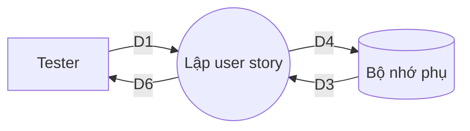

- **D1:** mã, dự án, module, tiêu đề, mô tả, acceptance criteria, độ ưu tiên.
- **D3:** danh sách mã user story đã có, danh sách dự án/module, tham số `MIN_AC_PER_STORY`, `PRIORITIES`.
- **D4:** D1 + người tạo, ngày tạo.
- **D6:** kết quả lưu hoặc thông báo lỗi.
- **Thuật toán:** B1 nhận D1 → B2 đọc D3 → B3 kiểm tra mã đúng định dạng và không trùng → B4 kiểm tra độ ưu tiên thuộc danh sách → B5 đếm số acceptance criteria ≥ tối thiểu → B6 kiểm tra module thuộc dự án → B7 nếu không thỏa thì trả lỗi (D6), dừng → B8 lưu D4 → B9 trả D6.

### DFD YC2 – Sinh test case bằng AI

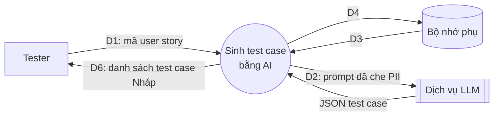

- **D3:** nội dung user story; tham số `MAX_TC_PER_STORY`, `AI_MAX_RETRY`, `AI_TIMEOUT_SEC`, `AI_CALLS_PER_HOUR`; số lần gọi AI của người dùng trong 1 giờ; số test case hiện có.
- **D4:** test case mới (nguồn AI, Nháp, v1), phiên bản v1, nhật ký AI (prompt đã che, model, kết quả gốc, số lần thử, thời gian, cờ injection).
- **Thuật toán:** B1 nhận D1 → B2 đọc D3 → B3 kiểm tra hạn mức gọi AI → B4 che PII → B5 phát hiện injection → B6 ghép prompt → B7 gửi LLM (D2), chờ tối đa `AI_TIMEOUT_SEC` → B8 kiểm tra schema; sai thì lặp B7 tối đa `AI_MAX_RETRY` lần → B9 xóa test case AI Nháp cũ, cắt theo số tối đa còn lại → B10 ghi D4 → B11 trả D6.

### DFD YC3 – Soạn thảo và gửi duyệt

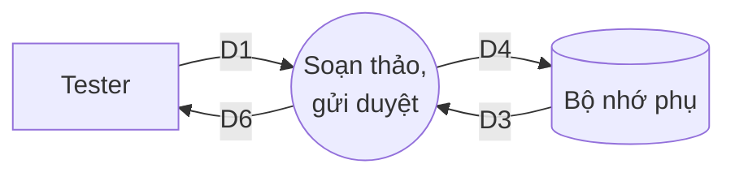

- **D1:** nội dung test case mới hoặc danh sách mã test case cần gửi duyệt, ghi chú thay đổi.
- **D3:** trạng thái và phiên bản hiện tại của test case.
- **D4:** nội dung mới, phiên bản + 1, bản chụp phiên bản; hoặc trạng thái *Chờ duyệt*.
- **Thuật toán:** kiểm tra trạng thái cho phép theo QĐ3 → lưu phiên bản mới (sửa bản *Đã duyệt* thì đưa về *Nháp*) → hoặc đổi trạng thái sang *Chờ duyệt* (trong 1 giao dịch cho cả danh sách).

### DFD YC4 – Duyệt test case

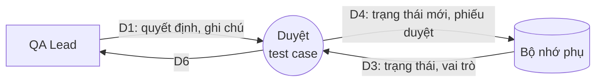

- **Thuật toán:** kiểm tra vai trò QA Lead → kiểm tra trạng thái *Chờ duyệt* → nếu Trả lại thì bắt buộc có ghi chú → ghi trạng thái mới + phiếu duyệt trong 1 giao dịch → ghi audit log.

### DFD YC5 – Ghi nhận kết quả chạy test

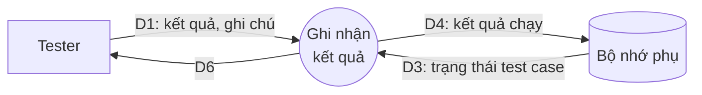

### DFD YC6 – Lập báo cáo

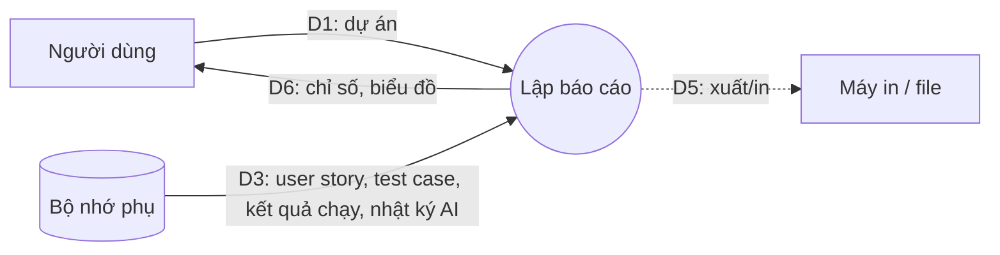

- **Thuật toán:** lấy kết quả chạy **gần nhất** của mỗi test case → tỷ lệ pass = Pass/đã chạy → độ bao phủ = story có test case đã duyệt / tổng story → tiến độ = đã chạy / đã duyệt → nhóm theo module, theo ngày → thống kê AI.

### DFD YC9 – Sinh và chạy script tự động

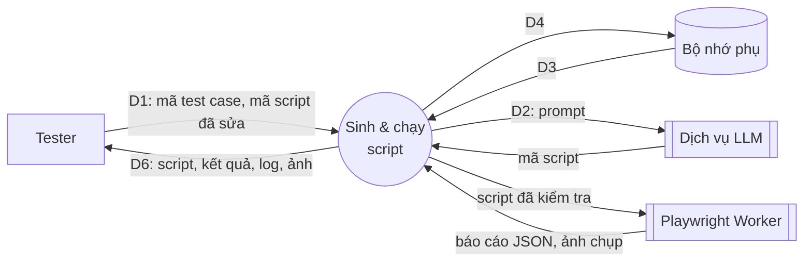

### DFD YC12 – Quản lý sprint

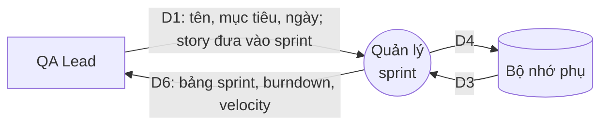

- **D3:** các sprint hiện có của dự án, tham số `SPRINT_MAX_DAYS`, user story, test case đã duyệt và kết quả chạy gần nhất.
- **D4:** sprint mới; `sprint_id`, `story_points` của user story.
- **Thuật toán burndown:** với mỗi ngày d của sprint: còn lại(d) = tổng story point − tổng story point của các story đạt DoD trước hoặc trong ngày d; đường lý tưởng giảm đều từ tổng điểm về 0.

### DFD YC10 – Thay đổi quy định

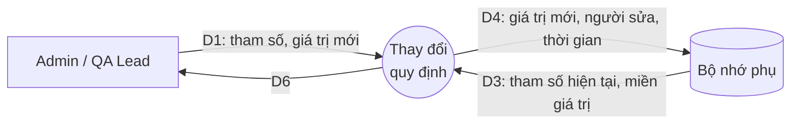

## 3.5. Sơ đồ hoạt động – quy trình nghiệp vụ mới

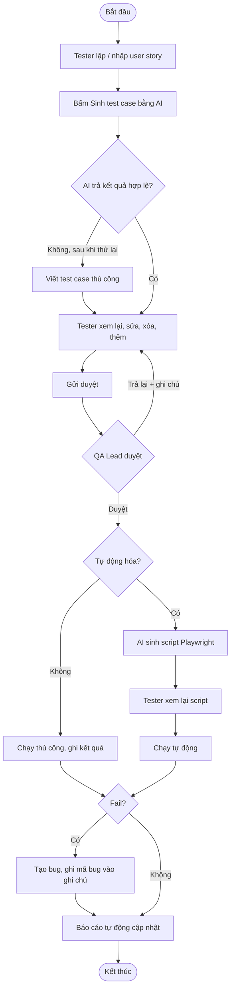

So với quy trình cũ (Chương 1): AI rút ngắn bước viết nháp; duyệt có lưu vết; không còn viết lại test case thành script bằng tay; báo cáo tự động.

## 3.6. Sơ đồ trạng thái của test case

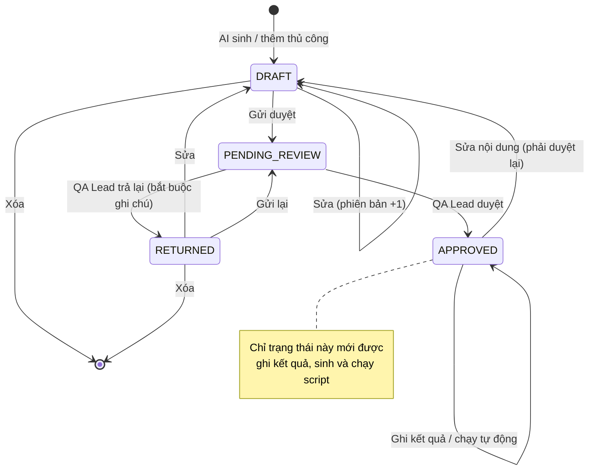
