# Chương 3. Phân tích

> Sản phẩm của giai đoạn: **mô hình thế giới thực** – sơ đồ use case, đặc tả use case, sơ đồ luồng dữ liệu (DFD) cho từng yêu cầu, sơ đồ hoạt động và sơ đồ trạng thái.

## 3.1. Sơ đồ use case tổng quát

Sơ đồ được vẽ bằng **draw.io** theo ký hiệu UML (file gốc: `docs/usecase/UseCaseTongQuat.drawio`, sinh bằng `python3 docs/usecase/generate_usecase.py`). Quyền của từng tác nhân khớp với bảng 3.2 và ma trận phân quyền trong code (`app/src/middleware/auth.js`).

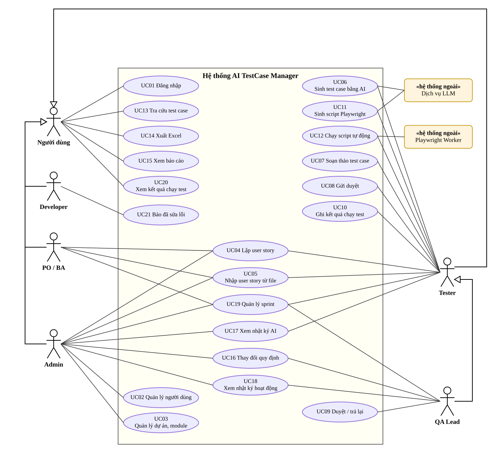

| Ký hiệu | Ý nghĩa |
|---|---|
| Hình người | Tác nhân (người dùng theo vai trò) |
| Hình elip | Use case (chức năng của hệ thống) |
| Hình chữ nhật «hệ thống ngoài» | Hệ thống bên ngoài mà use case gọi tới |
| Đường thẳng | Tác nhân thực hiện use case |
| Mũi tên tam giác rỗng | **Tổng quát hóa**: tác nhân con có mọi use case của tác nhân cha |

- **Người dùng** là tác nhân chung: mọi vai trò đều đăng nhập, tra cứu test case, xuất Excel, xem báo cáo và xem kết quả chạy test. Admin, PO/BA, Developer, Tester tổng quát hóa thành Người dùng.
- **Developer** xem kết quả chạy (log, ảnh chụp lỗi) để tái hiện lỗi, sửa xong thì **báo đã sửa lỗi** (UC21) kèm bản build; test case chuyển sang *Cần kiểm thử lại* cho Tester.
- **PO / BA** lập, nhập user story (UC04, UC05) và lập kế hoạch sprint (UC19); không viết, duyệt, chạy test case và không gọi AI.
- **QA Lead** tổng quát hóa thành **Tester**: có toàn bộ quyền của Tester, thêm quyền duyệt test case (UC09), thay đổi quy định (UC16), xem nhật ký hoạt động (UC18) và quản lý sprint (UC19).
- Ở UC19, Tester chỉ đưa story vào sprint và xem bảng sprint; tạo, sửa sprint do PO/BA, QA Lead, Admin thực hiện.

> Mọi use case (trừ UC01) đều yêu cầu đã đăng nhập (`<<include>> UC01`).

## 3.2. Danh sách use case

| Mã | Tên use case | Tác nhân | Yêu cầu |
|---|---|---|---|
| UC01 | Đăng nhập / đăng xuất / đổi mật khẩu | Tất cả | Bảo mật |
| UC02 | Quản lý người dùng (thêm, khóa/mở khóa, phân vai trò) | Admin | YC11 |
| UC03 | Quản lý dự án, module | Admin | YC11 |
| UC04 | Lập, sửa, xóa user story | PO/BA, Tester, QA Lead, Admin | YC1 |
| UC05 | Nhập user story từ file CSV/JSON | PO/BA, Tester, QA Lead, Admin | YC8 |
| UC06 | Sinh test case bằng AI | Tester, QA Lead | YC2 |
| UC07 | Soạn thảo test case (thêm, sửa, xóa, xem lịch sử phiên bản) | Tester, QA Lead | YC3 |
| UC08 | Gửi duyệt test case (đơn lẻ hoặc hàng loạt) | Tester, QA Lead | YC3 |
| UC09 | Duyệt / trả lại test case | QA Lead | YC4 |
| UC10 | Ghi nhận kết quả chạy test thủ công | Tester, QA Lead | YC5 |
| UC11 | Sinh script Playwright bằng AI, xem lại, sửa, tải về | Tester, QA Lead | YC9 |
| UC12 | Chạy script tự động | Tester, QA Lead | YC9 |
| UC13 | Tra cứu test case | Tất cả | YC7 |
| UC14 | Xuất test case ra Excel | Tất cả | YC8 |
| UC15 | Xem báo cáo kiểm thử | Tất cả | YC6 |
| UC16 | Thay đổi quy định | Admin, QA Lead | YC10 |
| UC17 | Xem nhật ký AI | Tester, QA Lead, Admin | Truy vết |
| UC18 | Xem nhật ký hoạt động | Admin, QA Lead | Bảo mật |
| UC19 | Quản lý sprint: tạo sprint, đưa story từ backlog vào sprint, xem bảng sprint, burndown, velocity | PO/BA, QA Lead, Admin (Tester: đưa story vào sprint, xem) | YC12 |
| UC20 | Xem kết quả chạy test (log, ảnh chụp lỗi, ghi chú mã bug) | Tất cả | YC5 |
| UC21 | Báo đã sửa lỗi kèm bản build để Tester kiểm thử lại | Developer | YC13 |

## 3.3. Đặc tả các use case chính

### UC06 – Sinh test case bằng AI

| Mục | Nội dung |
|---|---|
| Tác nhân | Tester (hoặc QA Lead); hệ thống ngoài: Dịch vụ LLM |
| Mô tả | Từ user story và acceptance criteria, AI sinh danh sách test case ở trạng thái Nháp |
| Tiền điều kiện | Đã đăng nhập, có quyền `ai:use`; user story tồn tại; chưa vượt giới hạn gọi AI/giờ |
| Hậu điều kiện | Test case mới được lưu (nguồn AI, trạng thái Nháp, phiên bản 1); có 1 bản ghi nhật ký AI |
| Luồng chính | 1. Tester mở chi tiết user story, bấm **Sinh test case bằng AI**. 2. Hệ thống kiểm tra quyền và hạn mức gọi AI. 3. Hệ thống che dữ liệu nhạy cảm (email, SĐT, CCCD, số thẻ) trong user story. 4. Hệ thống phát hiện dấu hiệu prompt injection và gắn cờ nếu có. 5. Hệ thống ghép prompt: vai trò QA senior + quy định QĐ2 + định dạng JSON + dữ liệu story bọc trong `<user_story>`. 6. Hệ thống gửi prompt tới Dịch vụ LLM. 7. LLM trả về JSON. 8. Hệ thống kiểm tra JSON theo schema. 9. Hệ thống cắt bớt nếu vượt số test case tối đa, xóa các test case AI còn Nháp cũ, lưu test case mới và phiên bản 1. 10. Hệ thống ghi nhật ký AI và hiển thị: số test case, thời gian, dữ liệu đã che, cảnh báo (nếu có). |
| Luồng thay thế | 8a. JSON sai schema hoặc lỗi mạng → quay lại bước 6, tối đa `AI_MAX_RETRY` lần. 8b. Vẫn sai sau khi thử lại → ghi nhật ký FAILED, thông báo "AI chưa sinh được test case hợp lệ, vui lòng thử lại hoặc viết thủ công". |
| Luồng ngoại lệ | 2a. Vượt hạn mức → báo lỗi 429. 9a. User story đã đủ số test case tối đa → báo lỗi, không lưu. |
| Quy định | QĐ2 |

### UC09 – Duyệt / trả lại test case

| Mục | Nội dung |
|---|---|
| Tác nhân | QA Lead |
| Tiền điều kiện | Test case ở trạng thái *Chờ duyệt* |
| Hậu điều kiện | Trạng thái chuyển thành *Đã duyệt* hoặc *Bị trả lại*; có phiếu duyệt (BM3) và audit log |
| Luồng chính | 1. QA Lead mở **Duyệt test case** (menu có huy hiệu số lượng chờ duyệt). 2. Chọn một test case để xem chi tiết, lịch sử phiên bản (so sánh bản AI gốc với bản đã sửa). 3. Bấm **Duyệt** (có thể kèm ghi chú). 4. Hệ thống kiểm tra quyền và trạng thái, lưu phiếu duyệt, đổi trạng thái. |
| Luồng thay thế | 3a. Bấm **Trả lại** → bắt buộc nhập ghi chú; Tester thấy ghi chú ở chi tiết test case. 1a. Duyệt hàng loạt: chọn nhiều test case, bấm **Duyệt tất cả mục đã chọn**. |
| Luồng ngoại lệ | 3b. Trả lại không có ghi chú → báo lỗi. 4a. Người dùng không phải QA Lead → 403. |
| Quy định | QĐ4 |

### UC12 – Chạy script tự động

| Mục | Nội dung |
|---|---|
| Tác nhân | Tester; hệ thống ngoài: Playwright Worker |
| Tiền điều kiện | Test case *Đã duyệt*, đã có script (UC11) |
| Hậu điều kiện | Có 1 kết quả chạy (BM4) hình thức Tự động, kèm log, thời gian và ảnh chụp nếu lỗi |
| Luồng chính | 1. Tester mở tab **Script Playwright**, xem lại mã, bấm **Chạy tự động**. 2. Hệ thống kiểm tra tĩnh script (QĐ9). 3. Hệ thống ghi script ra file tạm và khởi động tiến trình Playwright riêng với biến môi trường tối thiểu, giới hạn thời gian. 4. Playwright mở Chrome, thực hiện các bước trên ứng dụng cần test. 5. Hệ thống đọc báo cáo JSON, xác định Pass/Fail, lưu log và ảnh chụp lỗi, xóa file tạm. 6. Kết quả hiển thị ngay và được tính vào báo cáo. |
| Luồng thay thế | 5a. Quá thời gian → dừng tiến trình, kết quả *Blocked*. 5b. Script lỗi cú pháp → kết quả *Blocked* kèm log. |
| Luồng ngoại lệ | 2a. Script vi phạm kiểm tra tĩnh → từ chối chạy, nêu lý do. 3a. Worker chưa cài → báo lỗi 503 kèm hướng dẫn cài. |
| Quy định | QĐ5, QĐ9 |

### UC10 – Ghi nhận kết quả chạy test

| Mục | Nội dung |
|---|---|
| Tác nhân | Tester |
| Tiền điều kiện | Test case *Đã duyệt* |
| Luồng chính | 1. Mở test case, tab **Chạy test**. 2. Chọn Pass/Fail/Blocked, nhập ghi chú. 3. Bấm **Lưu kết quả**. 4. Hệ thống kiểm tra QĐ5 và lưu. |
| Luồng ngoại lệ | Fail/Blocked không có ghi chú → báo lỗi. Test case chưa duyệt → báo lỗi. |

### UC16 – Thay đổi quy định

| Mục | Nội dung |
|---|---|
| Tác nhân | Admin, QA Lead |
| Luồng chính | 1. Mở **Thay đổi quy định**. 2. Sửa giá trị tham số. 3. Bấm **Lưu**. 4. Hệ thống kiểm tra miền giá trị (QĐ10), lưu, ghi audit log. Quy định mới có hiệu lực ngay (ví dụ AI sinh tối đa theo số mới). |
| Luồng ngoại lệ | Giá trị ngoài miền cho phép → báo lỗi, giữ giá trị cũ. |

### UC19 – Quản lý sprint (Sprint Planning)

| Mục | Nội dung |
|---|---|
| Tác nhân | PO/BA (Product Owner), QA Lead (Scrum Master), Admin |
| Tiền điều kiện | Đã chọn dự án; có quyền `sprint:manage` |
| Hậu điều kiện | Sprint mới được lưu; các user story được chọn chuyển từ Product backlog vào sprint |
| Luồng chính | 1. Mở **Sprint (Agile)**, bấm **Tạo sprint**, nhập tên, Sprint Goal, ngày bắt đầu/kết thúc. 2. Hệ thống kiểm tra QĐ12 (độ dài, không trùng thời gian) và lưu. 3. Trong mục **Product backlog**, chọn sprint cho từng story và bấm **Đưa vào**. 4. Hệ thống kiểm tra story và sprint cùng dự án, cập nhật. 5. Bảng sprint hiển thị story theo 4 cột: *Cần viết test case → Đang soạn/chờ duyệt → Đang kiểm thử → Hoàn thành (DoD)*, cùng burndown và velocity. |
| Luồng ngoại lệ | 2a. Sprint dài quá giới hạn hoặc trùng thời gian → báo lỗi. 1a. Tester không có nút Tạo sprint; gọi trực tiếp API → 403. |
| Quy định | QĐ12 |

### UC21 – Báo đã sửa lỗi

| Mục | Nội dung |
|---|---|
| Tác nhân | Developer |
| Tiền điều kiện | Đã đăng nhập, có quyền `bug:fix`; test case có lần chạy gần nhất là *Fail* |
| Hậu điều kiện | Lần chạy được ghi bản build, ghi chú, người báo, ngày báo (BM11); test case ở trạng thái *Cần kiểm thử lại*; ghi audit log `REPORT_FIX` |
| Luồng chính | 1. Mở **Kết quả chạy test** (hoặc tab *Chạy test* của test case), xem ghi chú, log, ảnh chụp lỗi để tái hiện. 2. Sửa lỗi, bấm **🔧 Báo đã sửa** ở lần chạy Fail, nhập bản build và ghi chú. 3. Hệ thống kiểm tra QĐ13, lưu, báo thành công. 4. Tester lọc **Cần kiểm thử lại** ở *Tra cứu test case*, chạy lại trên bản build mới; lần chạy mới làm test case hết trạng thái này. |
| Luồng ngoại lệ | 3a. Thiếu bản build → báo lỗi. 3b. Lần chạy không phải *Fail*, không phải lần gần nhất hoặc đã được báo sửa → báo lỗi. 2a. Vai trò khác không có nút; gọi trực tiếp API → 403. |
| Quy định | QĐ13 |

### UC01 – Đăng nhập

| Mục | Nội dung |
|---|---|
| Luồng chính | 1. Nhập tên đăng nhập, mật khẩu. 2. Hệ thống so khớp mật khẩu băm (bcrypt). 3. Cấp JWT hạn 8 giờ, ghi audit log `LOGIN`. 4. Hiển thị menu theo vai trò. |
| Luồng ngoại lệ | Sai thông tin → thông báo chung "Tên đăng nhập hoặc mật khẩu không đúng" (không tiết lộ tài khoản có tồn tại), ghi `LOGIN_FAILED`. Sai quá 10 lần/15 phút → tạm khóa theo IP. Tài khoản bị khóa → từ chối. |

<!-- DFD:BEGIN (sinh tự động bởi docs/dfd/generate_dfd.py, đừng sửa tay) -->
## 3.4. Sơ đồ luồng dữ liệu (DFD) cho từng yêu cầu

Các sơ đồ được vẽ bằng phần mềm chuyên dụng **draw.io (diagrams.net)**. File gốc `.drawio` nằm trong thư mục `docs/dfd/` (mở bằng [app.diagrams.net](https://app.diagrams.net) hoặc draw.io Desktop để xem, sửa); hình trong báo cáo được sinh từ cùng một nguồn bằng lệnh `python3 docs/dfd/generate_dfd.py`.

### 3.4.1. Ký hiệu và quy ước

| Ký hiệu | Ý nghĩa |
|---|---|
| Hình chữ nhật | Người dùng (tác nhân) hoặc thiết bị nhập / xuất |
| Hình elip | Khối xử lý – một công việc của phần mềm |
| Mũi tên khối | Luồng dữ liệu, ghi tên D1–D6. Luồng **không có** được vẽ **màu trắng** và mô tả là "Không có" |
| Hai đường kẻ ngang | Bộ nhớ phụ (cơ sở dữ liệu) |

| Luồng | Ý nghĩa |
|---|---|
| **D1** | Thông tin **người dùng nhập** vào khối xử lý |
| **D2** | Thông tin từ **thiết bị nhập khác** (không phải bàn phím, chuột): file, dịch vụ bên ngoài… |
| **D3** | Dữ liệu **đọc** từ bộ nhớ phụ |
| **D4** | Dữ liệu **ghi** xuống bộ nhớ phụ (thông tin nhập cần lưu + kết quả mới tạo ra hoặc thay đổi) |
| **D5** | Thông tin đưa ra **thiết bị xuất khác** (không phải màn hình): máy in, file, dịch vụ bên ngoài… |
| **D6** | Thông tin **trả về người dùng**, luôn có thông báo thành công hoặc thất bại |

**Lưu ý khi vẽ:**
- Tên luồng D là **thông tin**, không phải hành động.
- Mỗi khối xử lý có ít nhất một luồng vào và một luồng ra.
- Không có luồng trực tiếp giữa tác nhân với tác nhân, hay giữa tác nhân với bộ nhớ phụ: mọi dữ liệu đều đi qua khối xử lý.
- Người dùng không nhập những thông tin đã lưu hoặc tính được (VD: người tạo, ngày tạo, phiên bản, tỷ lệ pass do hệ thống tự lấy / tự tính).

**Ba bước thực hiện cho mỗi yêu cầu:** (1) vẽ sơ đồ luồng dữ liệu; (2) mô tả các luồng D1–D6 (luồng không có ghi "Không có"); (3) viết thuật toán xử lý theo khuôn *Nhận D1 → Kết nối CSDL → Đọc D3 → kiểm tra quy định → Lưu D4 → Xuất D5 → Xuất D6 → Đóng kết nối → Kết thúc*. Ở mỗi bước kiểm tra, nếu không thỏa quy định thì ghi thông báo lỗi vào D6 và nhảy tới bước Xuất D6.
### 3.4.2. DFD YC1 – Lập user story

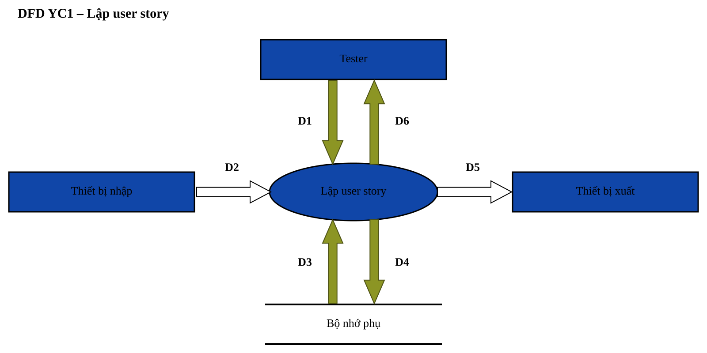

*Biểu mẫu:* BM1 · *Quy định:* QĐ1 · *File:* `docs/dfd/YC01_LapUserStory.drawio`

| Luồng | Mô tả |
|---|---|
| D1 | Mã user story, dự án, module, tiêu đề, mô tả, các acceptance criteria, độ ưu tiên. |
| D2 | Không có |
| D3 | Danh sách mã user story đã có; danh sách dự án, module; tham số MIN_AC_PER_STORY, PRIORITIES. |
| D4 | D1 + người tạo, ngày tạo. |
| D5 | Không có |
| D6 | Thông báo lưu thành công kèm user story vừa lập, hoặc thông báo lỗi vi phạm QĐ1. |

**Thuật toán:**

- B1: Nhận D1 từ người dùng.
- B2: Kết nối cơ sở dữ liệu.
- B3: Đọc D3 từ bộ nhớ phụ.
- B4: Kiểm tra mã user story đúng dạng US-XXX và không trùng với mã đã có? Nếu không thỏa: ghi thông báo lỗi vào D6, chuyển tới B10.
- B5: Kiểm tra tiêu đề ≥ 5 ký tự, mô tả ≥ 10 ký tự? Nếu không thỏa: ghi thông báo lỗi vào D6, chuyển tới B10.
- B6: Kiểm tra độ ưu tiên thuộc danh sách PRIORITIES? Nếu không thỏa: ghi thông báo lỗi vào D6, chuyển tới B10.
- B7: Kiểm tra số acceptance criteria ≥ MIN_AC_PER_STORY? Nếu không thỏa: ghi thông báo lỗi vào D6, chuyển tới B10.
- B8: Kiểm tra module thuộc dự án đã chọn? Nếu không thỏa: ghi thông báo lỗi vào D6, chuyển tới B10.
- B9: Lưu D4 xuống bộ nhớ phụ.
- B10: Xuất D6 cho người dùng.
- B11: Đóng kết nối cơ sở dữ liệu.
- B12: Kết thúc.

### 3.4.3. DFD YC2 – Sinh test case bằng AI

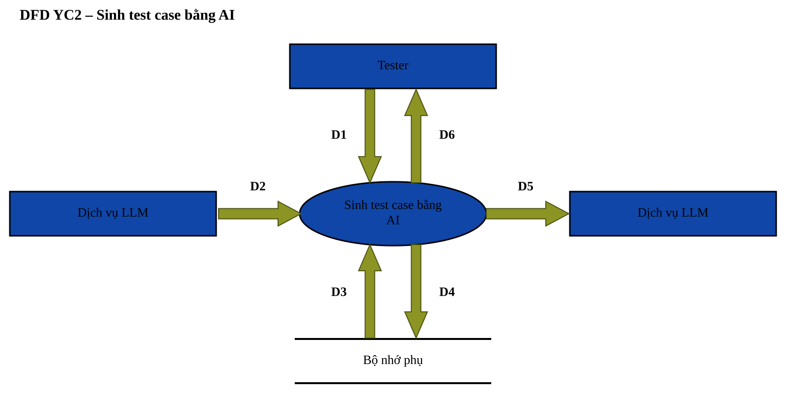

*Biểu mẫu:* BM2 · *Quy định:* QĐ2 · *File:* `docs/dfd/YC02_SinhTestCaseBangAI.drawio`

| Luồng | Mô tả |
|---|---|
| D1 | Mã user story cần sinh test case. |
| D2 | Chuỗi JSON danh sách test case do LLM trả về. |
| D3 | Nội dung user story; tham số MAX_TC_PER_STORY, AI_MAX_RETRY, AI_TIMEOUT_SEC, AI_CALLS_PER_HOUR; số lần gọi AI của người dùng trong 1 giờ; số test case hiện có của user story. |
| D4 | Các test case mới (nguồn AI, trạng thái Nháp, phiên bản 1); nhật ký AI (prompt đã che PII, model, kết quả gốc, số lần thử, thời gian, cờ injection). |
| D5 | Prompt gửi LLM: vai trò QA, quy định QĐ2, nội dung user story ĐÃ CHE dữ liệu nhạy cảm (PII). |
| D6 | Thông báo thành công kèm danh sách test case Nháp, cảnh báo nếu có prompt injection; hoặc thông báo lỗi (hết hạn mức, LLM lỗi, vượt số test case tối đa). |

**Thuật toán:**

- B1: Nhận D1 từ người dùng.
- B2: Kết nối cơ sở dữ liệu.
- B3: Đọc D3 từ bộ nhớ phụ.
- B4: Kiểm tra số lần gọi AI trong 1 giờ < AI_CALLS_PER_HOUR? Nếu không thỏa: ghi thông báo lỗi vào D6, chuyển tới B11.
- B5: Tính số test case còn được sinh = MAX_TC_PER_STORY − số test case hiện có (không tính test case AI Nháp sẽ thay thế). Kiểm tra số này > 0? Nếu không thỏa: ghi thông báo lỗi vào D6, chuyển tới B11.
- B6: Che dữ liệu nhạy cảm (email, số điện thoại, khóa API…) và đánh dấu nếu phát hiện prompt injection.
- B7: Ghép prompt và xuất D5 đến Dịch vụ LLM, chờ tối đa AI_TIMEOUT_SEC giây.
- B8: Nhận D2 từ Dịch vụ LLM. Nếu D2 sai JSON schema thì quay lại bước trước, tối đa AI_MAX_RETRY lần; quá số lần vẫn sai? Nếu không thỏa: ghi thông báo lỗi vào D6, chuyển tới B11.
- B9: Xóa các test case AI còn Nháp của user story; cắt danh sách theo số test case còn được sinh.
- B10: Lưu D4 xuống bộ nhớ phụ.
- B11: Xuất D6 cho người dùng.
- B12: Đóng kết nối cơ sở dữ liệu.
- B13: Kết thúc.

### 3.4.4. DFD YC3 – Soạn thảo và gửi duyệt test case

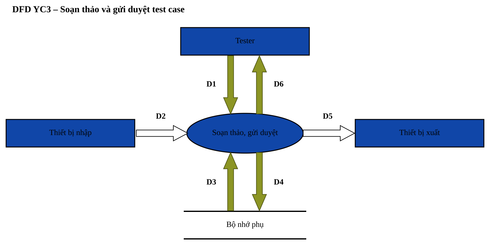

*Biểu mẫu:* BM2 · *Quy định:* QĐ2, QĐ3 · *File:* `docs/dfd/YC03_SoanThaoGuiDuyet.drawio`

| Luồng | Mô tả |
|---|---|
| D1 | Nội dung test case (BM2) cần thêm/sửa kèm ghi chú thay đổi; hoặc danh sách mã test case cần gửi duyệt. |
| D2 | Không có |
| D3 | Trạng thái, phiên bản hiện tại của test case; số test case của user story; tham số MAX_TC_PER_STORY. |
| D4 | Nội dung mới, phiên bản + 1, bản chụp phiên bản; hoặc trạng thái Chờ duyệt của các test case gửi duyệt. |
| D5 | Không có |
| D6 | Thông báo lưu / gửi duyệt thành công kèm test case sau khi lưu, hoặc thông báo lỗi vi phạm QĐ2, QĐ3. |

**Thuật toán:**

- B1: Nhận D1 từ người dùng.
- B2: Kết nối cơ sở dữ liệu.
- B3: Đọc D3 từ bộ nhớ phụ.
- B4: Thêm mới: kiểm tra số test case của user story < MAX_TC_PER_STORY và có 1–15 bước? Nếu không thỏa: ghi thông báo lỗi vào D6, chuyển tới B8.
- B5: Sửa / gửi duyệt / xóa: kiểm tra trạng thái cho phép theo QĐ3 (Chờ duyệt thì không được sửa; chỉ Nháp, Bị trả lại mới được gửi duyệt)? Nếu không thỏa: ghi thông báo lỗi vào D6, chuyển tới B8.
- B6: Sửa test case Đã duyệt thì đưa trạng thái về Nháp; tính phiên bản mới = phiên bản hiện tại + 1.
- B7: Lưu D4 xuống bộ nhớ phụ.
- B8: Xuất D6 cho người dùng.
- B9: Đóng kết nối cơ sở dữ liệu.
- B10: Kết thúc.

### 3.4.5. DFD YC4 – Duyệt test case

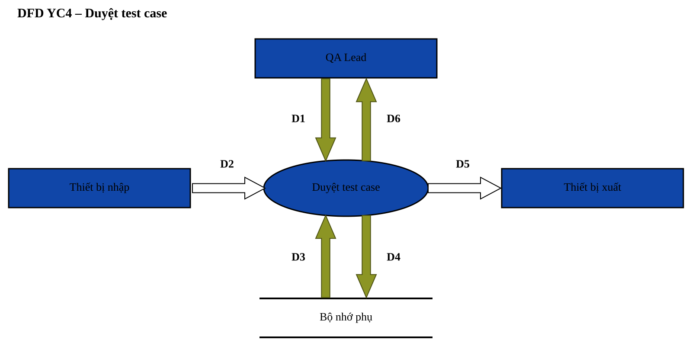

*Biểu mẫu:* BM3 · *Quy định:* QĐ4 · *File:* `docs/dfd/YC04_DuyetTestCase.drawio`

| Luồng | Mô tả |
|---|---|
| D1 | Mã test case, quyết định Duyệt / Trả lại, ghi chú (BM3). |
| D2 | Không có |
| D3 | Trạng thái hiện tại của test case; vai trò của người duyệt. |
| D4 | Trạng thái mới (Đã duyệt / Bị trả lại); phiếu duyệt (người duyệt, quyết định, ghi chú, ngày duyệt); nhật ký hoạt động. |
| D5 | Không có |
| D6 | Thông báo duyệt thành công kèm trạng thái mới, hoặc thông báo lỗi vi phạm QĐ4. |

**Thuật toán:**

- B1: Nhận D1 từ người dùng.
- B2: Kết nối cơ sở dữ liệu.
- B3: Đọc D3 từ bộ nhớ phụ.
- B4: Kiểm tra người duyệt có vai trò QA Lead? Nếu không thỏa: ghi thông báo lỗi vào D6, chuyển tới B8.
- B5: Kiểm tra test case đang ở trạng thái Chờ duyệt? Nếu không thỏa: ghi thông báo lỗi vào D6, chuyển tới B8.
- B6: Nếu quyết định là Trả lại: kiểm tra có ghi chú? Nếu không thỏa: ghi thông báo lỗi vào D6, chuyển tới B8.
- B7: Lưu D4 xuống bộ nhớ phụ.
- B8: Xuất D6 cho người dùng.
- B9: Đóng kết nối cơ sở dữ liệu.
- B10: Kết thúc.

### 3.4.6. DFD YC5 – Ghi nhận kết quả chạy test

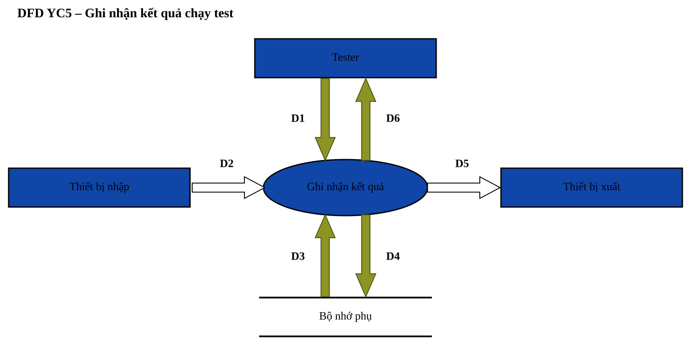

*Biểu mẫu:* BM4 · *Quy định:* QĐ5 · *File:* `docs/dfd/YC05_GhiKetQuaChayTest.drawio`

| Luồng | Mô tả |
|---|---|
| D1 | Mã test case, kết quả Pass / Fail / Blocked, ghi chú (mã bug). |
| D2 | Không có |
| D3 | Trạng thái của test case. |
| D4 | Kết quả chạy: kết quả, hình thức Thủ công, ghi chú, người chạy, thời điểm chạy. |
| D5 | Không có |
| D6 | Thông báo ghi nhận thành công, hoặc thông báo lỗi vi phạm QĐ5. |

**Thuật toán:**

- B1: Nhận D1 từ người dùng.
- B2: Kết nối cơ sở dữ liệu.
- B3: Đọc D3 từ bộ nhớ phụ.
- B4: Kiểm tra test case ở trạng thái Đã duyệt? Nếu không thỏa: ghi thông báo lỗi vào D6, chuyển tới B7.
- B5: Nếu kết quả là Fail hoặc Blocked: kiểm tra có ghi chú? Nếu không thỏa: ghi thông báo lỗi vào D6, chuyển tới B7.
- B6: Lưu D4 xuống bộ nhớ phụ.
- B7: Xuất D6 cho người dùng.
- B8: Đóng kết nối cơ sở dữ liệu.
- B9: Kết thúc.

### 3.4.7. DFD YC6 – Lập báo cáo kiểm thử

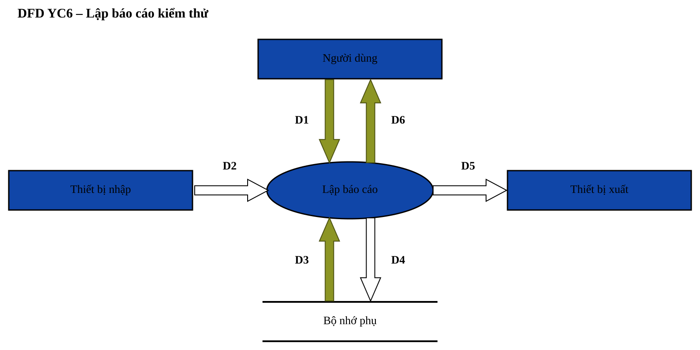

*Biểu mẫu:* BM5 · *Quy định:* QĐ5 · *File:* `docs/dfd/YC06_LapBaoCao.drawio`

| Luồng | Mô tả |
|---|---|
| D1 | Dự án cần xem báo cáo. |
| D2 | Không có |
| D3 | User story, test case, các lần chạy test, nhật ký AI của dự án. |
| D4 | Không có |
| D5 | Không có |
| D6 | Báo cáo BM5: tỷ lệ pass, độ bao phủ, tiến độ thực thi, kết quả theo module, xu hướng theo ngày, thống kê AI, danh sách user story chưa được bao phủ (dạng bảng và biểu đồ). |

**Thuật toán:**

- B1: Nhận D1 từ người dùng.
- B2: Kết nối cơ sở dữ liệu.
- B3: Đọc D3 từ bộ nhớ phụ.
- B4: Với mỗi test case: lấy kết quả của lần chạy GẦN NHẤT.
- B5: Tính tỷ lệ pass = số test case Pass / số test case đã chạy.
- B6: Tính độ bao phủ = số user story có ≥ 1 test case Đã duyệt / tổng số user story.
- B7: Tính tiến độ thực thi = số test case đã chạy / số test case Đã duyệt.
- B8: Nhóm kết quả theo module và theo ngày; thống kê số test case AI sinh, tỷ lệ phải sửa.
- B9: Xuất D6 cho người dùng.
- B10: Đóng kết nối cơ sở dữ liệu.
- B11: Kết thúc.

### 3.4.8. DFD YC7 – Tra cứu test case

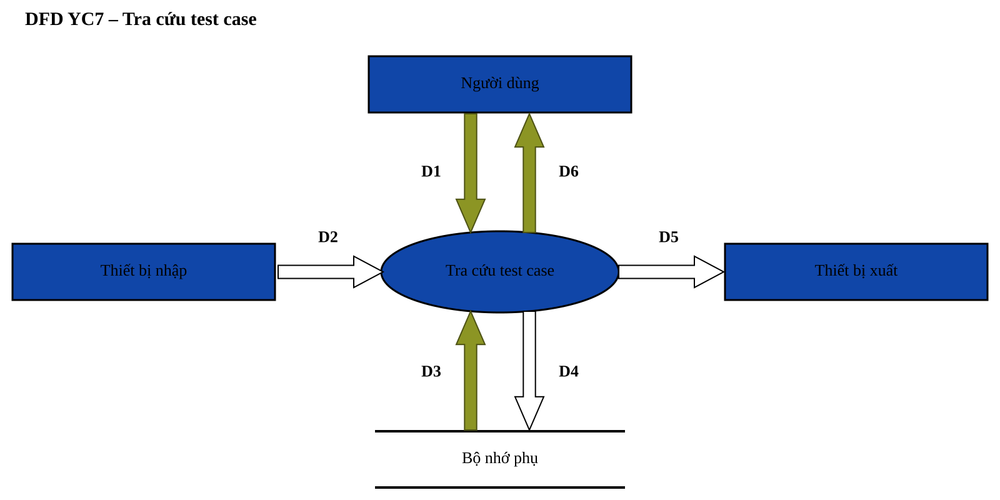

*Biểu mẫu:* BM6 · *Quy định:* Không có · *File:* `docs/dfd/YC07_TraCuuTestCase.drawio`

| Luồng | Mô tả |
|---|---|
| D1 | Điều kiện tra cứu: từ khóa (mã / tiêu đề), dự án, trạng thái, độ ưu tiên, loại, nguồn. |
| D2 | Không có |
| D3 | Các test case thỏa điều kiện kèm user story, kết quả chạy gần nhất, có script hay không. |
| D4 | Không có |
| D5 | Không có |
| D6 | Danh sách test case thỏa điều kiện (BM6), hoặc thông báo không tìm thấy. |

**Thuật toán:**

- B1: Nhận D1 từ người dùng.
- B2: Kết nối cơ sở dữ liệu.
- B3: Đọc D3 từ bộ nhớ phụ.
- B4: Ghép điều kiện D1 thành câu truy vấn có tham số (không nối chuỗi SQL) trước khi đọc D3.
- B5: Xuất D6 cho người dùng.
- B6: Đóng kết nối cơ sở dữ liệu.
- B7: Kết thúc.

### 3.4.9. DFD YC8a – Nhập user story từ file

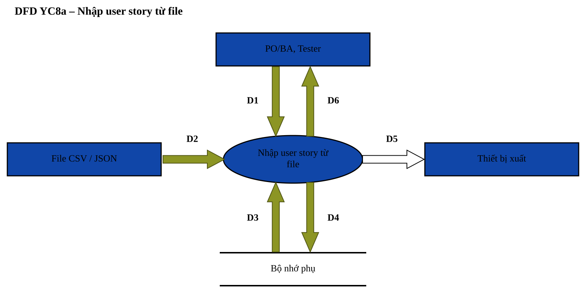

*Biểu mẫu:* BM7 · *Quy định:* QĐ1, QĐ8 · *File:* `docs/dfd/YC08_NhapXuatDuLieu.drawio`

| Luồng | Mô tả |
|---|---|
| D1 | Dự án nhận dữ liệu; lệnh chọn file. |
| D2 | Các dòng user story trong file (BM7). |
| D3 | Danh sách mã user story đã có; module của dự án; tham số MIN_AC_PER_STORY, PRIORITIES. |
| D4 | Các user story hợp lệ. |
| D5 | Không có |
| D6 | Thông báo số dòng nhập thành công và danh sách dòng lỗi kèm lý do. |

**Thuật toán:**

- B1: Nhận D1 từ người dùng.
- B2: Nhận D2 từ thiết bị nhập.
- B3: Kết nối cơ sở dữ liệu.
- B4: Đọc D3 từ bộ nhớ phụ.
- B5: Kiểm tra số dòng trong D2 ≤ 200? Nếu không thỏa: ghi thông báo lỗi vào D6, chuyển tới B8.
- B6: Với từng dòng: kiểm tra theo QĐ1 như YC1; dòng lỗi được ghi lại số dòng và lý do, không làm hỏng các dòng hợp lệ.
- B7: Lưu D4 xuống bộ nhớ phụ.
- B8: Xuất D6 cho người dùng.
- B9: Đóng kết nối cơ sở dữ liệu.
- B10: Kết thúc.

### 3.4.10. DFD YC8b – Xuất test case ra Excel

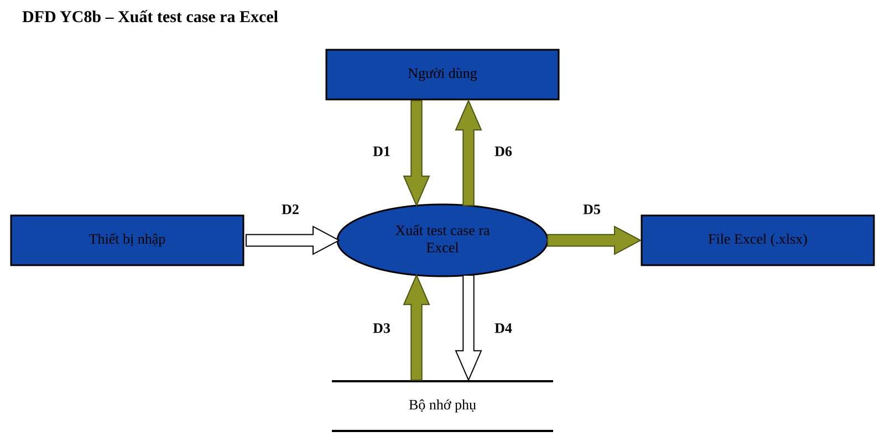

*Biểu mẫu:* BM8 · *Quy định:* Không có · *File:* `docs/dfd/YC08_NhapXuatDuLieu.drawio`

| Luồng | Mô tả |
|---|---|
| D1 | Điều kiện lọc như YC7. |
| D2 | Không có |
| D3 | Các test case thỏa điều kiện kèm kết quả chạy gần nhất. |
| D4 | Không có |
| D5 | File Excel: mỗi test case một dòng theo các cột của BM2 và kết quả gần nhất (BM8). |
| D6 | Thông báo xuất file thành công (trình duyệt tải file về). |

**Thuật toán:**

- B1: Nhận D1 từ người dùng.
- B2: Kết nối cơ sở dữ liệu.
- B3: Đọc D3 từ bộ nhớ phụ.
- B4: Ghi từng test case thành một dòng Excel; các bước, acceptance criteria xuống dòng trong ô.
- B5: Xuất D5 ra thiết bị xuất.
- B6: Xuất D6 cho người dùng.
- B7: Đóng kết nối cơ sở dữ liệu.
- B8: Kết thúc.

### 3.4.11. DFD YC9 – Sinh và chạy script kiểm thử tự động

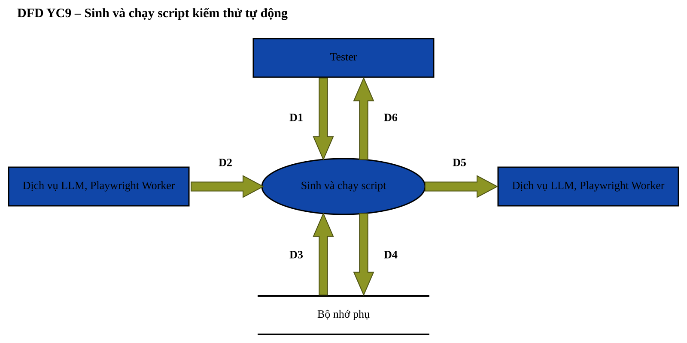

*Biểu mẫu:* BM9 · *Quy định:* QĐ9 · *File:* `docs/dfd/YC09_SinhVaChayScript.drawio`

| Luồng | Mô tả |
|---|---|
| D1 | Mã test case; yêu cầu sinh script hoặc chạy script; mã script đã sửa (nếu Tester sửa tay). |
| D2 | Từ LLM: mã script Playwright. Từ Playwright Worker: báo cáo chạy (JSON), log, ảnh chụp lỗi. |
| D3 | Test case Đã duyệt, URL ứng dụng của dự án, script đang lưu; tham số RUN_TIMEOUT_SEC, AI_MAX_RETRY. |
| D4 | Script (mã nguồn, người tạo, ngày); kết quả chạy hình thức Tự động (kết quả, thời gian, log, ảnh lỗi); nhật ký AI. |
| D5 | Đến LLM: prompt đã che PII. Đến Playwright Worker: script đã qua kiểm tra tĩnh. |
| D6 | Thông báo thành công kèm mã script, kết quả Pass / Fail, log, ảnh chụp lỗi; hoặc thông báo lỗi vi phạm QĐ9. |

**Thuật toán:**

- B1: Nhận D1 từ người dùng.
- B2: Kết nối cơ sở dữ liệu.
- B3: Đọc D3 từ bộ nhớ phụ.
- B4: Kiểm tra test case ở trạng thái Đã duyệt? Nếu không thỏa: ghi thông báo lỗi vào D6, chuyển tới B10.
- B5: Sinh script: xuất D5 (prompt) đến Dịch vụ LLM, nhận D2 (mã script).
- B6: Kiểm tra tĩnh script: không dùng module nguy hiểm, không truy cập process.env, không eval / new Function? Nếu không thỏa: ghi thông báo lỗi vào D6, chuyển tới B10.
- B7: Chạy script: xuất D5 (script) đến Playwright Worker, chờ tối đa RUN_TIMEOUT_SEC giây, nhận D2 (báo cáo, ảnh lỗi).
- B8: Xác định kết quả Pass / Fail từ báo cáo.
- B9: Lưu D4 xuống bộ nhớ phụ.
- B10: Xuất D6 cho người dùng.
- B11: Đóng kết nối cơ sở dữ liệu.
- B12: Kết thúc.

### 3.4.12. DFD YC10 – Thay đổi quy định

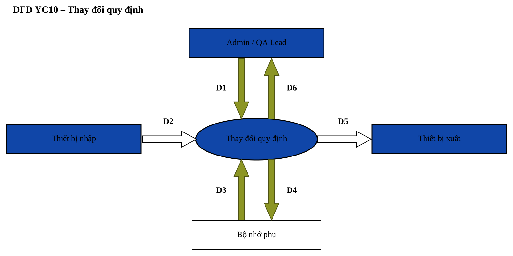

*Biểu mẫu:* Không có · *Quy định:* QĐ10 · *File:* `docs/dfd/YC10_ThayDoiQuyDinh.drawio`

| Luồng | Mô tả |
|---|---|
| D1 | Tham số cần thay đổi, giá trị mới. |
| D2 | Không có |
| D3 | Giá trị hiện tại, kiểu dữ liệu, miền giá trị cho phép của tham số; vai trò người sửa. |
| D4 | Giá trị mới, người sửa, thời điểm sửa; nhật ký hoạt động. |
| D5 | Không có |
| D6 | Thông báo thay đổi thành công (giá trị cũ → mới), hoặc thông báo giá trị ngoài miền cho phép. |

**Thuật toán:**

- B1: Nhận D1 từ người dùng.
- B2: Kết nối cơ sở dữ liệu.
- B3: Đọc D3 từ bộ nhớ phụ.
- B4: Kiểm tra người sửa có vai trò Admin hoặc QA Lead? Nếu không thỏa: ghi thông báo lỗi vào D6, chuyển tới B7.
- B5: Kiểm tra giá trị mới đúng kiểu và thuộc miền giá trị cho phép (QĐ10)? Nếu không thỏa: ghi thông báo lỗi vào D6, chuyển tới B7.
- B6: Lưu D4 xuống bộ nhớ phụ.
- B7: Xuất D6 cho người dùng.
- B8: Đóng kết nối cơ sở dữ liệu.
- B9: Kết thúc.

### 3.4.13. DFD YC11 – Quản lý người dùng, dự án

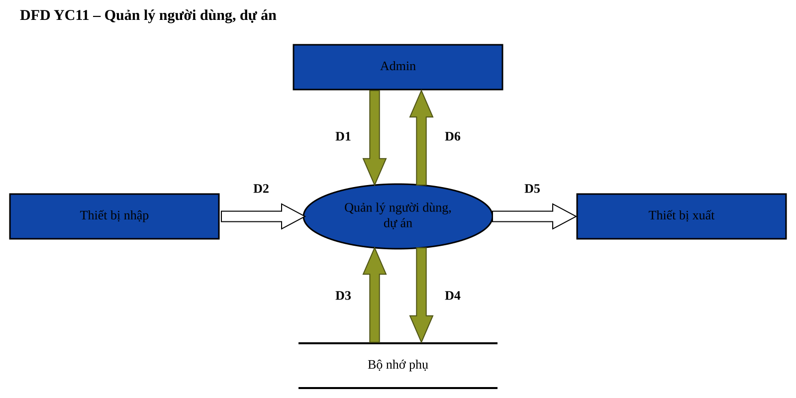

*Biểu mẫu:* Không có · *Quy định:* QĐ11 · *File:* `docs/dfd/YC11_QuanLyNguoiDungDuAn.drawio`

| Luồng | Mô tả |
|---|---|
| D1 | Thông tin tài khoản (tên đăng nhập, họ tên, vai trò, mật khẩu, khóa/mở); hoặc thông tin dự án, module. |
| D2 | Không có |
| D3 | Danh sách tài khoản, dự án, module hiện có. |
| D4 | Tài khoản (mật khẩu ĐÃ BĂM bcrypt), dự án, module; nhật ký hoạt động. |
| D5 | Không có |
| D6 | Thông báo lưu thành công (không bao giờ chứa mật khẩu băm), hoặc thông báo lỗi vi phạm QĐ11. |

**Thuật toán:**

- B1: Nhận D1 từ người dùng.
- B2: Kết nối cơ sở dữ liệu.
- B3: Đọc D3 từ bộ nhớ phụ.
- B4: Kiểm tra người thực hiện có vai trò Admin? Nếu không thỏa: ghi thông báo lỗi vào D6, chuyển tới B9.
- B5: Kiểm tra tên đăng nhập 3–30 ký tự a-z 0-9 _ . và không trùng; mật khẩu ≥ 8 ký tự? Nếu không thỏa: ghi thông báo lỗi vào D6, chuyển tới B9.
- B6: Kiểm tra Admin không tự khóa hoặc tự hạ quyền chính mình? Nếu không thỏa: ghi thông báo lỗi vào D6, chuyển tới B9.
- B7: Băm mật khẩu bằng bcrypt.
- B8: Lưu D4 xuống bộ nhớ phụ.
- B9: Xuất D6 cho người dùng.
- B10: Đóng kết nối cơ sở dữ liệu.
- B11: Kết thúc.

### 3.4.14. DFD YC12 – Quản lý sprint (Agile/Scrum)

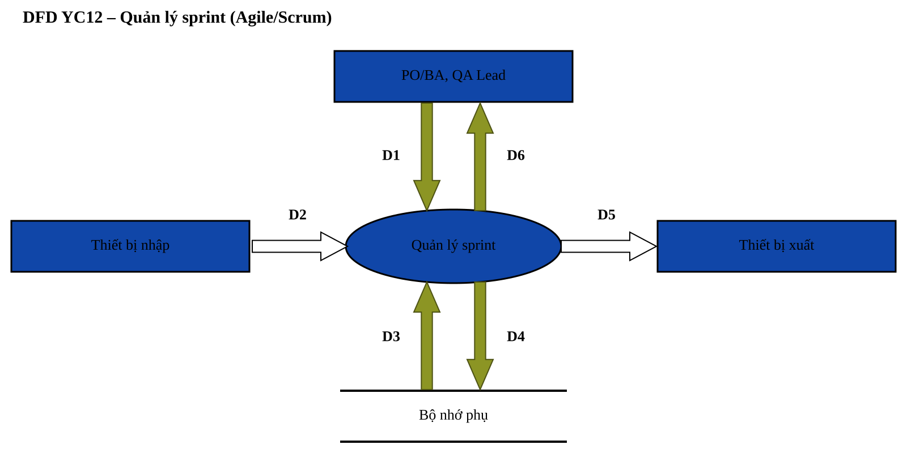

*Biểu mẫu:* BM10 · *Quy định:* QĐ12 · *File:* `docs/dfd/YC12_QuanLySprint.drawio`

| Luồng | Mô tả |
|---|---|
| D1 | Tên, mục tiêu, ngày bắt đầu, ngày kết thúc sprint (BM10); user story đưa vào sprint và story point. |
| D2 | Không có |
| D3 | Các sprint hiện có của dự án; tham số SPRINT_MAX_DAYS; user story, test case Đã duyệt và kết quả chạy gần nhất. |
| D4 | Sprint mới / đã sửa; sprint_id, story_points của user story. |
| D5 | Không có |
| D6 | Thông báo lưu thành công kèm bảng sprint, burndown, velocity; hoặc thông báo lỗi vi phạm QĐ12. |

**Thuật toán:**

- B1: Nhận D1 từ người dùng.
- B2: Kết nối cơ sở dữ liệu.
- B3: Đọc D3 từ bộ nhớ phụ.
- B4: Kiểm tra số ngày của sprint ≤ SPRINT_MAX_DAYS và ngày kết thúc không trước ngày bắt đầu? Nếu không thỏa: ghi thông báo lỗi vào D6, chuyển tới B10.
- B5: Kiểm tra sprint không trùng thời gian với sprint khác của dự án? Nếu không thỏa: ghi thông báo lỗi vào D6, chuyển tới B10.
- B6: Kiểm tra user story cùng dự án và story point thuộc dãy 1, 2, 3, 5, 8, 13? Nếu không thỏa: ghi thông báo lỗi vào D6, chuyển tới B10.
- B7: Xác định story đạt DoD: có ≥ 1 test case Đã duyệt và mọi test case Đã duyệt có lần chạy gần nhất là Pass.
- B8: Tính velocity = tổng story point của story đạt DoD; burndown: còn lại(ngày) = tổng story point − story point đã đạt DoD đến ngày đó.
- B9: Lưu D4 xuống bộ nhớ phụ.
- B10: Xuất D6 cho người dùng.
- B11: Đóng kết nối cơ sở dữ liệu.
- B12: Kết thúc.

### 3.4.15. DFD YC13 – Báo đã sửa lỗi và kiểm thử lại

*Biểu mẫu:* BM11 · *Quy định:* QĐ13 · *File:* `docs/dfd/YC13_BaoDaSuaLoi.drawio`

| Luồng | Mô tả |
|---|---|
| D1 | Lần chạy Fail được chọn, bản build đã sửa, ghi chú cho Tester (BM11). |
| D2 | Không có |
| D3 | Kết quả của lần chạy; lần chạy gần nhất của test case; thông tin đã báo sửa trước đó. |
| D4 | Bản build, ghi chú, người báo, thời điểm báo sửa của lần chạy; nhật ký hoạt động. |
| D5 | Không có |
| D6 | Thông báo đã báo sửa, test case chuyển sang Cần kiểm thử lại; hoặc thông báo lỗi vi phạm QĐ13. |

**Thuật toán:**

- B1: Nhận D1 từ người dùng.
- B2: Kết nối cơ sở dữ liệu.
- B3: Đọc D3 từ bộ nhớ phụ.
- B4: Kiểm tra người báo có vai trò Developer? Nếu không thỏa: ghi thông báo lỗi vào D6, chuyển tới B10.
- B5: Kiểm tra bản build được nhập (1–50 ký tự)? Nếu không thỏa: ghi thông báo lỗi vào D6, chuyển tới B10.
- B6: Kiểm tra lần chạy có kết quả Fail? Nếu không thỏa: ghi thông báo lỗi vào D6, chuyển tới B10.
- B7: Kiểm tra đây là lần chạy gần nhất của test case? Nếu không thỏa: ghi thông báo lỗi vào D6, chuyển tới B10.
- B8: Kiểm tra lần chạy chưa được báo sửa? Nếu không thỏa: ghi thông báo lỗi vào D6, chuyển tới B10.
- B9: Lưu D4 xuống bộ nhớ phụ.
- B10: Xuất D6 cho người dùng.
- B11: Đóng kết nối cơ sở dữ liệu.
- B12: Kết thúc.

### 3.4.16. Sơ đồ phối hợp giữa các công việc

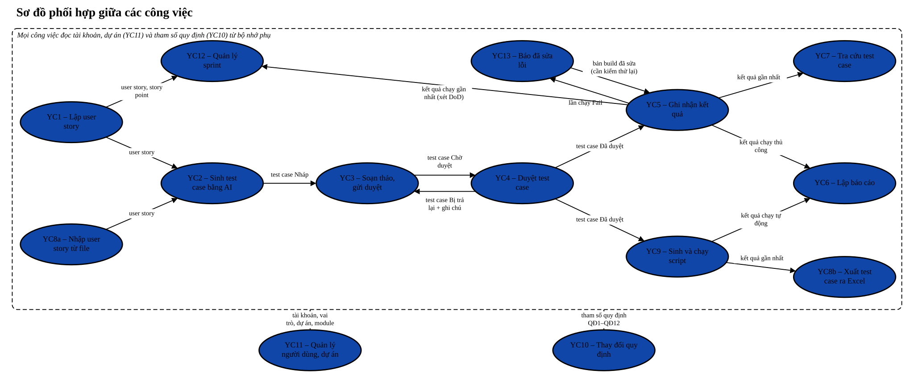

*File:* `docs/dfd/PhoiHop_CacCongViec.drawio`. Mỗi mũi tên là **thông tin** do công việc trước tạo ra (ghi xuống bộ nhớ phụ ở D4) và công việc sau sử dụng (đọc lên ở D3).

| Công việc trước | Thông tin chuyển giao | Công việc sau |
|---|---|---|
| YC1 – Lập user story | user story | YC2 – Sinh test case bằng AI |
| YC8a – Nhập user story từ file | user story | YC2 – Sinh test case bằng AI |
| YC1 – Lập user story | user story, story point | YC12 – Quản lý sprint |
| YC2 – Sinh test case bằng AI | test case Nháp | YC3 – Soạn thảo, gửi duyệt |
| YC3 – Soạn thảo, gửi duyệt | test case Chờ duyệt | YC4 – Duyệt test case |
| YC4 – Duyệt test case | test case Bị trả lại + ghi chú | YC3 – Soạn thảo, gửi duyệt |
| YC4 – Duyệt test case | test case Đã duyệt | YC5 – Ghi nhận kết quả |
| YC4 – Duyệt test case | test case Đã duyệt | YC9 – Sinh và chạy script |
| YC5 – Ghi nhận kết quả | lần chạy Fail | YC13 – Báo đã sửa lỗi |
| YC13 – Báo đã sửa lỗi | bản build đã sửa (cần kiểm thử lại) | YC5 – Ghi nhận kết quả |
| YC5 – Ghi nhận kết quả | kết quả chạy gần nhất (xét DoD) | YC12 – Quản lý sprint |
| YC5 – Ghi nhận kết quả | kết quả gần nhất | YC7 – Tra cứu test case |
| YC5 – Ghi nhận kết quả | kết quả chạy thủ công | YC6 – Lập báo cáo |
| YC9 – Sinh và chạy script | kết quả chạy tự động | YC6 – Lập báo cáo |
| YC9 – Sinh và chạy script | kết quả gần nhất | YC8b – Xuất test case ra Excel |
| YC9 – Sinh và chạy script | kết quả chạy tự động gần nhất (xét DoD) | YC12 – Quản lý sprint |
| YC11 – Quản lý người dùng, dự án | tài khoản, vai trò, dự án, module | Mọi công việc |
| YC10 – Thay đổi quy định | tham số quy định QĐ1–QĐ12 | Mọi công việc |

<!-- DFD:END -->

## 3.5. Sơ đồ hoạt động – quy trình nghiệp vụ mới

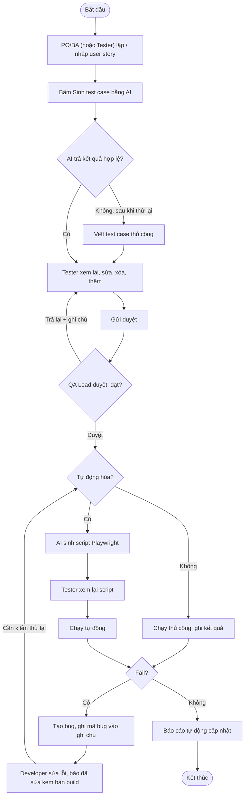

So với quy trình cũ (Chương 1): AI rút ngắn bước viết nháp; duyệt có lưu vết; không còn viết lại test case thành script bằng tay; Developer báo đã sửa kèm bản build nên Tester biết ngay test case nào cần kiểm thử lại; báo cáo tự động.

## 3.6. Sơ đồ trạng thái của test case

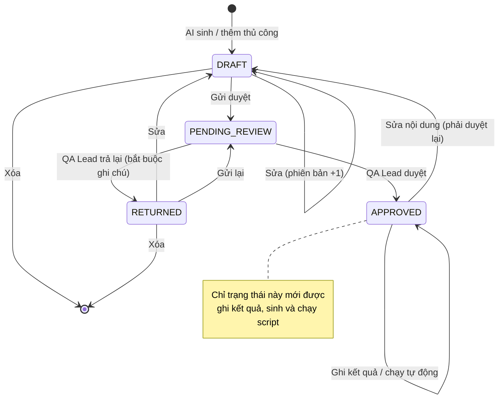
