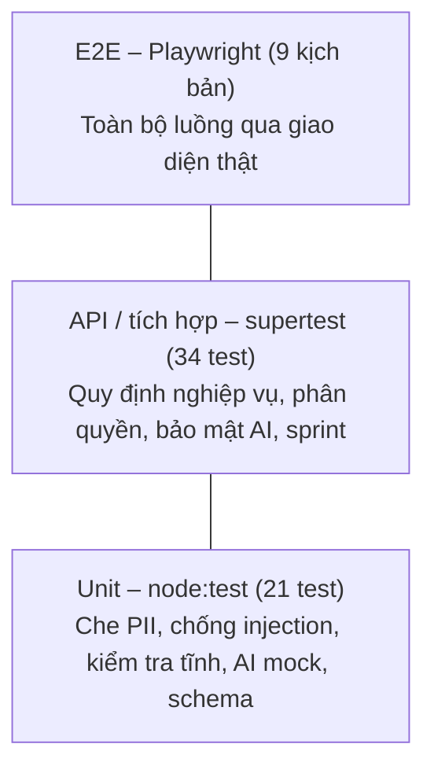
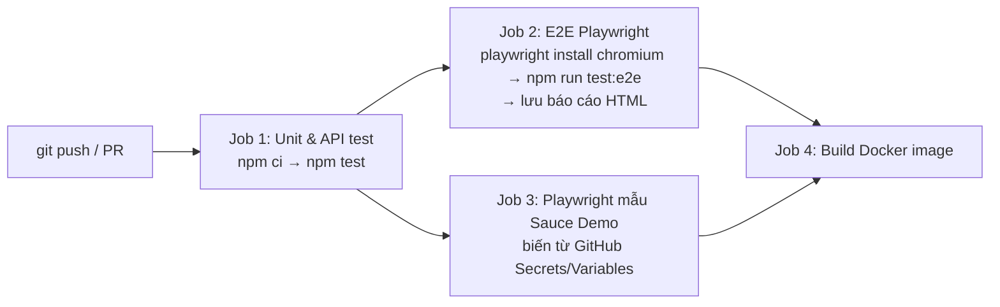

# Chương 6. Kiểm chứng (kiểm thử)

> Sản phẩm của giai đoạn: **phần mềm chất lượng** – kế hoạch kiểm thử, bộ test case kiểm thử chính hệ thống, kiểm thử tự động nhiều tầng và kết quả.

## 6.1. Chiến lược kiểm thử

Áp dụng mô hình **kim tự tháp kiểm thử**: nhiều test nhanh ở tầng dưới, ít test chậm ở tầng trên.



| Loại | Công cụ | Phạm vi | Khi nào chạy |
|---|---|---|---|
| Unit test | `node:test` (có sẵn trong Node.js) | Hàm thuần: piiMasker, injectionGuard, staticCheck, MockProvider, schema | Mỗi lần lưu mã, CI |
| API test | `node:test` + supertest, CSDL trong bộ nhớ | Toàn bộ route + service + CSDL | CI |
| E2E test | **Playwright** | Giao diện thật trên Chrome, server riêng, dữ liệu mới | CI, trước khi demo |
| Kiểm thử thủ công | Bộ test case hệ thống (mục 6.4) | Giao diện, trải nghiệm, trường hợp khó tự động hóa | Trước khi nộp |
| Kiểm thử bảo mật | API test + thủ công | RBAC, XSS, SQL injection, prompt injection, PII, sandbox | CI + thủ công |
| Kiểm thử chức năng YC9 | Playwright trên Sauce Demo | Script mẫu (POM) + script do AI sinh | Thủ công, demo |

**Tiêu chí hoàn thành:** 100% test tự động pass; không còn lỗi mức High; mỗi YC1–YC13 có ít nhất 1 test case kiểm thử.

**Kiểm thử trong Agile:** kiểm thử không phải một giai đoạn cuối mà là một phần của **Definition of Done** của mỗi story: story chỉ được tính hoàn thành khi có test tự động mới và CI xanh. Vì vậy bộ test dưới đây được viết dần qua 5 sprint (cột *Sprint* trong Product Backlog), không dồn về cuối kỳ.

## 6.2. Kiểm thử tự động – Unit và API

Chạy: `cd app && npm test`

| Mã | Mô tả | Kết quả |
|---|---|---|
| UT-01 | Che email | Pass |
| UT-02 | Che số điện thoại VN (0xxx, +84) | Pass |
| UT-03 | Che CCCD 12 số, số thẻ 16 số | Pass |
| UT-04 | Không che nhầm số thông thường (10 MB, 8 ký tự, mã US) | Pass |
| UT-05 | Chuỗi rỗng/null không lỗi | Pass |
| UT-06 | Phát hiện prompt injection tiếng Anh | Pass |
| UT-07 | Phát hiện prompt injection tiếng Việt | Pass |
| UT-08 | User story bình thường không bị gắn cờ | Pass |
| UT-09 | Loại bỏ thẻ giả `</user_story><system>` | Pass |
| UT-10 | Kiểm tra tĩnh chặn child_process, fs, process.env, eval | Pass |
| UT-11 | Kiểm tra tĩnh cho qua script Playwright hợp lệ | Pass |
| UT-12 | Kiểm tra tĩnh yêu cầu có khối test() | Pass |
| UT-13 | Tách acceptance criteria theo dòng | Pass |
| UT-14 | MockProvider trả kết quả đúng schema | Pass |
| UT-15 | Mỗi acceptance criterion có ít nhất 1 case Positive | Pass |
| UT-16 | Có case Negative và Edge (giá trị biên 10 MB) | Pass |
| UT-17 | Tuân thủ QĐ2: không vượt số tối đa | Pass |
| UT-18 | Prompt chứa quy định số lượng, dữ liệu bọc trong `<user_story>` | Pass |
| UT-19 | Schema từ chối priority sai, steps rỗng | Pass |
| UT-20 | Bỏ code fence ```json | Pass |
| UT-21 | Sinh script Playwright có locator `data-test` | Pass |
| IT-01 | Đăng nhập đúng trả JWT, không trả mật khẩu băm | Pass |
| IT-02 | Sai mật khẩu → 401, thông báo chung | Pass |
| IT-03 | Không có token → 401 | Pass |
| IT-04 | Token giả mạo → 401 | Pass |
| IT-05 | QĐ4: Tester không được duyệt → 403 | Pass |
| IT-06 | Developer chỉ xem, không lập story, không gọi AI | Pass |
| IT-07 | Tester không được đổi quy định | Pass |
| IT-08 | Chỉ Admin quản lý người dùng; không lộ mật khẩu băm | Pass |
| IT-09 | Tài khoản bị khóa không đăng nhập được | Pass |
| IT-10 | Header bảo mật, CSP được bật | Pass |
| IT-11 | QĐ1: mã sai định dạng → 400 | Pass |
| IT-12 | QĐ1: mã trùng → 409 | Pass |
| IT-13 | QĐ1: độ ưu tiên sai → 400 | Pass |
| IT-14→22 | Luồng đầy đủ: lập story → AI sinh → sửa (phiên bản) → chưa duyệt không chạy → gửi duyệt (khóa sửa) → trả lại thiếu ghi chú bị chặn → trả lại → duyệt → Fail thiếu ghi chú bị chặn → Pass → báo cáo bao phủ → sửa bản đã duyệt quay về Nháp | Pass |
| IT-23 | QĐ2 + YC10: đổi tối đa 3 → AI chỉ sinh 3; thêm tay bị chặn | Pass |
| IT-24 | Tham số ngoài miền giá trị → 400 | Pass |
| IT-25 | Email, SĐT được che trong prompt lưu ở nhật ký | Pass |
| IT-26 | Prompt injection được gắn cờ, vẫn sinh đúng schema | Pass |
| IT-27 | AI sai định dạng lần đầu → tự thử lại, attempts = 2 | Pass |
| IT-28 | AI luôn sai → 502, nhật ký FAILED, attempts = 3 | Pass |
| IT-29 | Vượt hạn mức gọi AI/giờ → 429 | Pass |
| IT-30 | Nhập file: dòng lỗi không làm hỏng dòng hợp lệ | Pass |
| IT-31 | Xuất Excel đúng định dạng | Pass |
| IT-32 | YC9: chỉ sinh script cho test case đã duyệt | Pass |
| IT-33 | Audit log ghi thao tác duyệt | Pass |
| IT-34 | QA Lead tạo sprint mới cho dự án | Pass |
| IT-35 | QĐ12: sprint trùng thời gian → 409 | Pass |
| IT-36 | QĐ12: sprint quá dài / kết thúc trước khi bắt đầu → 400 | Pass |
| IT-37 | Tester không được tạo sprint → 403 | Pass |
| IT-38 | Story chỉ gắn sprint cùng dự án; story point phải thuộc Fibonacci | Pass |
| IT-39 | Product backlog chỉ gồm story chưa có sprint; đưa story vào sprint | Pass |
| IT-40 | Definition of Done và velocity: Sprint 1 hoàn thành 5/13 SP | Pass |
| IT-41 | Burndown: 1 điểm/ngày, đường lý tưởng giảm về 0 | Pass |
| IT-42 | Báo cáo lọc theo sprint, trả velocity các sprint | Pass |
| IT-43 | PO/BA lập được user story và tạo sprint | Pass |
| IT-44 | PO/BA không viết, duyệt, chạy test case, không gọi AI, không đổi quy định → 403 | Pass |
| IT-45 | PO/BA xem được test case, báo cáo; Admin tạo được tài khoản PO/BA | Pass |
| IT-46 | YC13: Developer báo đã sửa lần chạy Fail → test case cần kiểm thử lại | Pass |
| IT-47 | YC13: Tester chạy lại thì test case hết cần kiểm thử lại | Pass |
| IT-48 | QĐ13: thiếu bản build → 400; lần chạy Pass, đã chạy lại hoặc đã báo rồi → 409 | Pass |
| IT-49 | Chỉ Developer được báo đã sửa lỗi (vai trò khác → 403) | Pass |

**Kết quả:** `62 tests, 62 pass, 0 fail` (Node.js 21, macOS, 31/10/2026).

## 6.3. Kiểm thử E2E bằng Playwright

Chạy: `cd app && npm run test:e2e` (Playwright tự khởi động server ở cổng 3100 với CSDL riêng `data/e2e.db`; xem báo cáo HTML: `npx playwright show-report e2e-report`).

**Kỹ thuật áp dụng:**

- Locator theo vai trò và nhãn (`getByRole`, `getByLabel`, `getByPlaceholder`) – giống cách người dùng nhìn thấy, bền khi đổi CSS.
- Auto-waiting và web-first assertion (`expect(...).toBeVisible()`), không dùng `sleep`.
- `webServer` trong cấu hình: tự dựng môi trường sạch cho mỗi lần chạy.
- `test.describe.configure({ mode: 'serial' })`: các kịch bản nối tiếp nhau như một ngày làm việc thật.
- Ảnh chụp + trace khi lỗi (`screenshot: 'only-on-failure'`, `trace: 'retain-on-failure'`).

| Mã | Kịch bản | Kết quả |
|---|---|---|
| E2E-01 | Đăng nhập sai mật khẩu hiển thị lỗi | Pass |
| E2E-02 | Tester lập user story mới qua hộp thoại | Pass |
| E2E-03 | Tester sinh test case bằng AI, chọn tất cả và gửi duyệt | Pass |
| E2E-04 | QA Lead trả lại thiếu ghi chú bị chặn; trả lại có ghi chú; duyệt hàng loạt phần còn lại | Pass |
| E2E-05 | Tester ghi kết quả Fail: thiếu ghi chú bị chặn, có ghi chú thì lưu | Pass |
| E2E-06 | QA Lead đổi QĐ2 thành 2, sinh lại → AI chỉ sinh 2 | Pass |
| E2E-07 | Developer không thấy chức năng ghi | Pass |
| E2E-08 | QA Lead Sprint Planning: đưa story từ Product backlog vào sprint đang chạy, bảng sprint cập nhật | Pass |
| E2E-09 | Tester xem được burndown nhưng không có nút tạo sprint | Pass |

**Kết quả:** `9 passed (10.1s)`.

## 6.4. Bộ test case kiểm thử hệ thống (thủ công)

| Mã | Chức năng | Các bước | Kết quả mong đợi | Loại | Ưu tiên |
|---|---|---|---|---|---|
| ST-01 | Đăng nhập | Bỏ trống mật khẩu, bấm Đăng nhập | Trình duyệt báo trường bắt buộc | Negative | Medium |
| ST-02 | Đăng nhập | Sai mật khẩu 11 lần liên tiếp | Lần thứ 11 báo "Đăng nhập sai quá nhiều lần…" | Negative | High |
| ST-03 | Phiên | Đăng nhập, xóa token trong DevTools, tải lại | Quay về trang đăng nhập | Negative | Medium |
| ST-04 | YC1 | Lập story mã `us-abc` (chữ thường) | Lưu thành `US-ABC` | Edge | Low |
| ST-05 | YC1 | Acceptance criteria chỉ gồm dòng trống | Báo lỗi tối thiểu 1 tiêu chí | Negative | Medium |
| ST-06 | YC2 | Sinh test case cho story có email, SĐT | Thông báo "Đã che 1 EMAIL, 1 PHONE"; nhật ký AI hiển thị `[EMAIL]`, `[PHONE]` | Positive | High |
| ST-07 | YC2 | Story chứa "Ignore all previous instructions" | Có cảnh báo prompt injection; test case vẫn đúng định dạng | Negative | High |
| ST-08 | YC2 | Sinh lại khi đã có test case AI Nháp | Hỏi xác nhận; các case AI Nháp cũ bị thay thế, case đã duyệt giữ nguyên | Positive | Medium |
| ST-09 | YC2 | Đặt `AI_PROVIDER=gemini` nhưng không có key | Thanh bên báo provider "unavailable"; bấm sinh báo lỗi rõ ràng | Negative | Medium |
| ST-10 | YC3 | Sửa test case Đã duyệt | Cảnh báo phải duyệt lại; sau khi lưu trạng thái Nháp, phiên bản +1 | Positive | High |
| ST-11 | YC3 | Xem tab Lịch sử của test case AI đã sửa | Bảng so sánh v1 (AI) và bản hiện tại, tô màu khác biệt | Positive | Medium |
| ST-12 | YC4 | Huy hiệu số lượng chờ duyệt | Tăng khi Tester gửi duyệt, giảm khi QA Lead duyệt | Positive | Low |
| ST-13 | YC5 | Ghi Blocked có ghi chú | Lưu; báo cáo đếm Blocked | Positive | Medium |
| ST-14 | YC6 | So sánh số liệu báo cáo với dữ liệu thật | Tỷ lệ pass = Pass/đã chạy theo lần chạy gần nhất | Positive | High |
| ST-15 | YC6 | Chọn dự án ở thanh trên cùng | Báo cáo, danh sách lọc theo dự án | Positive | Medium |
| ST-16 | YC7 | Lọc Nguồn = AI, Trạng thái = Đã duyệt | Chỉ hiện test case thỏa cả 2 điều kiện | Positive | Medium |
| ST-17 | YC8 | Nhập `samples/user_stories_mau.csv` | 4 story được tạo; tiếng Việt hiển thị đúng | Positive | Medium |
| ST-18 | YC8 | Xuất Excel, mở bằng Excel | Đủ cột, các bước xuống dòng, tiêu đề tô màu | Positive | Low |
| ST-19 | YC9 | Sinh script cho US-SAU-001-TC01 và chạy | Chrome chạy ngầm; kết quả Pass trong khoảng 2–5 giây | Positive | High |
| ST-20 | YC9 | Sửa script cho expect sai rồi chạy | Kết quả Fail, có log lỗi và ảnh chụp màn hình | Negative | High |
| ST-21 | YC9 | Thêm `require('child_process')` vào script rồi chạy | Bị chặn: "không được dùng module hệ thống" | Negative | High |
| ST-22 | YC10 | Đặt MAX_TC_PER_STORY = 100 | Báo lỗi miền 1–50 | Edge | Medium |
| ST-23 | Bảo mật XSS | Lập story có tiêu đề `` | Hiển thị nguyên văn, không chạy script | Negative | High |
| ST-24 | Bảo mật SQLi | Tìm kiếm `' OR 1=1 --` | Không lỗi, không lộ dữ liệu ngoài kết quả tìm | Negative | High |
| ST-25 | RBAC | Developer gọi trực tiếp `POST /api/stories` bằng Postman | 403 | Negative | High |
| ST-26 | YC12 | Ghi Pass cho test case cuối cùng của một story trong sprint đang chạy | Story chuyển sang cột *Hoàn thành (DoD)*, burndown giảm đúng số story point | Positive | High |
| ST-27 | YC12 | Tạo sprint 30 ngày khi `SPRINT_MAX_DAYS` = 28 | Báo lỗi QĐ12 | Edge | Medium |
| ST-28 | YC13 | Tester ghi Fail; Developer bấm *Báo đã sửa*, nhập bản 1.0.2; Tester lọc *Cần kiểm thử lại* và chạy lại Pass | Test case hiện trong bộ lọc kèm cảnh báo bản build; sau khi chạy lại thì biến mất | Positive | High |

## 6.5. Kiểm thử chức năng YC9 với Playwright trên Sauce Demo

### Bộ test mẫu viết tay (Page Object Model)

`automation/specs/samples/` – 8 test cho US-SAU-001 (đăng nhập) và US-SAU-002 (giỏ hàng). Áp dụng:

- **Page Object Model** (`automation/pages/LoginPage.js`, `InventoryPage.js`): gom locator và thao tác của từng trang; khi giao diện đổi chỉ sửa một chỗ.
- `testIdAttribute: 'data-test'` để dùng `getByTestId('username')` khớp thuộc tính `data-test` của Sauce Demo.
- **Data-driven test**: một khối test chạy với nhiều bộ dữ liệu (bỏ trống username / password).
- Chạy song song (`fullyParallel`), dùng Chrome có sẵn trên máy (`channel: 'chrome'`).

Chạy: `cd automation && npm run test:samples` → **8 passed (7.0s)**.

### Script do AI sinh và chạy từ hệ thống

| Test case | Kết quả chạy tự động | Thời gian |
|---|---|---|
| US-SAU-001-TC01 Đăng nhập thành công | Pass | 2,4 s |
| US-SAU-001-TC02 Đăng nhập sai mật khẩu | Pass | 2,2 s |
| US-SAU-001-TC03 Tài khoản bị khóa | Pass | 2,2 s |
| US-SAU-002-TC01 Thêm sản phẩm vào giỏ | Pass | 2,4 s |
| US-SAU-002-TC01 (cố ý sửa expect thành 2) | Fail đúng như mong đợi, có ảnh chụp lỗi | 6,8 s |
| Script chứa `child_process`, `process.env` | Bị chặn trước khi chạy | – |

**So sánh script AI với bộ viết tay:** script AI viết "phẳng" (mỗi bước một lệnh, locator CSS `[data-test=...]`), đủ để chạy nhưng chưa tái sử dụng được. Bộ viết tay dùng POM, data-driven, dễ bảo trì hơn. Đây là lý do hệ thống bắt buộc **Tester xem lại script** trước khi chạy và là hướng phát triển ở các phiên bản sau (AI sinh script theo POM, tự sửa locator).

## 6.6. Tích hợp liên tục (CI)

`.github/workflows/ci.yml` chạy tự động mỗi lần push lên `main` hoặc tạo Pull Request:



Pull Request chỉ được merge khi cả 4 job xanh.

## 6.7. Tổng kết kiểm thử

| Hạng mục | Số lượng | Pass | Fail |
|---|---|---|---|
| Unit test | 21 | 21 | 0 |
| API / tích hợp | 34 | 34 | 0 |
| E2E Playwright (hệ thống) | 9 | 9 | 0 |
| Playwright mẫu (Sauce Demo) | 8 | 8 | 0 |
| Script AI sinh chạy tự động | 4 | 4 | 0 |
| Test case hệ thống thủ công | 27 | Thực hiện trước buổi bảo vệ | |

**Hạn chế đã biết:** MockProvider sinh câu chữ theo khuôn mẫu, chất lượng thấp hơn LLM thật; kiểm tra tĩnh dựa trên mẫu (regex) nên chỉ là một lớp bảo vệ, lớp chính khi triển khai là container cô lập; chưa kiểm thử hiệu năng với dữ liệu lớn.
