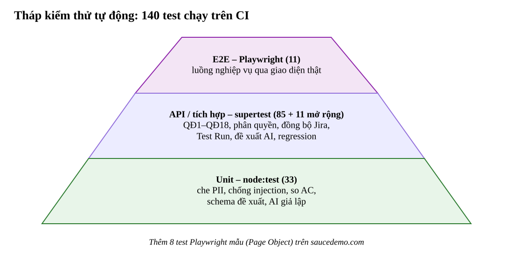
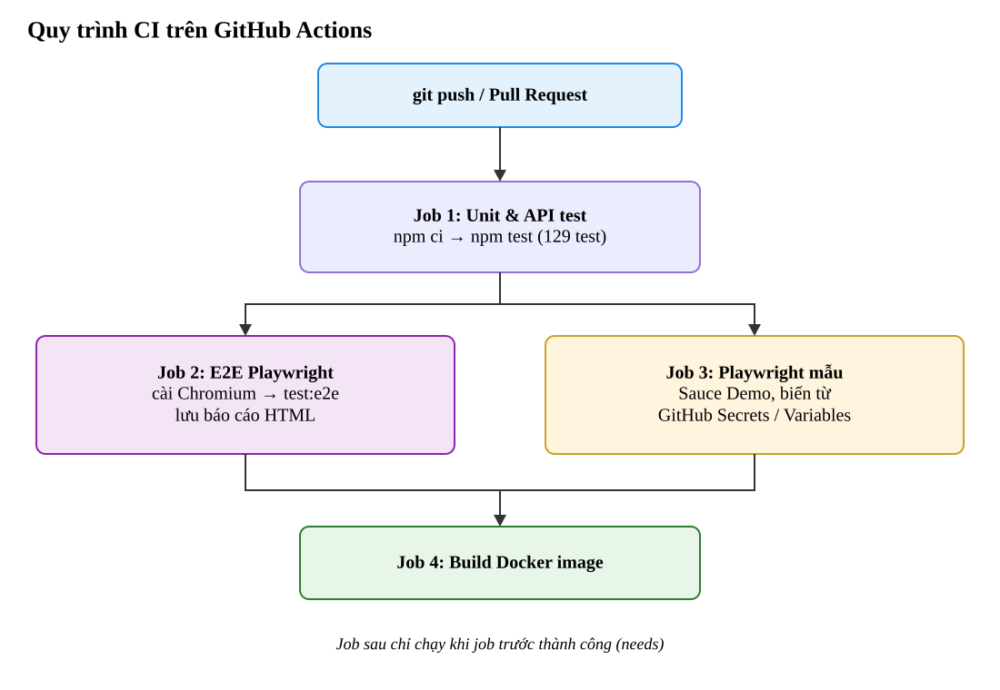

# Chương 6. Kiểm chứng (kiểm thử)

> Sản phẩm của giai đoạn: **phần mềm chất lượng** – kế hoạch kiểm thử, bộ test case kiểm thử chính hệ thống, kiểm thử tự động nhiều tầng và kết quả.

## 6.1. Chiến lược kiểm thử

Áp dụng mô hình **kim tự tháp kiểm thử**: nhiều test nhanh ở tầng dưới, ít test chậm ở tầng trên.



*File gốc:* `docs/sodo/ThapKiemThu.drawio` (mở bằng draw.io để sửa).

| Loại | Công cụ | Phạm vi | Khi nào chạy |
|---|---|---|---|
| Unit test | `node:test` (có sẵn trong Node.js) | Hàm thuần: piiMasker, injectionGuard, so sánh AC, tách Description, MockProvider, schema, prompt | Mỗi lần lưu mã, CI |
| API test | `node:test` + supertest, CSDL trong bộ nhớ | Toàn bộ route + service + CSDL | CI |
| E2E test | **Playwright** | Giao diện thật trên Chrome, server riêng, dữ liệu mới | CI, trước khi demo |
| Kiểm thử thủ công | Bộ test case hệ thống (mục 6.4) | Giao diện, trải nghiệm, trường hợp khó tự động hóa | Trước khi nộp |
| Kiểm thử bảo mật | API test + thủ công | RBAC, XSS, SQL injection, prompt injection, PII, sandbox | CI + thủ công |
| Kiểm thử phần mở rộng | `node:test` (bật `SCRIPT_ENABLED`, `SPRINT_ENABLED`) + Playwright trên Sauce Demo | YC19, YC20 | CI |

**Tiêu chí hoàn thành:** 100% test tự động pass; không còn lỗi mức High; mỗi yêu cầu MVP (18 YC) và mỗi góp ý đã chốt ([1.1]…[D3], [R1]–[R5]) có ít nhất 1 test tự động; mã góp ý ghi ngay trong tên test để truy vết.

**Kiểm thử trong Agile:** kiểm thử không phải một giai đoạn cuối mà là một phần của **Definition of Done** của mỗi story: story chỉ được tính hoàn thành khi có test tự động mới và CI xanh. Vì vậy bộ test được viết dần qua các sprint (cột *Sprint* trong Product Backlog), không dồn về cuối kỳ.

## 6.2. Kiểm thử tự động – Unit và API

Chạy: `cd app && npm test`. Mỗi file test dùng CSDL trong bộ nhớ, Jira giả lập và AI giả lập (`MockProvider`) nên chạy độc lập, không cần mạng. `tests/helpers.js` gom các thao tác dựng dữ liệu dùng chung (tạo requirement, test đã duyệt, mô phỏng PO/BA đổi requirement).

| File | Mã test | Phạm vi |
|---|---|---|
| `tests/unit/security.test.js` | UT-01 → UT-12 | Che PII, prompt injection, kiểm tra tĩnh script |
| `tests/unit/ai.test.js` | UT-13 → UT-23 | MockProvider, schema, prompt sinh test và script |
| `tests/unit/rules.test.js` | UT-24 → UT-33 | So sánh AC, schema đề xuất, AI giả lập phân tích, tách Description, trạng thái đồng bộ |
| `tests/api/auth_rbac.test.js` | IT-01 → IT-14 | Xác thực, phân quyền 5 vai trò, quyền mới |
| `tests/api/jira.test.js` | IT-15 → IT-30 | YC1, YC8, YC12: đồng bộ, phiên bản, gắn cờ, Cần kiểm tra |
| `tests/api/workflow.test.js` | IT-31 → IT-50 | YC2, YC3, YC4, YC7, YC9, YC10, bảo mật AI |
| `tests/api/run.test.js` | IT-51 → IT-64 | YC5, YC6, YC13, YC14 |
| `tests/api/impact.test.js` | IT-65 → IT-77 | YC15, YC16, YC17 |
| `tests/api/retest.test.js` | IT-78 → IT-85 | YC18 |
| `tests/api/extension.test.js` | EXT-01 → EXT-11 | YC19, YC20 (bật cờ trong test) |

### Unit test

| Mã | Mô tả | Kết quả |
|---|---|---|
| UT-01 | Che email | Pass |
| UT-02 | Che số điện thoại Việt Nam (0xxx và +84) | Pass |
| UT-03 | Che số CCCD 12 số và số thẻ 16 số | Pass |
| UT-04 | Không che nhầm số thông thường | Pass |
| UT-05 | Chuỗi rỗng không lỗi | Pass |
| UT-06 | Phát hiện prompt injection tiếng Anh | Pass |
| UT-07 | Phát hiện prompt injection tiếng Việt | Pass |
| UT-08 | User story bình thường không bị gắn cờ | Pass |
| UT-09 | Loại bỏ thẻ phân cách để dữ liệu không thoát khỏi <user_story> | Pass |
| UT-10 | Kiểm tra tĩnh chặn child_process, fs, process.env, eval | Pass |
| UT-11 | Kiểm tra tĩnh cho qua script Playwright hợp lệ | Pass |
| UT-12 | Kiểm tra tĩnh yêu cầu có khối test() | Pass |
| UT-13 | Tách acceptance criteria theo dòng, bỏ ký hiệu đầu dòng | Pass |
| UT-14 | MockProvider trả kết quả đúng schema; mỗi test chỉ rõ AC liên quan (ac_refs) | Pass |
| UT-15 | Mỗi acceptance criterion có ít nhất 1 case Positive | Pass |
| UT-16 | Có sinh case Negative và Edge (giá trị biên 10 MB) | Pass |
| UT-17 | Tuân thủ QĐ2: không vượt số test case tối đa | Pass |
| UT-18 | Prompt chứa quy định số lượng, yêu cầu ac_refs, đánh số AC và bọc dữ liệu trong <user_story> | Pass |
| UT-19 | Schema từ chối priority không hợp lệ và steps rỗng | Pass |
| UT-20 | Bỏ code fence ```json quanh kết quả AI | Pass |
| UT-21 | Sinh script Playwright có locator data-test từ các bước | Pass |
| UT-22 | Script luôn mở URL cần test trước tiên dù bước test case viết chung chung | Pass |
| UT-23 | Sauce Demo: tiêu chí đăng xuất sinh thao tác menu Logout và kiểm tra về trang đăng nhập | Pass |
| UT-24 | QĐ3: AC chuẩn hóa theo nội dung dòng – bỏ ký hiệu đầu dòng, khoảng trắng thừa, dòng trùng | Pass |
| UT-25 | QĐ3: so AC hai phiên bản – đổi thứ tự không coi là đổi; sửa nội dung = bỏ AC cũ, thêm AC mới | Pass |
| UT-26 | QĐ2: test do AI sinh bắt buộc có ac_refs (ít nhất 1 AC) | Pass |
| UT-27 | QĐ15 [R2]: schema đề xuất – Cần sửa/Nên chạy lại phải có test; Cần sửa/Còn thiếu phải có nội dung test; nguồn AC phải ghi rõ AC | Pass |
| UT-28 | YC15: AI giả lập – AC sửa → Cần sửa; AC bỏ không thay thế → Cần làm rõ; AC mới chưa có test → Còn thiếu; mô tả đổi → Nên chạy lại | Pass |
| UT-29 | YC17: AI giả lập xếp ưu tiên – test liên kết AC đã đổi là HIGH; gợi ý tối đa 2 test ưu tiên cao | Pass |
| UT-30 | QĐ15: prompt phân tích ảnh hưởng bọc dữ liệu trong thẻ, yêu cầu chỉ xét thay đổi sau phiên bản test đã liên kết | Pass |
| UT-31 | QĐ8 [1.2]: thời điểm cập nhật Jira dạng +0700 đổi về ISO UTC để so sánh được | Pass |
| UT-32 | QĐ1: tách Description theo nhãn "Acceptance criteria"; AC được chuẩn hóa; không có nhãn thì không có AC | Pass |
| UT-33 | BM1: trạng thái đồng bộ suy ra từ dữ liệu – Đã lưu trữ, Cần kiểm tra, Thiếu AC, Bình thường | Pass |

### API test – xác thực, phân quyền, Jira

| Mã | Mô tả | Kết quả |
|---|---|---|
| IT-01 | Đăng nhập đúng trả về JWT, không trả về mật khẩu băm | Pass |
| IT-02 | Sai mật khẩu trả 401 với thông báo chung | Pass |
| IT-03 | Gọi API không có token trả 401 | Pass |
| IT-04 | Token giả mạo trả 401 | Pass |
| IT-05 | QĐ4: Tester không được duyệt test case | Pass |
| IT-06 | Developer chỉ được xem: không sinh AI, không đồng bộ Jira | Pass |
| IT-07 | Tester không được thay đổi quy định | Pass |
| IT-08 | Chỉ Admin quản lý người dùng | Pass |
| IT-09 | Tài khoản bị khóa không đăng nhập được | Pass |
| IT-10 | Header bảo mật (helmet) và CSP được bật | Pass |
| IT-11 | PO/BA chỉ xem requirement: không đồng bộ Jira, không xử lý requirement Cần kiểm tra | Pass |
| IT-12 | PO/BA không viết, duyệt, chạy test case, không gọi AI, không lập Test Run | Pass |
| IT-13 | PO/BA xem được test case, Test Run, báo cáo; Admin tạo được tài khoản PO/BA | Pass |
| IT-14 | Quyền mới (mục 5): chỉ QA Lead lập Test Run (testrun:manage), quyết định đề xuất AI và xác nhận regression (proposal:review); chỉ Developer báo đã sửa | Pass |
| IT-15 | Chỉ Admin được kiểm tra kết nối Jira | Pass |
| IT-16 | QĐ12 + QĐ1: QA Lead thêm dự án từ Jira – module, thành viên, requirement nhận diện bằng issue ID, phiên bản 1 | Pass |
| IT-17 | Thêm lại dự án đã có → 409; mã không có trên Jira → 404; mã sai định dạng → 400 | Pass |
| IT-18 | Tester, PO/BA, Developer không được thêm dự án từ Jira | Pass |
| IT-19 | Đồng bộ lại dự án (nút Đồng bộ ngay) ghi nhật ký lần đồng bộ; dự án mẫu không liên kết Jira thì báo lỗi | Pass |
| IT-20 | YC1 – QĐ1: tách mô tả và AC, ánh xạ ưu tiên, module; story không có AC được đánh dấu Thiếu AC [A4] | Pass |
| IT-21 | QĐ8 [A1]: AC đổi trên Jira → phiên bản mới; chỉ test liên kết với AC đó bị gắn cờ Cần xem lại | Pass |
| IT-22 | QĐ8 [D1]: đổi ưu tiên không tạo phiên bản, không gắn cờ; đổi mô tả thì mọi test của requirement bị gắn cờ | Pass |
| IT-23 | QĐ8 [1.2]: chỉ ghi khi Jira có bản mới hơn – bản cũ đến sau (đồng bộ chồng nhau) không ghi đè | Pass |
| IT-24 | QĐ1 [1.1]: Jira đổi mã issue thì giữ nguyên requirement (nhận diện bằng issue ID), chỉ cập nhật mã hiển thị | Pass |
| IT-25 | QĐ8 [1.4]: issue biến mất → hỏi Jira theo issue ID, gắn cờ Cần kiểm tra kèm lý do, không tự lưu trữ | Pass |
| IT-26 | QĐ8: Jira trả danh sách rỗng thì không gắn cờ; lỗi kết nối được thử lại 2 lần, ghi nhật ký FAILED và không đổi dữ liệu | Pass |
| IT-27 | QĐ8 [D2]: Giữ lại vẫn giữ cờ Cần kiểm tra; đồng bộ lấy lại được issue thì cờ tự gỡ | Pass |
| IT-28 | QĐ8: Lưu trữ thì ẩn khỏi danh sách, giữ test và lịch sử; xuất hiện lại trên Jira thì tự hiện lại | Pass |
| IT-29 | QĐ8: webhook sai mã bí mật bị từ chối; đúng mã thì đồng bộ lại dự án qua Jira API (nguồn WEBHOOK) | Pass |
| IT-30 | QĐ12: gán thành viên theo email; Jira ẩn email thì so họ tên; nhiều tài khoản trùng họ tên thì không gán | Pass |

### API test – test case, AI

| Mã | Mô tả | Kết quả |
|---|---|---|
| IT-31 | QĐ1, QĐ3: requirement Thiếu AC thì AI không sinh test; vẫn soạn tay được nhưng chưa gửi duyệt được khi chưa liên kết AC | Pass |
| IT-32 | YC2 – QĐ2: AI sinh test ở trạng thái Nháp, nguồn AI; mỗi test chỉ rõ AC liên quan; mọi AC đều được bao phủ | Pass |
| IT-33 | QĐ2: sinh lại thì bản nháp cũ được giữ nguyên, không bị thay thế | Pass |
| IT-34 | QĐ2 + YC10: tối đa 3 test thì AI chỉ sinh trong giới hạn còn lại; thêm tay bị chặn; giảm tham số không xóa test cũ | Pass |
| IT-35 | YC10 – QĐ10: tham số ngoài miền giá trị bị từ chối; độ ưu tiên cố định và tham số ngoài MVP không hiện ở BM9 | Pass |
| IT-36 | YC3 – QĐ3: soạn test thủ công liên kết AC; AC không thuộc phiên bản hiện tại bị từ chối; lưu phiên bản requirement đã liên kết | Pass |
| IT-37 | YC3, YC4 – QĐ3, QĐ4: sửa tạo phiên bản; chờ duyệt không sửa được; trả lại bắt buộc ghi chú; sửa test Đã duyệt thì về Nháp [R4] | Pass |
| IT-38 | QĐ3 [A2]: chỉ xóa test Nháp/Bị trả lại chưa có lần chạy; test đã chạy chỉ được bỏ khỏi suite | Pass |
| IT-39 | QĐ3 [2.2] [D1]: Đã xem lại hàng loạt – bắt buộc lý do, một lý do chung, lưu nhật ký, gỡ cờ và nâng phiên bản liên kết [R5] | Pass |
| IT-40 | QĐ3 [A1] [R5]: AC đổi – test cần sửa thì sửa, duyệt lại rồi mới gỡ cờ; test vẫn đúng thì Đã xem lại và gán lại AC | Pass |
| IT-41 | YC7 – QĐ7: tra cứu kết hợp điều kiện (AND), từ khóa theo mã và tiêu đề, lọc cờ Cần xem lại và Test Suite | Pass |
| IT-42 | QĐ6, QĐ7 [B3]: "Kết quả gần nhất" chỉ lấy lần chạy của phiên bản hiện tại; test vừa sửa hiện Chưa chạy | Pass |
| IT-43 | YC9 – QĐ9: xuất Excel đúng danh sách đang lọc, có cột AC, suite, Test Run, phiên bản, cờ | Pass |
| IT-44 | Bảo mật AI: email, số điện thoại được che trong prompt gửi đi | Pass |
| IT-45 | Bảo mật AI: phát hiện và gắn cờ prompt injection, kết quả vẫn phải đúng schema | Pass |
| IT-46 | QĐ2: AI trả sai định dạng lần đầu thì hệ thống tự thử lại | Pass |
| IT-47 | QĐ2: AI luôn sai định dạng thì báo lỗi thân thiện và ghi nhật ký FAILED sau 1 + 2 lần thử | Pass |
| IT-48 | QĐ2: test do AI sinh không chỉ rõ AC liên quan bị coi là sai định dạng | Pass |
| IT-49 | QĐ2: giới hạn số lần gọi AI mỗi giờ dùng chung cho sinh test (YC2) và phân tích ảnh hưởng (YC15) | Pass |
| IT-50 | Nhật ký hoạt động ghi lại thao tác duyệt và Đã xem lại | Pass |

### API test – Test Suite, Test Run, báo cáo

| Mã | Mô tả | Kết quả |
|---|---|---|
| IT-51 | YC6 – QĐ6 [B1]: báo cáo theo dự án – bao phủ story (mẫu số không gồm story Thiếu AC), bao phủ AC, chỉ tính requirement chưa lưu trữ | Pass |
| IT-52 | YC6 – QĐ6: báo cáo theo Test Run lấy lần chạy gần nhất trong đợt; tiến độ, tỷ lệ pass | Pass |
| IT-53 | YC6 – QĐ6: thống kê AI chỉ tính test nguồn AI; "phải sửa" khi đổi bước hoặc kết quả mong đợi, đổi tiêu đề thì không tính | Pass |
| IT-54 | YC13 – QĐ13: Test Suite phẳng – tên 3–100 ký tự, không trùng trong dự án; test phải cùng dự án; một test thuộc nhiều suite; xóa suite không xóa test | Pass |
| IT-55 | YC14 – QĐ14 [2.1]: chỉ test đủ điều kiện chạy được đưa vào đợt; test bị chặn được liệt kê kèm lý do; bắt buộc build, môi trường | Pass |
| IT-56 | QĐ14, QĐ5: phiên bản test cố định khi đưa vào đợt; sửa test sau đó chỉ hiện cảnh báo, kết quả ghi theo phiên bản đã cố định | Pass |
| IT-57 | YC5 – QĐ5: chỉ người được giao hoặc QA Lead được ghi; Fail/Blocked bắt buộc ghi chú; bằng chứng là đường dẫn | Pass |
| IT-58 | QĐ14 [D3]: build và môi trường sửa được khi đợt chưa có kết quả; đã có kết quả thì cố định, muốn chạy build khác phải lập đợt mới | Pass |
| IT-59 | QĐ14 [A6]: requirement đổi, lưu trữ hoặc Cần kiểm tra khi đợt đang mở thì đợt vẫn chạy phiên bản đã cố định và hiện cảnh báo | Pass |
| IT-60 | QĐ14: một test nằm trong nhiều đợt đang mở; kết quả từng đợt tính riêng | Pass |
| IT-61 | QĐ3 [A2]: bỏ test khỏi đợt chỉ khi test chưa có kết quả trong đợt | Pass |
| IT-62 | QĐ14 [B4]: đóng đợt còn test chưa chạy phải xác nhận, test chưa chạy tính là chưa chạy; đợt đã đóng không ghi, không sửa | Pass |
| IT-63 | YC14: lập đợt từ Test Suite và phân công lại cho Tester khác vai trò hợp lệ | Pass |
| IT-64 | YC14: tiến độ đợt tính theo số test đã có kết quả trên tổng số test trong đợt | Pass |

### API test – phân tích ảnh hưởng, đề xuất, regression

| Mã | Mô tả | Kết quả |
|---|---|---|
| IT-65 | QĐ15: chỉ phân tích khi requirement có ít nhất 2 phiên bản; requirement đã lưu trữ thì không phân tích | Pass |
| IT-66 | YC15 – QĐ15: AI đề xuất Cần sửa cho test liên kết AC đã đổi và Còn thiếu cho AC mới; mỗi đề xuất có loại, lý do, phần thay đổi nguồn; không tự đổi test | Pass |
| IT-67 | YC16 – QĐ16: Tester xem được đề xuất (trước/sau) nhưng không quyết định; từ chối bắt buộc ghi chú | Pass |
| IT-68 | QĐ16 [R4] [R5]: chấp nhận Cần sửa → test về Nháp theo nội dung đề xuất, ghi mã đề xuất, phải duyệt lại (YC4) rồi mới gỡ cờ | Pass |
| IT-69 | QĐ16 + QĐ2: chấp nhận Còn thiếu → test nháp mới nguồn AI liên kết AC nguồn, trong giới hạn số test tối đa | Pass |
| IT-70 | QĐ15 [A5]: mốc so là phiên bản cũ nhất mà các test đã liên kết; với từng test chỉ xét thay đổi sau phiên bản test đó liên kết | Pass |
| IT-71 | QĐ16: Cần làm rõ chỉ ghi nhận; Nên chạy lại thêm test vào bộ regression của cùng thay đổi (chưa có bộ thì tạo) | Pass |
| IT-72 | QĐ16: requirement đổi sau khi phân tích thì đề xuất chuyển Lỗi thời và không áp dụng được | Pass |
| IT-73 | QĐ15 [R5]: mọi test đã được xem lại theo phiên bản hiện tại thì không còn thay đổi để phân tích | Pass |
| IT-74 | YC17 – QĐ17: bộ regression luôn gồm test liên kết AC đã đổi; AI xếp ưu tiên kèm lý do, gợi ý thêm; test chưa đủ điều kiện liệt kê riêng và chặn xác nhận | Pass |
| IT-75 | QĐ17 [2.2]: bỏ test bắt buộc phải ghi lý do; QA Lead thêm, bớt; xác nhận xong tạo Test Run loại Regression | Pass |
| IT-76 | QĐ17 [R3]: chỉ tiêu đề hoặc mô tả đổi thì bộ regression gồm mọi test của requirement | Pass |
| IT-77 | QĐ17: không gọi được AI thì hệ thống vẫn đưa ra danh sách test liên kết | Pass |

### API test – báo sửa lỗi và kiểm thử lại

| Mã | Mô tả | Kết quả |
|---|---|---|
| IT-78 | YC18 – QĐ18: Developer báo đã sửa lần Fail gần nhất trong Test Run, bắt buộc build 1–50 ký tự; test chuyển Chờ kiểm thử lại | Pass |
| IT-79 | QĐ18: mỗi lần Fail chỉ báo một lần; không báo cho lần Pass, lần Fail đã được chạy lại trong đợt, lần chạy không tồn tại | Pass |
| IT-80 | QĐ18: chỉ Developer được báo đã sửa lỗi | Pass |
| IT-81 | QĐ18 [R1] [3.1] [3.3]: đợt còn mở và trùng build đã sửa thì chạy lại ngay trong đợt; Pass → Đã đóng, lần chạy lại gắn với lần Fail gốc | Pass |
| IT-82 | QĐ18 [R1] [3.1]: đợt đã đóng thì QA Lead lập đợt Kiểm thử lại với build đã sửa; lần chạy ở đợt khác vẫn truy được lần Fail gốc | Pass |
| IT-83 | QĐ18 [3.3]: chạy lại Blocked thì vẫn Chờ kiểm thử lại; Fail thì Mở lại và Developer báo sửa lần nữa trên lần Fail mới | Pass |
| IT-84 | QĐ18 [3.2]: build của đợt khác build Developer đã báo thì cảnh báo nhưng không chặn ghi kết quả | Pass |
| IT-85 | QĐ18 [3.1]: lần Fail của cùng test ở các đợt khác nhau được theo dõi riêng | Pass |

### Phần mở rộng (YC19, YC20)

| Mã | Mô tả | Kết quả |
|---|---|---|
| EXT-01 | YC20: đồng bộ sprint từ Jira – sprint có ngày được thêm, sprint chưa đặt ngày bỏ qua kèm cảnh báo | Pass |
| EXT-02 | YC20: story gắn đúng sprint theo Jira; story không thuộc sprint nằm trong Product backlog | Pass |
| EXT-03 | QĐ20: story point ngoài dãy 1, 2, 3, 5, 8, 13 bị bỏ qua kèm cảnh báo | Pass |
| EXT-04 | QĐ20: không có API tạo, sửa, xóa sprint (sprint lập trên Jira) | Pass |
| EXT-05 | YC20: đồng bộ lại khi sprint đổi trên Jira – cập nhật, không tạo trùng; story chuyển sprint theo Jira | Pass |
| EXT-06 | YC20: Product backlog chỉ gồm story chưa thuộc sprint | Pass |
| EXT-07 | YC20: Definition of Done và velocity – Sprint 1 hoàn thành 5/13 story point | Pass |
| EXT-08 | YC20: burndown có 1 điểm cho mỗi ngày, đường lý tưởng giảm về 0 | Pass |
| EXT-09 | YC10: khi bật phần mở rộng thì tham số RUN_TIMEOUT_SEC, SPRINT_MAX_DAYS hiện ở BM9 | Pass |
| EXT-10 | YC19: chỉ sinh script cho test case đã duyệt; script sinh ra qua kiểm tra tĩnh | Pass |
| EXT-11 | YC19 – QĐ5: chạy script tự động phải ghi vào một test trong Test Run (không ghi ngoài đợt) | Pass |

**Kết quả:** `129 tests, 129 pass, 0 fail` (Node.js, macOS, 16/11/2026).

## 6.3. Kiểm thử E2E bằng Playwright

Chạy: `cd app && npm run test:e2e` (Playwright tự khởi động server ở cổng 3100 với CSDL riêng `data/e2e.db`, Jira và AI giả lập; xem báo cáo HTML: `npx playwright show-report e2e-report`).

**Kỹ thuật áp dụng:**

- Locator theo vai trò và nhãn (`getByRole`, `getByLabel`, `getByPlaceholder`) – giống cách người dùng nhìn thấy, bền khi đổi CSS.
- Auto-waiting và web-first assertion (`expect(...).toBeVisible()`), không dùng `sleep`.
- `webServer` trong cấu hình: tự dựng môi trường sạch cho mỗi lần chạy.
- `test.describe.configure({ mode: 'serial' })`: các kịch bản nối tiếp nhau như một vòng làm việc thật, từ đồng bộ Jira tới kiểm thử lại.
- Ảnh chụp + trace khi lỗi (`screenshot: 'only-on-failure'`, `trace: 'retain-on-failure'`).

| Mã | Mô tả | Kết quả |
|---|---|---|
| E2E-01 | Đăng nhập sai mật khẩu hiển thị lỗi | Pass |
| E2E-02 | YC12, YC1: QA Lead thêm dự án từ Jira, requirement được đồng bộ về (chỉ đọc) | Pass |
| E2E-03 | YC2, YC3: Tester sinh test case bằng AI (mỗi test gắn AC) và gửi duyệt | Pass |
| E2E-04 | YC4: QA Lead trả lại 1 test kèm ghi chú bắt buộc, duyệt phần còn lại | Pass |
| E2E-05 | YC14: QA Lead lập Test Run – chọn test đã duyệt, ghi build, môi trường, giao cho Tester | Pass |
| E2E-06 | YC5: Tester ghi kết quả trong Test Run – Fail bắt buộc ghi chú | Pass |
| E2E-07 | YC18: Developer báo đã sửa lỗi kèm build; test chuyển Chờ kiểm thử lại | Pass |
| E2E-08 | YC8, YC15, YC16: AC đổi trên Jira → test bị gắn cờ → AI phân tích ảnh hưởng → QA Lead chấp nhận đề xuất | Pass |
| E2E-09 | YC17: QA Lead tạo bộ regression – test chưa đủ điều kiện được liệt kê riêng, chưa xác nhận được | Pass |
| E2E-10 | YC10 + QĐ2: QA Lead đổi quy định tối đa 2 test và AI tuân thủ quy định mới | Pass |
| E2E-11 | Phân quyền: PO/BA chỉ xem requirement, báo cáo; không thấy duyệt, đề xuất AI, đồng bộ | Pass |

**Kết quả:** `11 passed`.

## 6.4. Bộ test case kiểm thử hệ thống (thủ công)

| Mã | Chức năng | Các bước | Kết quả mong đợi | Loại | Ưu tiên |
|---|---|---|---|---|---|
| ST-01 | Đăng nhập | Bỏ trống mật khẩu, bấm Đăng nhập | Trình duyệt báo trường bắt buộc | Negative | Medium |
| ST-02 | Đăng nhập | Sai mật khẩu 11 lần liên tiếp | Lần thứ 11 báo "Đăng nhập sai quá nhiều lần…" | Negative | High |
| ST-03 | Phiên | Đăng nhập, xóa token trong DevTools, tải lại | Quay về trang đăng nhập | Negative | Medium |
| ST-04 | YC1 | PO/BA tạo Story trên Jira có mục *Acceptance criteria* 3 dòng; QA Lead bấm *Đồng bộ ngay* | Requirement hiện với 3 AC, phiên bản 1, mã trùng mã issue, có liên kết mở Jira | Positive | High |
| ST-05 | YC1 | Story trên Jira không có mục *Acceptance criteria* | Requirement ở tab *Thiếu AC*, nút Sinh test bị khóa | Negative | Medium |
| ST-06 | YC1 | Đổi mã issue trên Jira (chuyển dự án) rồi đồng bộ | Vẫn là requirement cũ, giữ test và lịch sử; mã hiển thị đổi | Edge | Medium |
| ST-07 | YC2 | Sinh test cho requirement có email, SĐT | Thông báo đã che EMAIL, PHONE; nhật ký AI hiển thị `[EMAIL]`, `[PHONE]` | Positive | High |
| ST-08 | YC2 | Requirement chứa "Ignore all previous instructions" | Có cảnh báo prompt injection; test vẫn đúng định dạng | Negative | High |
| ST-09 | YC2 | Sinh lại khi đã có test AI Nháp | Bản nháp cũ giữ nguyên, test mới được thêm trong giới hạn còn lại | Positive | Medium |
| ST-10 | YC3 | Gửi duyệt test chưa gán AC | Báo lỗi phải liên kết ít nhất 1 AC | Negative | High |
| ST-11 | YC3 | Sửa test Đã duyệt | Cảnh báo phải duyệt lại; sau khi lưu trạng thái Nháp, phiên bản +1 | Positive | High |
| ST-12 | YC4 | Huy hiệu số lượng chờ duyệt | Tăng khi Tester gửi duyệt, giảm khi QA Lead duyệt | Positive | Low |
| ST-13 | YC8 | PO/BA sửa 1 AC trên Jira; Đồng bộ ngay | Phiên bản mới; so sánh tô màu AC đổi; chỉ test liên kết AC đó có cờ Cần xem lại | Positive | High |
| ST-14 | YC8 | PO/BA sửa mô tả; chọn mọi test có cờ, bấm Đã xem lại với một lý do chung | Cờ gỡ hết; nhật ký Đã xem lại ghi cùng lý do | Positive | High |
| ST-15 | YC8 | Xóa issue trên Jira; đồng bộ; chọn *Giữ lại*; khôi phục issue; đồng bộ | Cần kiểm tra (Jira báo không tìm thấy) → vẫn Cần kiểm tra → tự về Bình thường | Positive | High |
| ST-16 | YC13 | Tạo suite trùng tên trong cùng dự án | Báo lỗi trùng tên | Negative | Medium |
| ST-17 | YC14 | Lập đợt từ suite có 1 test chưa duyệt | Đợt chỉ gồm test đủ điều kiện; test chưa duyệt được liệt kê kèm lý do | Positive | High |
| ST-18 | YC14 | Ghi 1 kết quả rồi sửa build của đợt | Báo lỗi build đã cố định, hướng dẫn lập đợt mới | Negative | High |
| ST-19 | YC14 | Đóng đợt còn 2 test chưa chạy | Hộp xác nhận ghi "2 test chưa chạy"; đóng xong không ghi thêm được | Edge | Medium |
| ST-20 | YC5 | Tester ghi kết quả cho test giao cho người khác | Không có nút; gọi API → 403 | Negative | High |
| ST-21 | YC5 | Ghi Blocked có ghi chú | Lưu; báo cáo đếm Blocked là đã chạy, không là Pass | Positive | Medium |
| ST-22 | YC15 | Bấm Phân tích ảnh hưởng sau khi AC đổi | Đề xuất Cần sửa cho test liên kết AC cũ, Còn thiếu cho AC mới; mỗi đề xuất có lý do và AC nguồn | Positive | High |
| ST-23 | YC16 | Sửa requirement trên Jira sau khi phân tích, rồi chấp nhận đề xuất | Đề xuất chuyển Lỗi thời, không áp dụng | Edge | High |
| ST-24 | YC17 | Tạo bộ regression, bỏ 1 test bắt buộc không ghi lý do | Báo lỗi bắt buộc lý do | Negative | Medium |
| ST-25 | YC18 | Developer báo đã sửa (build 1.0.2) khi đợt đã đóng; QA Lead tạo đợt Kiểm thử lại; Tester chạy Pass | Phiếu Đã đóng; lịch sử lần chạy lại trỏ về lần Fail gốc | Positive | High |
| ST-26 | YC6 | Chọn phạm vi Test Run trên Tổng quan | Số liệu chỉ tính lần chạy gần nhất trong đợt | Positive | Medium |
| ST-27 | YC9 | Xuất Excel, mở bằng Excel | Đủ cột (AC, suite, Test Run, phiên bản, cờ), các bước xuống dòng, tiêu đề tô màu | Positive | Low |
| ST-28 | YC10 | Đặt MAX_TC_PER_STORY = 100 | Báo lỗi miền 1–50 | Edge | Medium |
| ST-29 | Bảo mật XSS | Tiêu đề issue Jira là `` rồi đồng bộ | Hiển thị nguyên văn, không chạy script | Negative | High |
| ST-30 | Bảo mật SQLi | Tìm kiếm `' OR 1=1 --` | Không lỗi, không lộ dữ liệu ngoài kết quả tìm | Negative | High |
| ST-31 | YC12 | Admin bấm *Kiểm tra kết nối Jira*, rồi *Thêm dự án từ Jira* với mã `HRM` | Kết nối thành công; dự án có module, thành viên; liệt kê thành viên chưa có tài khoản | Positive | High |

## 6.5. Kiểm thử phần mở rộng YC19 với Playwright trên Sauce Demo

YC19 nằm ngoài MVP (tắt mặc định). Phần này giữ để chứng minh khả năng mở rộng khi bật `SCRIPT_ENABLED=true`.

`automation/specs/samples/` – 8 test viết tay cho Sauce Demo (đăng nhập, giỏ hàng), áp dụng **Page Object Model** (`automation/pages/LoginPage.js`, `InventoryPage.js`), `testIdAttribute: 'data-test'`, data-driven test, chạy song song. Chạy: `cd automation && npm run test:samples` → **8 passed**.

Khi bật YC19, script do AI sinh được kiểm tra tĩnh (chặn `child_process`, `fs`, `process.env`, `eval`) rồi chạy trong tiến trình riêng có timeout; kết quả ghi vào một test trong Test Run đang mở (EXT-10, EXT-11). Script AI viết "phẳng", đủ chạy nhưng chưa tái sử dụng được như bộ viết tay theo POM; vì vậy Tester phải xem lại script trước khi chạy.

## 6.6. Tích hợp liên tục (CI)

`.github/workflows/ci.yml` chạy tự động mỗi lần push lên `main` hoặc tạo Pull Request:



*File gốc:* `docs/sodo/CI_Pipeline.drawio` (mở bằng draw.io để sửa).

Pull Request chỉ được merge khi cả 4 job xanh.

## 6.7. Tổng kết kiểm thử

| Hạng mục | Số lượng | Pass | Fail |
|---|---|---|---|
| Unit test | 33 | 33 | 0 |
| API / tích hợp (MVP) | 85 | 85 | 0 |
| Phần mở rộng YC19, YC20 | 11 | 11 | 0 |
| E2E Playwright (hệ thống) | 11 | 11 | 0 |
| Playwright mẫu (Sauce Demo) | 8 | 8 | 0 |
| Test case hệ thống thủ công | 31 | Thực hiện trước buổi bảo vệ | |

**Độ phủ yêu cầu:** cả 18 YC của MVP đều có test API và ít nhất một kịch bản E2E hoặc thủ công; các quy định mới của bản chốt (nhận diện bằng issue ID, chỉ ghi bản mới hơn, Cần kiểm tra/Giữ lại, cố định phiên bản trong Test Run, khóa build/môi trường, mốc phiên bản khi phân tích, đề xuất Lỗi thời, lần chạy lại gắn lần Fail gốc) đều có test riêng.

**Hạn chế đã biết:** MockProvider sinh câu chữ theo khuôn mẫu, chất lượng thấp hơn LLM thật; phân tích ảnh hưởng bằng LLM thật chưa đo độ chính xác trên bộ dữ liệu lớn; chưa kiểm thử hiệu năng với dữ liệu lớn; webhook Jira mới kiểm thử tự động bằng request giả lập.
